# 🌟 The Ultimate Air Fryer Indian Cookbook
### *100 Authentic, Wholesome & Crispy Air Fryer Recipes*

---

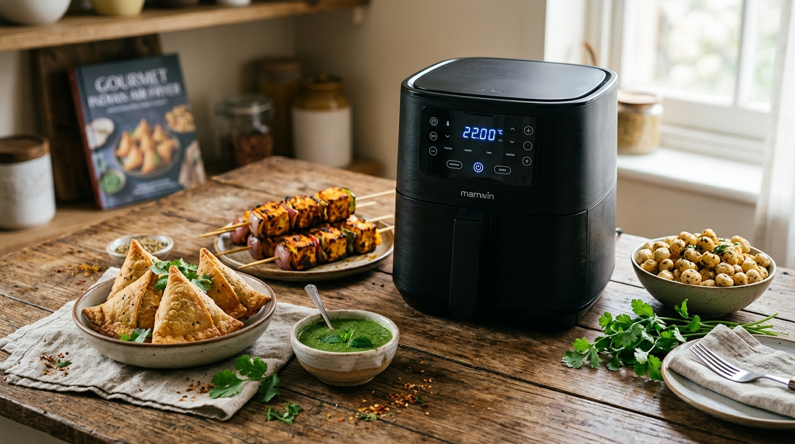

## 📖 Welcome

Welcome to the ultimate culinary guide dedicated 100% to Air Fryer mastery! 

Whether you are looking to recreate nostalgic Indian street-side favorites with 85% less oil, craft crisp breakfast cutlets on busy weekday mornings, host festive gatherings with sizzling tandoori platters, or bake wholesome guilt-free desserts—this cookbook is your definitive companion.

Every single recipe in this 100-recipe collection has been specifically engineered, tested, and optimized for rapid air convection. No confusing conversions from deep fryers or conventional ovens: every temperature, timing milestone, oil-brush technique, and crisping secret is tailor-made for your air fryer basket.

## 🌿 Why Air Fryer Cooking Is Healthier

### Up to 80-85% Less Dietary Fat
Traditional deep frying submerges food in boiling oil, causing porous surfaces (like samosa dough or pakora batter) to absorb significant grams of saturated lipids. An air fryer circulates superheated air (up to 200°C / 400°F) driven by high-velocity convection fans. A microscopic mist or light brush of oil (1 to 2 teaspoons across an entire batch) triggers the identical Maillard reaction—yielding the iconic crunchy blistered exterior without caloric overload.

### Mitigation of Harmful Compounds (Acrylamides)
Extensive frying at erratic stovetop temperatures can cause excessive acrylamide formation in starchy roots like potatoes. Modern digital air fryers maintain precise thermodynamic thresholds with rapid cook cycles, significantly reducing excessive scorching.

### Maximized Micronutrient & Antioxidant Retention
Water-soluble vitamins (such as Vitamin C and B-complex vitamins found in okra, bell peppers, carrots, and spinach) leach into water when boiled or degrade during prolonged shallow frying. The rapid, dry convective envelope of the air fryer seals in plant phytonutrients in half the cook time.

### Zero Grease Splatter & Effortless Digestion
Heavy deep-fried snacks leave a feeling of lethargy due to sluggish lipid breakdown in the gut. Air-fried snacks retain the clean, vibrant aromas of spices (cumin, ajwain, chaat masala, kasuri methi) while leaving you energized.

## 💡 Air Fryer Tips for Best Results

### 1. Always Preheat for 3 to 5 Minutes
Starting with a hot air fryer basket instantly sears the outer moisture layer of your cutlet or tikka, creating a crisp barrier before moisture can seep out.

### 2. Never Crowd the Basket (Respect Airflow)
Convection cooking requires 360-degree high-velocity cyclonic airflow. Leave at least 0.5 inches (1.5 cm) between cutlets, samosas, and kebabs. Cook in two quick batches rather than one soggy, crowded batch.

### 3. The 'Oil Brush at Midpoint' Secret
Don't drench food in oil upfront. Lightly brush or spray with an oil mister before air frying, flip at the halfway mark, and give a feather-light spray on the newly exposed underside for uniform blistered gold.

### 4. Manage Moisture (Dry Surfaces Crisp Best)
Tofu, paneer, and parboiled potatoes must be thoroughly patted dry with paper towels before seasoning. Surface moisture converts to steam inside the basket, softening batter crusts.

### 5. Use Perforated Parchment or Silicone Liners Wisely
Never put empty parchment in an air fryer while preheating (it gets sucked into the heating coil). Use perforated parchment designed with air holes, and only insert it weighted down with food.

### 6. The Cornstarch / Rice Flour Crisp Shield
For pakoras, koftas, and bhindi chips, dust with 1 tablespoon of rice flour or fine cornstarch. It creates a micro-crystalline lattice that stays shatteringly crisp for hours.

### 7. Shake or Flip Halfway Through
For smaller items (fries, roasted nuts, crispy corn, makhana), give the basket an energetic shake every 4 minutes. For cutlets and samosas, flip gently using silicone-tipped tongs.

## 📑 Table of Contents

### 🌅 Breakfast (Recipes 1–20)
- [1. Vegetable Poha Cutlets](#recipe-1)
- [2. Masala Oats Idli Bites](#recipe-2)
- [3. Stuffed Paratha (Low Oil)](#recipe-3)
- [4. Air Fryer Vegetable Uttapam Bites](#recipe-4)
- [5. Air Fryer Moong Dal Cheela Rolls](#recipe-5)
- [6. Air Fryer Vegetable Dhokla Bites](#recipe-6)
- [7. Air Fryer Rava Toast](#recipe-7)
- [8. Air Fryer Sabudana Vada](#recipe-8)
- [9. Air Fryer Methi Thepla Chips](#recipe-9)
- [10. Air Fryer Vegetable Besan Omelette](#recipe-10)
- [11. Air Fryer Vegetable Handvo Bites](#recipe-11)
- [12. Air Fryer Bread Pizza Toast](#recipe-12)
- [13. Air Fryer Vegetable Frankie Rolls](#recipe-13)
- [14. Air Fryer Vegetable Cheela Muffins](#recipe-14)
- [15. Air Fryer Multigrain Vegetable Bread Rolls](#recipe-15)
- [16. Air Fryer Vegetable Idli Fry](#recipe-16)
- [17. Air Fryer Vegetable Stuffed Kulcha](#recipe-17)
- [18. Air Fryer Ragi (Finger Millet) Cutlets](#recipe-18)
- [19. Air Fryer Paneer Stuffed Toast](#recipe-19)
- [20. Air Fryer Vegetable Dalia (Broken Wheat) Cutlets](#recipe-20)

### 🥟 Snacks & Starters (Recipes 21–60)
- [1. Vegetable Samosa (Baked-Style)](#recipe-21)
- [2. Paneer Tikka](#recipe-22)
- [3. Crispy Okra (Bhindi Chips)](#recipe-23)
- [4. Corn & Spinach Cutlets](#recipe-24)
- [5. Roasted Makhana & Peanuts](#recipe-25)
- [6. Vegetable Spring Rolls](#recipe-26)
- [7. Air Fryer Falafel](#recipe-27)
- [8. Air Fryer Aloo Tikki](#recipe-28)
- [9. Air Fryer Paneer Pakora](#recipe-29)
- [10. Crispy Chana Chaat Crisps](#recipe-30)
- [11. Air Fryer Gobi 65 (Crispy Cauliflower)](#recipe-31)
- [12. Air Fryer Paneer 65](#recipe-32)
- [13. Air Fryer Vegetable Momos](#recipe-33)
- [14. Air Fryer Cheese Corn Balls](#recipe-34)
- [15. Air Fryer Onion Pakora (Kanda Bhaji)](#recipe-35)
- [16. Air Fryer Sabudana Tikki](#recipe-36)
- [17. Air Fryer Beetroot Cutlets](#recipe-37)
- [18. Air Fryer Whole Wheat Mathri](#recipe-38)
- [19. Air Fryer Vegetable Nuggets](#recipe-39)
- [20. Air Fryer Roasted Masala Papad](#recipe-40)
- [21. Air Fryer Aloo Bread Roll](#recipe-41)
- [22. Air Fryer Corn Cheese Toast](#recipe-42)
- [23. Air Fryer Vegetable Manchurian Balls](#recipe-43)
- [24. Air Fryer Crispy Corn (Restaurant Style)](#recipe-44)
- [25. Air Fryer Masala Peanuts](#recipe-45)
- [26. Air Fryer Baby Corn Fritters](#recipe-46)
- [27. Air Fryer Vegetable Kachori](#recipe-47)
- [28. Air Fryer Paneer Fingers](#recipe-48)
- [29. Air Fryer Peri Peri Potato Wedges](#recipe-49)
- [30. Air Fryer Paneer Manchurian](#recipe-50)
- [31. Air Fryer Vegetable Kofta (Dry, Restaurant-Style)](#recipe-51)
- [32. Air Fryer Paneer Bhurji Rolls](#recipe-52)
- [33. Air Fryer Mushroom 65](#recipe-53)
- [34. Air Fryer Corn Pakora](#recipe-54)
- [35. Air Fryer Bread Pakora](#recipe-55)
- [36. Air Fryer Vegetable Seekh Kebab](#recipe-56)
- [37. Air Fryer Sesame Paneer Sticks](#recipe-57)
- [38. Air Fryer Sweet Potato Fries](#recipe-58)
- [39. Air Fryer Mixed Root Vegetable Chips](#recipe-59)
- [40. Air Fryer Paneer Popcorn](#recipe-60)

### 🍛 Main Course (Recipes 61–84)
- [1. Stuffed Bell Peppers (Bharwan Shimla Mirch)](#recipe-61)
- [2. Paneer & Vegetable Skewers](#recipe-62)
- [3. Whole Roasted Sweet Potato (Shakarkandi Chaat)](#recipe-63)
- [4. Rajma Galouti (Kidney Bean Patties)](#recipe-64)
- [5. Air Fryer Stuffed Mushrooms](#recipe-65)
- [6. Air Fryer Hara Bhara Kebab](#recipe-66)
- [7. Air Fryer Baingan Bharta (Roasted Eggplant Mash)](#recipe-67)
- [8. Air Fryer Whole Tandoori Gobi (Cauliflower)](#recipe-68)
- [9. Air Fryer Soya Chaap Tikka](#recipe-69)
- [10. Air Fryer Vegetable Biryani Cups](#recipe-70)
- [11. Air Fryer Raw Jackfruit (Kathal) Tikka](#recipe-71)
- [12. Air Fryer Stuffed Tomatoes](#recipe-72)
- [13. Air Fryer Vegetable Pulao Cups](#recipe-73)
- [14. Air Fryer Paneer Kathi Roll](#recipe-74)
- [15. Air Fryer Baked Malai Kofta](#recipe-75)
- [16. Air Fryer Vegetable Cutlet Burger Patty](#recipe-76)
- [17. Air Fryer Chilli Paneer Dry](#recipe-77)
- [18. Air Fryer Stuffed Zucchini Boats](#recipe-78)
- [19. Air Fryer Vegetable Lasagna Cups](#recipe-79)
- [20. Air Fryer Vegetable Enchilada Rolls](#recipe-80)
- [21. Air Fryer Paneer Steaks](#recipe-81)
- [22. Air Fryer Vegetable Korma Bake](#recipe-82)
- [23. Air Fryer Rajma Stuffed Potato](#recipe-83)
- [24. Air Fryer Vegetable Risotto Balls (Arancini-Style)](#recipe-84)

### 🍯 Sweet Treats (Recipes 85–100)
- [1. Baked Banana Chips (No Sugar)](#recipe-85)
- [2. Whole Wheat Gujiya (Festive, Low Oil)](#recipe-86)
- [3. Air Fryer Apple Cinnamon Chips](#recipe-87)
- [4. Air Fryer Whole Wheat Mawa Modak Bites](#recipe-88)
- [5. Air Fryer Coconut Ladoo Bites](#recipe-89)
- [6. Air Fryer Sweet Shakarpara](#recipe-90)
- [7. Air Fryer Roasted Dry Fruit & Seed Mix](#recipe-91)
- [8. Air Fryer Til Gud Chikki Bites](#recipe-92)
- [9. Air Fryer Roasted Besan Ladoo](#recipe-93)
- [10. Air Fryer Dry Fruit Barfi Bites](#recipe-94)
- [11. Air Fryer Gud Chana (Jaggery Roasted Chickpeas)](#recipe-95)
- [12. Air Fryer Whole Wheat Jaggery Cookies](#recipe-96)
- [13. Air Fryer Whole Wheat Banana Bread Bites](#recipe-97)
- [14. Air Fryer Rava Ladoo](#recipe-98)
- [15. Air Fryer Oats Coconut Cookies](#recipe-99)
- [16. Air Fryer Beetroot Chocolate Brownie Bites](#recipe-100)

---

# 🍽️ SECTION: BREAKFAST

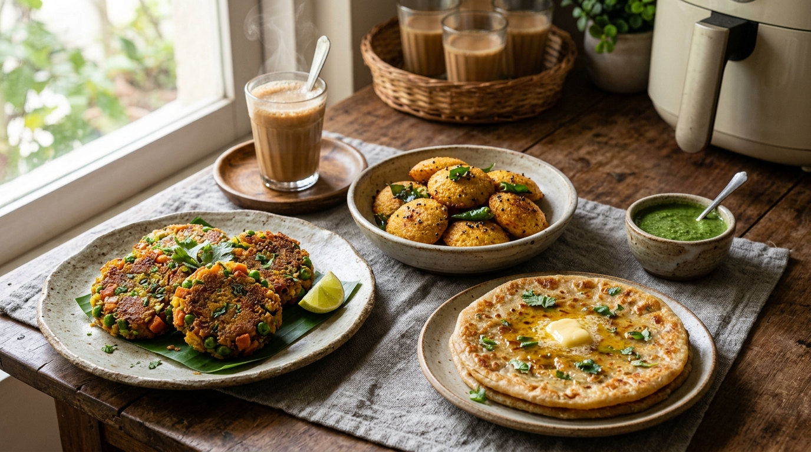

## 1. Vegetable Poha Cutlets

*Crisp flattened rice patties packed with sweet green peas, grated carrots, and zesty ginger-green chili seasoning, air-fried to a crunchy golden crust with just a teaspoon of oil.*

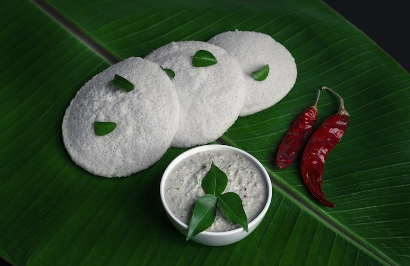

**⏱️ Prep Time:** 15 mins | **🔥 Cook Time:** 14 mins | **⌛ Total:** 29 mins
**🌡️ Air Fryer Temp:** 180°C / 360°F | **👥 Servings:** 4 | **📊 Calories:** 165 kcal
**Macros:** Protein: 4.5g | Carbs: 28g | Fat: 3.8g
**🏷️ Tags:** Vegetarian, Quick Breakfast, Gluten-Free Option

### 🛒 Ingredients
- 1.5 cups Thick Poha (flattened rice), rinsed and drained
- 2 medium Potatoes, boiled and mashed smooth
- 1/2 cup Finely chopped mixed vegetables (carrots, green peas, sweet corn)
- 1 Green chili, finely chopped
- 1 tsp Fresh ginger, grated
- 1/2 tsp Cumin powder (jeera)
- 1/2 tsp Chaat masala
- 1/2 tsp Garam masala
- 2 tbsp Fresh coriander leaves, chopped
- 1 tbsp Roasted peanut powder (for extra crunch)
- 1 tbsp Rice flour or cornstarch (for binding)
- 1.5 tsp Cooking oil / cooking spray
- Salt to taste

### 👩‍🍳 Step-by-Step Air Fryer Instructions
1. Rinse poha in a colander for 30 seconds; let it rest for 5 minutes until soft and pliable. Squeeze excess moisture gently.
2. In a mixing bowl, combine softened poha, mashed potatoes, veggies, green chili, ginger, peanut powder, spices, salt, and rice flour. Knead gently into a cohesive dough.
3. Shape the mixture into 8 uniform round cutlets or oval patties (approx. 1/2-inch thickness). Brush tops lightly with oil.
4. Preheat the air fryer to 180°C (360°F) for 4 minutes.
5. Arrange cutlets in a single layer in the air fryer basket leaving 1/2 inch space between each. Air fry at 180°C for 8 minutes.
6. Carefully flip cutlets with a silicone spatula, apply a feather-light brush of oil on top, and air fry for an additional 5-6 minutes until blistered golden and crisp.
7. Rest on the basket for 2 minutes before serving hot.

> [!TIP]
> **Chef's Air Fryer Secret:** Do not soak poha in stagnant water; rinse and let residual steam soften it so the mixture doesn't get soggy. If patties feel wet, add 1 extra tablespoon of roasted besan or rice flour.

**🥢 Serving & Pairing:** Zesty Mint-Coriander Chutney and Sweet Tamarind Date Dip.

---

## 2. Masala Oats Idli Bites

*Nutrient-rich rolled oats and semolina mini idlis tempered with mustard seeds, curry leaves, and crunchy carrots, air-fried in silicone muffin cups for a crispy-edged, pillowy interior.*

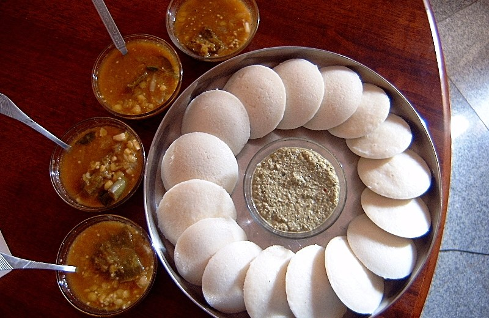

**⏱️ Prep Time:** 15 mins | **🔥 Cook Time:** 10 mins | **⌛ Total:** 25 mins
**🌡️ Air Fryer Temp:** 175°C / 350°F | **👥 Servings:** 4 | **📊 Calories:** 140 kcal
**Macros:** Protein: 5.5g | Carbs: 22g | Fat: 3.2g
**🏷️ Tags:** High Fiber, Healthy Breakfast, Vegetarian

### 🛒 Ingredients
- 1 cup Rolled oats, dry roasted and powdered coarsely
- 1/2 cup Semolina (Rava / Sooji)
- 3/4 cup Whisked fresh yogurt (dahi)
- 1/2 cup Water (adjusted for batter consistency)
- 1/4 cup Grated carrot and finely chopped capsicum
- 1 tsp Mustard seeds (rai)
- 1 tsp Urad dal (split black gram)
- 8-10 Fresh curry leaves, torn
- 1 Green chili, minced
- 1/2 tsp Fruit salt (Eno) or baking soda
- 1 tsp Oil for tempering
- Salt to taste

### 👩‍🍳 Step-by-Step Air Fryer Instructions
1. Heat 1 tsp oil in a pan; splutter mustard seeds, urad dal, curry leaves, and green chili. Add rava and roasted oat powder; roast on low flame for 2 minutes until aromatic.
2. Transfer to a bowl, cool slightly, then stir in yogurt, grated carrot, capsicum, salt, and water to form an idli-like thick batter. Rest for 10 minutes.
3. Preheat the air fryer to 175°C (350°F) for 4 minutes.
4. Just before cooking, sprinkle Eno fruit salt and 1 tsp water over batter; stir gently until frothy.
5. Spoon batter into silicone mini-muffin cups (filling 3/4 full). Place silicone cups directly into the air fryer basket.
6. Air fry at 175°C for 9-10 minutes until a toothpick inserted in the center comes out clean and the tops are slightly golden.
7. Unmold after cooling for 2 minutes and serve warm.

> [!TIP]
> **Chef's Air Fryer Secret:** Silicone muffin molds work magic in air fryers for steamed-style breakfast bites. They circulate hot air around the edges, creating a pleasant golden crust.

**🥢 Serving & Pairing:** Fresh Coconut Chutney and Hot Sambar.

---

## 3. Stuffed Paratha (Low Oil)

*Flaky whole wheat parathas stuffed with spiced potatoes and cauliflower, crisped in the air fryer to golden blistered perfection with just a light ghee brush.*

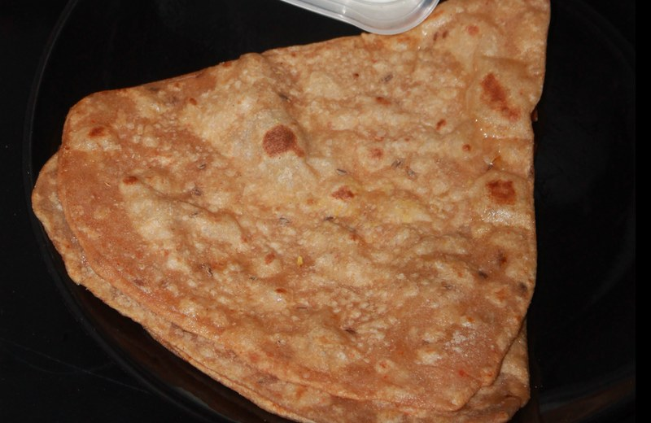

**⏱️ Prep Time:** 20 mins | **🔥 Cook Time:** 12 mins | **⌛ Total:** 32 mins
**🌡️ Air Fryer Temp:** 190°C / 375°F | **👥 Servings:** 2 | **📊 Calories:** 210 kcal
**Macros:** Protein: 6g | Carbs: 36g | Fat: 4.5g
**🏷️ Tags:** Low Oil, Traditional Classic, Whole Wheat

### 🛒 Ingredients
- 1 cup Whole wheat flour (gehun ka atta) + extra for dusting
- 1/2 cup Warm water (for soft dough kneading)
- 1 cup Boiled potato or grated spiced paneer/cauliflower filling
- 1/2 tsp Ajwain (carom seeds)
- 1/2 tsp Red chili powder
- 1/2 tsp Amchur (dry mango powder)
- 1 tbsp Chopped coriander leaves
- 1.5 tsp Desi ghee or olive oil for brushing
- Salt to taste

### 👩‍🍳 Step-by-Step Air Fryer Instructions
1. Knead wheat flour, ajwain, salt, and water into a smooth, pliable dough. Cover with a damp cloth and rest for 15 minutes.
2. Prepare filling: mix mashed potato/paneer with dry spices, coriander, and salt.
3. Divide dough into balls. Roll out a 4-inch disc, place 2 tablespoons of filling in center, seal edges into a dumpling, flatten, and roll gently into a 6-inch paratha (1/4-inch thick).
4. Preheat air fryer to 190°C (375°F) for 4 minutes.
5. Lightly brush both sides of the paratha with 1/4 tsp ghee.
6. Place paratha on the air fryer crisper tray. Air fry for 6 minutes, flip gently with silicone tongs, brush the reverse side with another 1/4 tsp ghee, and fry for 4-5 minutes until golden brown spots appear.
7. Serve piping hot right out of the air fryer.

> [!TIP]
> **Chef's Air Fryer Secret:** Roll parathas evenly without bursting edges. If parathas puff up and touch the upper heating coil, use a lightweight air fryer grill rack or fork prick to release excess steam.

**🥢 Serving & Pairing:** Thick Masala Dahi (Spiced Yogurt) and Mixed Mango Pickle.

---

## 4. Air Fryer Vegetable Uttapam Bites

*Mini bite-sized fermented rice-lentil uttapams studded with crunchy tomatoes, onions, capsicum, and curry leaves, baked into crisp-bottomed snacks.*

**⏱️ Prep Time:** 10 mins | **🔥 Cook Time:** 12 mins | **⌛ Total:** 22 mins
**🌡️ Air Fryer Temp:** 180°C / 360°F | **👥 Servings:** 4 | **📊 Calories:** 135 kcal
**Macros:** Protein: 4g | Carbs: 24g | Fat: 2.8g
**🏷️ Tags:** South Indian, Kid Friendly, Vegetarian

### 🛒 Ingredients
- 1.5 cups Fermented Dosa/Idli batter (thick consistency)
- 1 small Onion, finely chopped
- 1 small Tomato, deseeded and diced
- 1/4 cup Capsicum, finely minced
- 1 Green chili, chopped
- 2 tbsp Coriander leaves, chopped
- 1/2 tsp Podi (gunpowder spice) - optional
- 1 tsp Sesame oil or ghee
- Salt to taste

### 👩‍🍳 Step-by-Step Air Fryer Instructions
1. Preheat air fryer to 180°C (360°F) for 4 minutes.
2. Grease 4-6 shallow silicone tart molds or small heatproof ramekins with drops of sesame oil.
3. Pour 2.5 tablespoons of thick idli/dosa batter into each mold.
4. Top generously with onions, tomatoes, capsicum, chili, and coriander. Press vegetables lightly into the batter. Sprinkle a pinch of idli podi.
5. Place molds into the air fryer basket. Cook at 180°C for 8 minutes.
6. Mist a tiny touch of ghee over top and bake for another 3-4 minutes until edges are crisp and center is fully cooked.
7. Pop uttapam bites out of molds and serve warm.

> [!TIP]
> **Chef's Air Fryer Secret:** Keep the dosa batter thicker than normal crepe consistency so toppings don't sink to the bottom. Silicone molds keep the round shape intact.

**🥢 Serving & Pairing:** Spicy Tomato-Onion Kara Chutney and Coconut Chutney.

---

## 5. Air Fryer Moong Dal Cheela Rolls

*High-protein yellow moong lentil crepes rolled around a spiced crumbled paneer and vegetable filling, air-crisped until outer crust is crackly and warm.*

**⏱️ Prep Time:** 15 mins + soaking | **🔥 Cook Time:** 10 mins | **⌛ Total:** 25 mins
**🌡️ Air Fryer Temp:** 180°C / 360°F | **👥 Servings:** 3 | **📊 Calories:** 180 kcal
**Macros:** Protein: 9.5g | Carbs: 24g | Fat: 3.5g
**🏷️ Tags:** High Protein, Vegan, Gluten-Free

### 🛒 Ingredients
- 1 cup Split yellow moong dal, soaked for 2 hours and drained
- 1 inch Ginger + 1 Green chili (ground with dal)
- 1/4 tsp Turmeric powder
- 1/2 tsp Cumin seeds
- 1/2 cup Crumbled low-fat paneer or tofu
- 1/4 cup Grated carrot and shredded cabbage
- 1/2 tsp Chaat masala
- 1 tsp Olive oil
- Salt to taste

### 👩‍🍳 Step-by-Step Air Fryer Instructions
1. Blend soaked moong dal with ginger, chili, and 1/3 cup water into a smooth spreadable batter. Season with turmeric, cumin, and salt.
2. Quickly cook thin cheelas on a non-stick skillet for 1 minute per side (just enough to set the wrap).
3. Mix crumbled paneer, grated carrot, cabbage, and chaat masala in a bowl.
4. Place 3 tablespoons of filling along the centerline of each cheela, fold sides inward, and roll tightly into cylinders.
5. Preheat the air fryer to 180°C (360°F) for 3 minutes.
6. Brush rolls lightly with olive oil and place seam-side down in the air fryer basket.
7. Air fry at 180°C for 9-10 minutes, flipping at minute 5, until the exterior becomes wonderfully crunchy and golden.
8. Slice diagonally into pinwheels and serve.

> [!TIP]
> **Chef's Air Fryer Secret:** Pre-setting the cheela wrap on a pan ensures you can roll it tightly with paneer before air frying makes the exterior delightfully flaky.

**🥢 Serving & Pairing:** Tangy Green Mint Chutney and Sweet Date Tamarind Sauce.

---

## 6. Air Fryer Vegetable Dhokla Bites

*Fluffy, spongy gram flour dhoklas infused with finely diced bell peppers and green peas, baked gently in silicone ramekins and drizzled with a fragrant mustard-curry leaf tempering.*

**⏱️ Prep Time:** 15 mins | **🔥 Cook Time:** 14 mins | **⌛ Total:** 29 mins
**🌡️ Air Fryer Temp:** 160°C / 320°F | **👥 Servings:** 4 | **📊 Calories:** 150 kcal
**Macros:** Protein: 6g | Carbs: 22g | Fat: 3.5g
**🏷️ Tags:** Gujarati Classic, Low Calorie, Steamed & Baked

### 🛒 Ingredients
- 1 cup Besan (gram flour), sifted
- 1 tbsp Fine semolina (rava)
- 1 tbsp Lemon juice
- 1 tsp Ginger-green chili paste
- 1/4 tsp Turmeric powder
- 1/2 cup Water + 2 tbsp (for batter)
- 1/4 cup Finely diced colorful bell peppers
- 1 packet (5g) Eno fruit salt
- For Tempering: 1 tsp oil, 1 tsp mustard seeds, 8 curry leaves, 2 slit green chilies, 1/4 cup water, 1 tsp sugar, pinch of salt

### 👩‍🍳 Step-by-Step Air Fryer Instructions
1. Whisk besan, rava, lemon juice, ginger-chili paste, turmeric, salt, and water into a smooth lump-free batter. Rest for 10 minutes, then fold in diced peppers.
2. Preheat air fryer to 160°C (320°F) for 4 minutes.
3. Add Eno fruit salt to the batter, add 1 tsp water on top, and whisk briskly in one direction until the batter doubles in volume and becomes airy.
4. Immediately pour batter into greased silicone muffin molds (filling 2/3 full).
5. Place silicone molds in air fryer basket. Cover molds loosely with a sheet of foil to retain steam for the first 8 minutes.
6. Remove foil and air fry for an additional 5-6 minutes at 160°C until a skewer comes out clean.
7. Prepare tempering in a small saucepan, boil for 1 minute, and spoon evenly over hot dhoklas. Let dhoklas absorb the sweet-savory syrup for 3 minutes before serving.

> [!TIP]
> **Chef's Air Fryer Secret:** Covering the molds with foil for the first half of cooking traps steam inside the air fryer, ensuring sponge-like lightness without drying out.

**🥢 Serving & Pairing:** Spicy Raw Papaya Sambharo and Tangy Green Chutney.

---

## 7. Air Fryer Rava Toast

*Crisp whole wheat bread slices topped with a spiced semolina, yogurt, onion, and bell pepper crust, air-fried until the rava top is sizzled golden brown and bread base is ultra-crunchy.*

**⏱️ Prep Time:** 10 mins | **🔥 Cook Time:** 9 mins | **⌛ Total:** 19 mins
**🌡️ Air Fryer Temp:** 180°C / 360°F | **👥 Servings:** 3 | **📊 Calories:** 190 kcal
**Macros:** Protein: 5g | Carbs: 32g | Fat: 4g
**🏷️ Tags:** Quick & Crispy, Kids Favorite, Vegetarian

### 🛒 Ingredients
- 6 slices Whole wheat or multigrain bread
- 1/2 cup Semolina (Sooji / Rava)
- 1/3 cup Thick fresh yogurt (curd)
- 1 small Onion, finely chopped
- 1/2 Tomato, deseeded and finely chopped
- 1/4 cup Capsicum, finely minced
- 1 Green chili, finely chopped
- 2 tbsp Coriander leaves, minced
- 1/2 tsp Chaat masala & 1/4 tsp black pepper
- 1 tsp Butter or ghee for brushing
- Salt to taste

### 👩‍🍳 Step-by-Step Air Fryer Instructions
1. In a bowl, mix rava, curd, chopped vegetables, chili, coriander, chaat masala, pepper, and salt. Add 2 tablespoons of water if needed to make a thick, spreadable paste. Let rest 5 minutes.
2. Preheat air fryer to 180°C (360°F) for 3 minutes.
3. Spread 2 tablespoons of the rava mixture evenly over one side of each bread slice, pressing gently to adhere.
4. Lightly brush the bottom of the bread with drops of ghee/butter.
5. Place 2-3 slices in the air fryer basket with the rava topping facing upward.
6. Air fry at 180°C for 6 minutes, then flip carefully and air fry for 2-3 minutes to crisp the bread underside.
7. Flip back to check the rava crust; it should be bubbly and speckled golden. Cut into triangles and serve immediately.

> [!TIP]
> **Chef's Air Fryer Secret:** Do not make the rava batter watery or it will soak the bread. It must be thick like cream cheese so it forms a crisp crust on top.

**🥢 Serving & Pairing:** Classic Tomato Ketchup and Pudina Chutney.

---

## 8. Air Fryer Sabudana Vada

*The quintessential Maharashtrian fasting delicacy made shatteringly crisp in the air fryer with 90% less oil. Tapioca pearls bonded with roasted crushed peanuts and boiled potatoes.*

**⏱️ Prep Time:** 15 mins + soaking | **🔥 Cook Time:** 16 mins | **⌛ Total:** 31 mins
**🌡️ Air Fryer Temp:** 190°C / 375°F | **👥 Servings:** 4 | **📊 Calories:** 210 kcal
**Macros:** Protein: 4.2g | Carbs: 38g | Fat: 5g
**🏷️ Tags:** Vrat / Fasting Friendly, Gluten-Free, Crispy Snack

### 🛒 Ingredients
- 1 cup Sabudana (tapioca pearls), rinsed and soaked in equal water for 5 hours
- 2 medium Potatoes, boiled, peeled, and mashed well
- 1/2 cup Roasted peanuts, coarsely crushed
- 2 Green chilies, finely minced
- 1 tsp Cumin seeds (jeera)
- 1 tbsp Lemon juice
- 2 tbsp Fresh coriander leaves, chopped (or sendha namak herbs)
- 1 tsp Rock salt (sendha namak) or regular salt
- 1 tbsp Peanut oil or ghee for brushing

### 👩‍🍳 Step-by-Step Air Fryer Instructions
1. Test sabudana: a pearl pressed between thumb and forefinger should mash completely with no hard center.
2. In a bowl, combine drained sabudana, mashed potatoes, coarsely crushed peanuts, green chilies, cumin seeds, lemon juice, salt, and coriander. Mix thoroughly into a non-sticky dough.
3. Grease palms with peanut oil and shape into 8 flat, circular patties (about 1/2-inch thick). Patties should have smooth edges without cracks to prevent burst pearls.
4. Preheat the air fryer to 190°C (375°F) for 4 minutes.
5. Brush both sides of each vada with peanut oil.
6. Arrange vadas in the basket with space between each. Air fry at 190°C for 10 minutes.
7. Flip vadas with tongs, lightly brush with oil, and air fry for another 5-6 minutes until pearls turn translucent and the outer crust is crackling crisp.
8. Serve immediately while hot and crunchy.

> [!TIP]
> **Chef's Air Fryer Secret:** Crushed peanuts are essential—they absorb excess moisture and release natural peanut oils during air frying, giving that irresistible authentic deep-fried taste.

**🥢 Serving & Pairing:** Sweet Fasting Curd Dip (Dahi with sugar & roasted cumin) or Green Peanut Chutney.

---

## 9. Air Fryer Methi Thepla Chips

*Gujarati methi thepla dough rolled paper-thin, cut into triangular nachos, and air-fried into addictive, crunchy spiced chips that keep for weeks.*

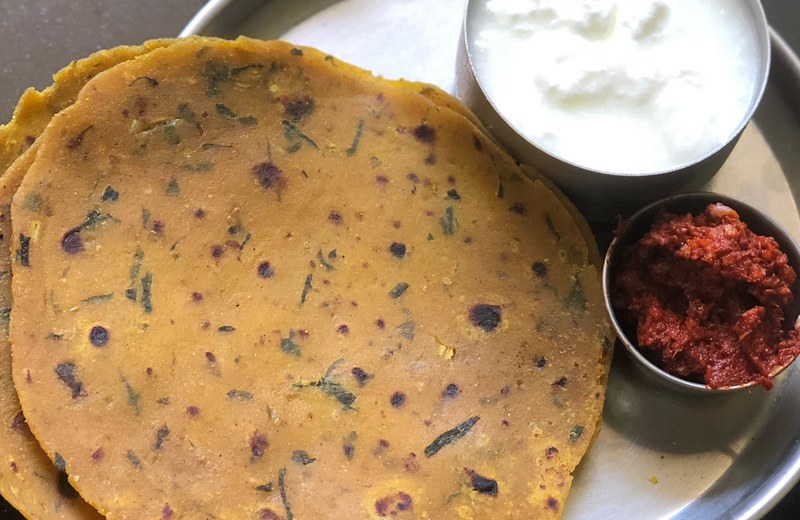

**⏱️ Prep Time:** 15 mins | **🔥 Cook Time:** 9 mins | **⌛ Total:** 24 mins
**🌡️ Air Fryer Temp:** 170°C / 340°F | **👥 Servings:** 4 | **📊 Calories:** 130 kcal
**Macros:** Protein: 4g | Carbs: 22g | Fat: 2.8g
**🏷️ Tags:** Gujarati Snack, Travel Friendly, High Fiber

### 🛒 Ingredients
- 1 cup Whole wheat flour
- 2 tbsp Besan (gram flour)
- 1/2 cup Fresh fenugreek leaves (methi), finely chopped and washed
- 2 tbsp Whisked yogurt
- 1/2 tsp Turmeric powder
- 1/2 tsp Red chili powder
- 1/2 tsp Ajwain (carom seeds), crushed
- 1 tsp White sesame seeds (til)
- 1 tsp Oil for dough + cooking spray
- Salt to taste

### 👩‍🍳 Step-by-Step Air Fryer Instructions
1. In a bowl, combine wheat flour, besan, methi leaves, yogurt, spices, sesame seeds, ajwain, salt, and 1 tsp oil. Knead into a firm, smooth dough using minimal water.
2. Rest dough for 10 minutes. Divide into 4 balls.
3. Roll each ball out on a lightly floured surface as thinly as possible (like a papad or tortilla).
4. Prick the rolled sheet all over with a fork to prevent puffing. Cut into triangular chip shapes using a pizza cutter.
5. Preheat air fryer to 170°C (340°F) for 3 minutes.
6. Place chips in a single/slightly overlapping layer in the basket. Spray lightly with cooking oil.
7. Air fry at 170°C for 6 minutes, shake basket vigorously, and fry for 2-3 more minutes until crisp and golden brown.
8. Cool completely on a wire rack; chips will turn crispier as they cool.

> [!TIP]
> **Chef's Air Fryer Secret:** Pricking with a fork is mandatory! Without pricking, the chips will puff into hollow balls instead of staying flat and crispy.

**🥢 Serving & Pairing:** Spicy Chhundo (Sweet Mango Relish) or Masala Chai.

---

## 10. Air Fryer Vegetable Besan Omelette

*A fluffy, savory eggless chickpea pancake laden with onions, tomatoes, spinach, and fresh herbs, baked in an air fryer cake pan into an airy frittata-style omelette.*

**⏱️ Prep Time:** 10 mins | **🔥 Cook Time:** 11 mins | **⌛ Total:** 21 mins
**🌡️ Air Fryer Temp:** 175°C / 350°F | **👥 Servings:** 2 | **📊 Calories:** 160 kcal
**Macros:** Protein: 8g | Carbs: 20g | Fat: 3.5g
**🏷️ Tags:** Vegetarian Eggless, High Protein, Breakfast

### 🛒 Ingredients
- 1 cup Besan (gram flour)
- 1/4 cup Finely chopped onions
- 1/4 cup Finely chopped tomatoes
- 1/4 cup Baby spinach, finely shredded
- 1 Green chili, chopped
- 1/4 tsp Turmeric powder
- 1/4 tsp Ajwain (carom seeds)
- 1/4 tsp Chaat masala
- 1/4 tsp Baking soda or Eno (for fluffiness)
- 3/4 cup Water (to adjust batter consistency)
- 1 tsp Oil
- Salt to taste

### 👩‍🍳 Step-by-Step Air Fryer Instructions
1. In a bowl, whisk besan, turmeric, ajwain, salt, and water into a smooth, pourable pancake batter (similar to beaten eggs).
2. Fold in onions, tomatoes, spinach, and green chili. Just before pouring, stir in baking soda.
3. Preheat air fryer to 175°C (350°F) for 3 minutes.
4. Lightly grease a 6-inch round air fryer cake pan or silicone baking dish with 1/2 tsp oil.
5. Pour batter into the pan (depth should be about 1/2 inch).
6. Air fry at 175°C for 8 minutes until top sets and puffs.
7. Brush a few drops of oil on top, carefully flip using a wide spatula, and air fry for 3 minutes to brown the underside.
8. Slide onto a plate, cut into wedges, and serve warm.

> [!TIP]
> **Chef's Air Fryer Secret:** Adding ajwain aids in digesting chickpea flour, while a pinch of baking soda provides the fluffy aerated texture of a traditional egg omelette.

**🥢 Serving & Pairing:** Buttered Whole Wheat Toast and Spicy Green Chili Sauce.

---

## 11. Air Fryer Vegetable Handvo Bites

*Authentic Gujarati savory mixed lentil and rice cake packed with bottle gourd (lauki), tempered with sesame seeds and mustard, air-fried with a crispy crust and moist crumb.*

**⏱️ Prep Time:** 15 mins + fermenting | **🔥 Cook Time:** 16 mins | **⌛ Total:** 31 mins
**🌡️ Air Fryer Temp:** 170°C / 340°F | **👥 Servings:** 4 | **📊 Calories:** 175 kcal
**Macros:** Protein: 7g | Carbs: 26g | Fat: 4.2g
**🏷️ Tags:** Gujarati Specialty, Lentil Cake, High Fiber

### 🛒 Ingredients
- 1.5 cups Fermented Handvo batter (rice, chana dal, urad dal, toor dal mix)
- 3/4 cup Grated bottle gourd (lauki / doodhi), squeezed lightly
- 1/4 cup Grated carrot
- 1 tbsp Ginger-green chili paste
- 1/2 tsp Turmeric & 1/2 tsp red chili powder
- 1 tsp Sugar
- 1 tbsp Lemon juice
- For Tempering: 1 tbsp sesame seeds (til), 1 tsp mustard seeds, 1/4 tsp hing, 8 curry leaves, 1 tsp oil
- Salt to taste

### 👩‍🍳 Step-by-Step Air Fryer Instructions
1. In a bowl, mix fermented handvo batter with grated lauki, carrot, ginger-chili paste, turmeric, chili powder, sugar, lemon juice, and salt.
2. Heat 1 tsp oil in a small pan, crackle mustard seeds, sesame seeds, hing, and curry leaves. Pour half the tempering into the batter and stir.
3. Preheat the air fryer to 170°C (340°F) for 4 minutes.
4. Grease silicone muffin cups or a small 6-inch air fryer baking tin. Spoon batter into cups, filling 3/4 full.
5. Scatter the remaining sesame-mustard tempering over the top of the batter.
6. Place cups in the air fryer basket. Air fry at 170°C for 14-16 minutes until a wooden skewer comes out clean and the sesame crust is aromatic and crunchy brown.
7. Let cool for 5 minutes before unmolding.

> [!TIP]
> **Chef's Air Fryer Secret:** The generous coating of sesame seeds on top toasts wonderfully in the air fryer fan heat, giving Handvo its iconic nutty crunch.

**🥢 Serving & Pairing:** Tangy Green Chutney and Sweet Lemon Pickle.

---

## 12. Air Fryer Bread Pizza Toast

*Crusty bread toasts layered with spiced pizza sauce, crunchy bell peppers, sweet corn, and bubbly melted mozzarella cheese with browned, bubbly edges.*

**⏱️ Prep Time:** 10 mins | **🔥 Cook Time:** 7 mins | **⌛ Total:** 17 mins
**🌡️ Air Fryer Temp:** 180°C / 360°F | **👥 Servings:** 2 | **📊 Calories:** 220 kcal
**Macros:** Protein: 8.5g | Carbs: 28g | Fat: 7g
**🏷️ Tags:** Kids Special, Cheese Lovers, Quick Breakfast

### 🛒 Ingredients
- 4 slices Sourdough or whole wheat bread
- 3 tbsp Pizza pasta sauce or spiced tomato-herb spread
- 1/2 cup Shredded mozzarella cheese
- 1/4 cup Finely diced colorful bell peppers
- 2 tbsp Sweet corn kernels
- 2 tbsp Finely sliced red onions
- 1/2 tsp Dried oregano & chili flakes
- 1 tsp Olive oil / butter
- Salt to taste

### 👩‍🍳 Step-by-Step Air Fryer Instructions
1. Preheat air fryer to 180°C (360°F) for 3 minutes.
2. Lightly toast the bread slices in the air fryer for 2 minutes to crisp the bottom (this prevents sogginess from sauce).
3. Spread 1 tablespoon of pizza sauce evenly over each pre-toasted slice.
4. Scatter onions, bell peppers, and corn kernels. Season with a pinch of oregano and chili flakes.
5. Top generously with shredded mozzarella cheese, making sure cheese covers vegetables so they don't blow away under convection airflow.
6. Place bread slices into the air fryer basket.
7. Air fry at 180°C for 5-6 minutes until cheese is completely melted, bubbling, and golden brown in spots.
8. Slice diagonally and serve immediately.

> [!TIP]
> **Chef's Air Fryer Secret:** Always pre-toast the bread for 2 minutes before saucing. Convection fans can blow loose sliced toppings away, so melt cheese directly over veggies to lock them down.

**🥢 Serving & Pairing:** Chili-Garlic Mayo or Herb Dip.

---

## 13. Air Fryer Vegetable Frankie Rolls

*Crisp rotis rolled with a spiced potato-veg cutlet filling, crunchy pickled vinegar onions, shredded cabbage, and authentic Frankie masala spice dust.*

**⏱️ Prep Time:** 15 mins | **🔥 Cook Time:** 9 mins | **⌛ Total:** 24 mins
**🌡️ Air Fryer Temp:** 180°C / 360°F | **👥 Servings:** 3 | **📊 Calories:** 230 kcal
**Macros:** Protein: 6g | Carbs: 38g | Fat: 5.5g
**🏷️ Tags:** Street Food, Wrap & Roll, Vegetarian

### 🛒 Ingredients
- 3 Whole wheat rotis or parathas (cooked)
- 3 Spiced potato cutlet cylinders (aloo cutlets)
- 1/2 cup Thinly sliced onions soaked in 1 tbsp vinegar & pinch salt
- 1/2 cup Shredded cabbage
- 2 tbsp Mint coriander chutney
- 1 tbsp Sweet tamarind chutney
- 1 tsp Frankie masala (chaat masala, roasted cumin, amchur, chili powder)
- 1 tsp Oil for brushing

### 👩‍🍳 Step-by-Step Air Fryer Instructions
1. If making potato filling fresh: shape boiled spiced potato into oblong cylinders and pre-cook in air fryer for 6 minutes at 190°C until crisp.
2. Lay each roti on a cutting board; spread 1 tsp mint chutney across the surface.
3. Place the crisp potato cylinder down the center.
4. Top with pickled vinegar onions, shredded cabbage, and a generous dusting of Frankie masala.
5. Fold the bottom edge up, roll tightly into a wrap, and secure with a toothpick if needed.
6. Preheat the air fryer to 180°C (360°F) for 3 minutes.
7. Brush the outer wrap with a light coat of oil and arrange seam-side down in the air fryer basket.
8. Air fry at 180°C for 6-8 minutes, turning once halfway through, until the outer roti shell is flaky and crunchy.
9. Wrap half in parchment paper and serve hot.

> [!TIP]
> **Chef's Air Fryer Secret:** Vinegar onions give street-style Frankie its signature zing. Placing rolls seam-side down first ensures they seal shut in the circulating air.

**🥢 Serving & Pairing:** Spicy Mint Chutney and Extra Pickled Onions.

---

## 14. Air Fryer Vegetable Cheela Muffins

*Savory chickpea and vegetable batter baked in silicone muffin cups into portable, high-protein breakfast bites that stay tender inside with a golden exterior.*

**⏱️ Prep Time:** 12 mins | **🔥 Cook Time:** 14 mins | **⌛ Total:** 26 mins
**🌡️ Air Fryer Temp:** 170°C / 340°F | **👥 Servings:** 4 | **📊 Calories:** 145 kcal
**Macros:** Protein: 7g | Carbs: 21g | Fat: 3.5g
**🏷️ Tags:** High Protein, Grab & Go, Eggless Muffin

### 🛒 Ingredients
- 1 cup Besan (gram flour)
- 2 tbsp Fine semolina (rava)
- 1/2 cup Grated zucchini or bottle gourd
- 1/4 cup Finely diced tomatoes
- 1/4 cup Corn kernels
- 1 Green chili, minced
- 1/4 tsp Turmeric & 1/2 tsp cumin powder
- 1/2 tsp Baking powder
- 2/3 cup Water
- 1 tsp Oil
- Salt to taste

### 👩‍🍳 Step-by-Step Air Fryer Instructions
1. Whisk besan, rava, turmeric, cumin, salt, and water in a bowl into a thick muffin batter.
2. Fold in grated zucchini, tomatoes, corn, and green chili. Rest batter for 5 minutes.
3. Preheat air fryer to 170°C (340°F) for 4 minutes.
4. Stir baking powder into the batter. Lightly grease 6 silicone muffin cups.
5. Divide batter evenly among silicone cups (filling 3/4 full).
6. Place muffin cups into the air fryer basket.
7. Air fry at 170°C for 13-14 minutes until tops are puffed, golden brown, and a toothpick inserted in the center comes out clean.
8. Let cool for 3 minutes before popping out of cups.

> [!TIP]
> **Chef's Air Fryer Secret:** Squeeze out excess liquid from grated zucchini so the muffin crumb stays light and bouncy rather than dense.

**🥢 Serving & Pairing:** Roasted Tomato Chutney and Masala Chai.

---

## 15. Air Fryer Multigrain Vegetable Bread Rolls

*Multigrain bread slices wrapped around a zesty spiced potato, green pea, and carrot filling, air-fried to a crackling golden crunch without deep-frying grease.*

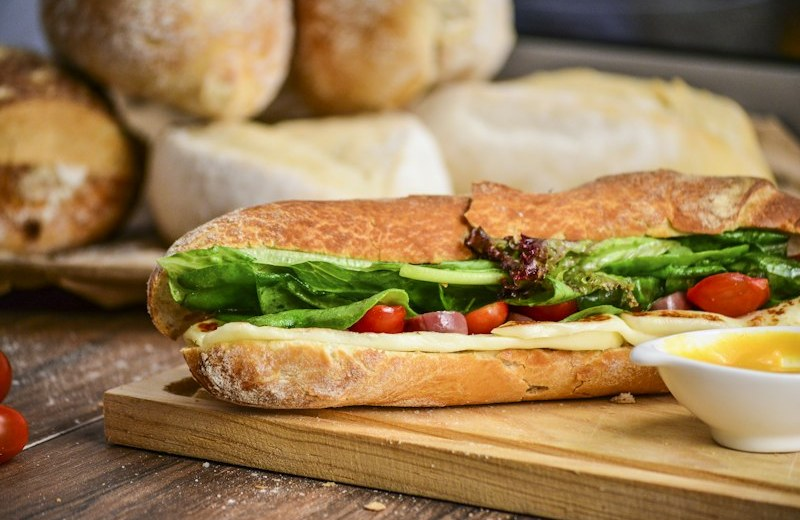

**⏱️ Prep Time:** 15 mins | **🔥 Cook Time:** 13 mins | **⌛ Total:** 28 mins
**🌡️ Air Fryer Temp:** 180°C / 360°F | **👥 Servings:** 4 | **📊 Calories:** 170 kcal
**Macros:** Protein: 5g | Carbs: 29g | Fat: 3.8g
**🏷️ Tags:** Low Calorie, Crispy Outer, Comfort Food

### 🛒 Ingredients
- 6 slices Multigrain or brown bread, crusts removed
- 2 medium Potatoes, boiled and mashed
- 1/3 cup Boiled green peas, lightly crushed
- 1/4 cup Grated carrot
- 1 Green chili, minced
- 1/2 tsp Cumin powder & 1/2 tsp garam masala
- 1/2 tsp Chaat masala
- 2 tbsp Fresh coriander, chopped
- Water in a shallow bowl (for dipping bread)
- 1 tbsp Oil for brushing
- Salt to taste

### 👩‍🍳 Step-by-Step Air Fryer Instructions
1. Prepare stuffing: mix mashed potatoes, green peas, carrot, chili, spices, salt, and coriander thoroughly. Shape into 6 oval logs.
2. Dip one slice of multigrain bread into water for 1 second; immediately press flat between palms to squeeze out all excess water completely.
3. Place a potato stuffing log in the center of the damp flattened bread.
4. Fold edges around the filling and press firmly to seal into a smooth cylindrical roll. Repeat for all slices.
5. Preheat air fryer to 180°C (360°F) for 4 minutes.
6. Brush each roll lightly with cooking oil on all sides.
7. Place rolls in the air fryer basket without overcrowding. Air fry at 180°C for 8 minutes.
8. Flip rolls gently with tongs, brush a tiny touch of oil, and air fry for 4-5 minutes until deep golden and shatteringly crunchy.
9. Serve piping hot.

> [!TIP]
> **Chef's Air Fryer Secret:** Squeezing out every drop of water from the bread is crucial! Any retained moisture will cause steam inside the air fryer instead of a crunchy crust.

**🥢 Serving & Pairing:** Spicy Mint Chutney and Sweet Tamarind Chutney.

---

## 16. Air Fryer Vegetable Idli Fry

*Leftover steamed idlis cut into bite-sized fingers, tossed in podi spice and curry leaves, and air-fried into addictive crunchy croutons with soft centers.*

**⏱️ Prep Time:** 10 mins | **🔥 Cook Time:** 11 mins | **⌛ Total:** 21 mins
**🌡️ Air Fryer Temp:** 190°C / 375°F | **👥 Servings:** 3 | **📊 Calories:** 165 kcal
**Macros:** Protein: 5g | Carbs: 30g | Fat: 3g
**🏷️ Tags:** South Indian Twist, Crispy Bites, Leftover Hack

### 🛒 Ingredients
- 6 Cold leftover idlis, cut into thick fingers or bite-sized cubes
- 1.5 tbsp Idli Podi (gunpowder spice mix)
- 1/2 tsp Mustard seeds
- 1 sprig Curry leaves, torn
- 1/4 tsp Turmeric powder & 1/2 tsp red chili powder
- 1.5 tsp Sesame oil or melted ghee
- 1/4 tsp Salt (if needed)

### 👩‍🍳 Step-by-Step Air Fryer Instructions
1. Use chilled leftover idlis (cold idlis stay firm and cut cleanly without crumbling).
2. Cut idlis into finger strips or 1-inch cubes.
3. In a bowl, toss idli pieces with sesame oil, idli podi, turmeric, chili powder, and torn curry leaves until evenly coated.
4. Preheat the air fryer to 190°C (375°F) for 3 minutes.
5. Spread spiced idli cubes in a single layer in the air fryer basket.
6. Air fry at 190°C for 7 minutes.
7. Shake the basket vigorously to rotate the cubes, spray a light mist of oil if needed, and air fry for 3-4 more minutes until edges are blistered and crunchy.
8. Transfer to a bowl and serve warm.

> [!TIP]
> **Chef's Air Fryer Secret:** Cold, refrigerated idlis work 100x better than freshly steamed ones because moisture has evaporated, allowing the air fryer to crisp the edges instantly.

**🥢 Serving & Pairing:** Coconut Chutney and Hot Filter Coffee.

---

## 17. Air Fryer Vegetable Stuffed Kulcha

*Soft yet crispy North Indian flatbread stuffed with spiced potatoes, onions, and pomegranate seeds (anardana), topped with nigella seeds and fresh coriander.*

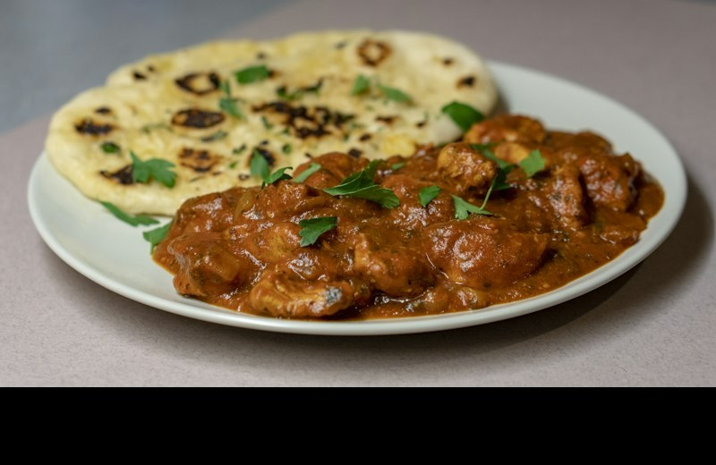

**⏱️ Prep Time:** 20 mins | **🔥 Cook Time:** 10 mins | **⌛ Total:** 30 mins
**🌡️ Air Fryer Temp:** 180°C / 360°F | **👥 Servings:** 2 | **📊 Calories:** 240 kcal
**Macros:** Protein: 7g | Carbs: 42g | Fat: 5g
**🏷️ Tags:** Amritsari Style, Punjabi Breakfast, Vegetarian

### 🛒 Ingredients
- 1 cup All-purpose flour or half whole wheat flour
- 2 tbsp Curd (yogurt)
- 1/4 tsp Baking powder & pinch of baking soda
- 1 cup Boiled spiced potato & onion stuffing
- 1 tsp Crushed anardana (dried pomegranate seeds)
- 1/2 tsp Ajwain & 1/2 tsp roasted cumin powder
- 1 tsp Kalonji (nigella seeds) & 2 tbsp chopped coriander (for topping)
- 1 tbsp Butter or ghee for brushing
- Salt to taste

### 👩‍🍳 Step-by-Step Air Fryer Instructions
1. Knead flour, curd, baking powder, baking soda, salt, and warm water into a soft, supple dough. Rest for 20 minutes under a damp towel.
2. Prepare stuffing: mix boiled mashed potato, finely chopped onions, green chilies, anardana, cumin powder, and salt.
3. Roll a dough ball into a 4-inch circle, place a ball of stuffing in the center, gather edges, seal tightly, and roll gently into an oval kulcha (1/3-inch thick).
4. Moisten top surface with drops of water; sprinkle kalonji and coriander leaves, pressing gently to adhere.
5. Preheat air fryer to 180°C (360°F) for 4 minutes.
6. Place kulcha in the basket. Air fry for 5 minutes.
7. Flip, brush lightly with butter/ghee, and air fry for 4-5 minutes until brown tandoor-like blisters form on both sides.
8. Brush with melted butter right out of the basket and crush gently between palms to release steam.

> [!TIP]
> **Chef's Air Fryer Secret:** Crushed anardana (pomegranate seeds) in the potato filling is the secret to authentic Amritsari flavor. Water helps coriander and nigella stick during high airflow.

**🥢 Serving & Pairing:** Punjabi Pindi Chole and Pickled Onions.

---

## 18. Air Fryer Ragi (Finger Millet) Cutlets

*Calcium-loaded finger millet patties combined with steamed vegetables, ginger, and roasted peanut crunch, air-fried into guilt-free, nutritious breakfast patties.*

**⏱️ Prep Time:** 15 mins | **🔥 Cook Time:** 15 mins | **⌛ Total:** 30 mins
**🌡️ Air Fryer Temp:** 180°C / 360°F | **👥 Servings:** 4 | **📊 Calories:** 145 kcal
**Macros:** Protein: 4.8g | Carbs: 26g | Fat: 2.9g
**🏷️ Tags:** Millet Power, Diabetic Friendly, Calcium Rich

### 🛒 Ingredients
- 1/2 cup Ragi (finger millet) flour
- 1 cup Water (for cooking ragi dough)
- 1 cup Boiled mashed potatoes or sweet potatoes
- 1/2 cup Steamed veggies (finely chopped beans, carrots, peas)
- 2 tbsp Roasted crushed peanuts
- 1 Green chili & 1 inch ginger, minced
- 1/2 tsp Cumin powder & 1/2 tsp garam masala
- 1 tbsp Chopped fresh coriander
- 1 tsp Oil for brushing
- Salt to taste

### 👩‍🍳 Step-by-Step Air Fryer Instructions
1. Boil 1 cup water with a pinch of salt. Lower flame, add ragi flour, and stir continuously for 2 minutes until it forms a soft dough ball. Let cool.
2. In a large bowl, knead cooked ragi dough with mashed potato, steamed veggies, peanuts, ginger, chili, spices, and coriander.
3. Shape mixture into 8 uniform round cutlets (1/2-inch thick). Brush lightly with oil.
4. Preheat air fryer to 180°C (360°F) for 4 minutes.
5. Arrange ragi cutlets in a single layer in the air fryer basket.
6. Air fry at 180°C for 9 minutes.
7. Carefully flip each cutlet, brush underside lightly with oil, and air fry for another 5-6 minutes until the outer crust turns firmly crisp.
8. Rest for 2 minutes before serving.

> [!TIP]
> **Chef's Air Fryer Secret:** Cooking ragi flour with hot water first gelatinizes the millet starch, making the cutlets tender inside with no raw millet aftertaste.

**🥢 Serving & Pairing:** Cooling Cucumber Mint Raita or Garlic Chutney.

---

## 19. Air Fryer Paneer Stuffed Toast

*Golden toasted bread sandwiches stuffed with a spiced cottage cheese filling, bell peppers, and fresh cilantro, grilled until crunchy with zero oily mess.*

**⏱️ Prep Time:** 10 mins | **🔥 Cook Time:** 9 mins | **⌛ Total:** 19 mins
**🌡️ Air Fryer Temp:** 180°C / 360°F | **👥 Servings:** 2 | **📊 Calories:** 230 kcal
**Macros:** Protein: 11g | Carbs: 26g | Fat: 8.5g
**🏷️ Tags:** High Protein, Quick Breakfast, Vegetarian

### 🛒 Ingredients
- 4 slices Multigrain or brown bread
- 1 cup Fresh paneer, grated or crumbled
- 1/4 cup Finely diced onions
- 1/4 cup Finely diced capsicum
- 1 Green chili, finely chopped
- 1/2 tsp Cumin powder & 1/2 tsp chaat masala
- 1/4 tsp Turmeric powder
- 2 tbsp Coriander leaves, chopped
- 1 tsp Butter or ghee for brushing
- Salt to taste

### 👩‍🍳 Step-by-Step Air Fryer Instructions
1. In a bowl, mix grated paneer, onions, capsicum, chili, cumin powder, chaat masala, turmeric, salt, and coriander thoroughly.
2. Spread green chutney (optional) on bread slices. Place half the paneer filling on one slice, cover with another slice, and press down gently.
3. Preheat air fryer to 180°C (360°F) for 3 minutes.
4. Brush both outer surfaces of the sandwich with a light coating of butter or ghee.
5. Place sandwiches side-by-side in the air fryer basket.
6. Air fry at 180°C for 5 minutes.
7. Flip gently with a spatula and air fry for another 3-4 minutes until both sides are evenly browned and shatteringly crisp.
8. Slice diagonally and serve hot.

> [!TIP]
> **Chef's Air Fryer Secret:** Grating paneer rather than dicing gives uniform melt and prevents the sandwich from bulging or coming apart during air circulation.

**🥢 Serving & Pairing:** Pudina Chutney and Sweet Tomato Sauce.

---

## 20. Air Fryer Vegetable Dalia (Broken Wheat) Cutlets

*Wholesome cracked wheat patties combined with boiled potatoes, green beans, carrots, and warm Indian spices, air-fried until crunchy on the outside and soft within.*

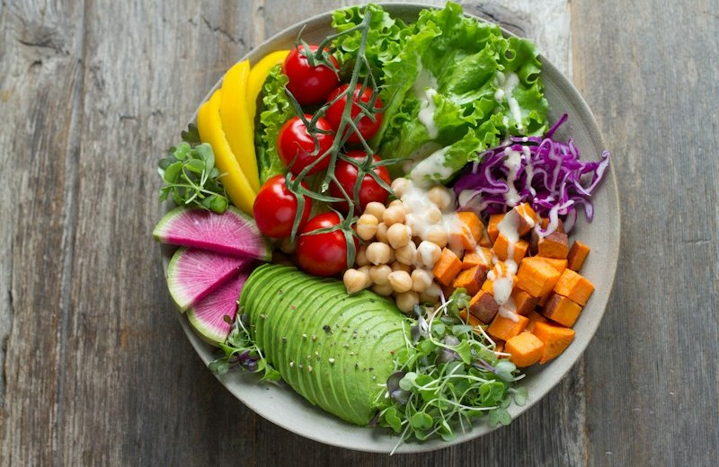

**⏱️ Prep Time:** 15 mins + soaking | **🔥 Cook Time:** 15 mins | **⌛ Total:** 30 mins
**🌡️ Air Fryer Temp:** 180°C / 360°F | **👥 Servings:** 4 | **📊 Calories:** 155 kcal
**Macros:** Protein: 5.2g | Carbs: 27g | Fat: 3g
**🏷️ Tags:** High Fiber, Whole Grain, Heart Healthy

### 🛒 Ingredients
- 3/4 cup Dalia (broken wheat), rinsed and boiled until tender, drained dry
- 2 medium Potatoes, boiled and mashed
- 1/2 cup Finely chopped steamed vegetables (carrots, green peas, French beans)
- 1 Green chili & 1 tsp ginger, minced
- 1/2 tsp Cumin powder
- 1/2 tsp Chaat masala & 1/2 tsp amchur powder
- 2 tbsp Roasted besan or breadcrumbs (for binding)
- 2 tbsp Chopped coriander leaves
- 1 tsp Oil for brushing
- Salt to taste

### 👩‍🍳 Step-by-Step Air Fryer Instructions
1. Ensure cooked dalia is completely drained of water in a fine sieve for 10 minutes.
2. In a mixing bowl, combine cooked dalia, mashed potato, steamed veggies, ginger, chili, spices, salt, coriander, and roasted besan.
3. Knead mixture into a firm dough; shape into 8 oval patties.
4. Preheat the air fryer to 180°C (360°F) for 4 minutes.
5. Brush patties lightly with oil on both sides.
6. Place cutlets into the air fryer basket with adequate clearance between them.
7. Air fry at 180°C for 9 minutes.
8. Flip cutlets with silicone tongs, lightly spray oil, and air fry for another 5-6 minutes until deep golden brown and crisp.
9. Serve hot directly from the basket.

> [!TIP]
> **Chef's Air Fryer Secret:** Dalia must be completely dry before mixing with potatoes. The roasted besan provides binding and a wonderful nutty aroma during air frying.

**🥢 Serving & Pairing:** Fresh Mint-Coriander Chutney and Masala Chai.

---

# 🍽️ SECTION: SNACKS & STARTERS

## 1. Vegetable Samosa (Baked-Style)

*Flaky, blistered pastry pockets stuffed with spiced potatoes, sweet green peas, and cashews, air-fried with 80% less oil compared to traditional deep frying.*

**⏱️ Prep Time:** 25 mins | **🔥 Cook Time:** 16 mins | **⌛ Total:** 41 mins
**🌡️ Air Fryer Temp:** 180°C / 360°F | **👥 Servings:** 4 | **📊 Calories:** 165 kcal / piece
**Macros:** Protein: 4.5g | Carbs: 26g | Fat: 4.8g
**🏷️ Tags:** Street Food Legend, Crispy Pastry, Party Favorite

### 🛒 Ingredients
- 1.5 cups All-purpose flour (maida) or whole wheat pastry flour
- 3 tbsp Desi ghee or warm oil (moyen for flaky crust)
- 1/2 tsp Ajwain (carom seeds), crushed
- 1/3 cup Cold water (for stiff dough)
- 3 medium Potatoes, boiled, peeled and roughly hand-crumbled
- 1/2 cup Boiled green peas
- 1 tbsp Chopped cashews and raisins (optional)
- 1 tbsp Ginger-green chili paste
- 1 tsp Coriander seeds, coarsely crushed
- 1/2 tsp Cumin seeds, 1/2 tsp garam masala, 1/2 tsp amchur powder
- 1 tbsp Oil for filling + 1 tbsp for brushing samosas
- Salt to taste

### 👩‍🍳 Step-by-Step Air Fryer Instructions
1. Knead flour, ajwain, salt, and melted ghee with fingertips until it resembles breadcrumbs. Add cold water gradually to knead a stiff, firm dough. Rest 20 minutes under damp cloth.
2. Make filling: Sauté crushed coriander seeds, cumin, ginger-chili paste in 1 tbsp oil. Add green peas, crumbled potatoes, spices, and salt. Cook 3 minutes. Cool completely.
3. Divide dough into 4 balls. Roll each ball into an oval (1/8-inch thick). Cut into two halves. Form each half-circle into a cone, brush water on seam, and press firmly to seal.
4. Fill cone 3/4 full with spiced potato mix. Brush water around top rim, fold a pleat on back edge, and press flat to seal securely into a triangle that can stand upright.
5. Preheat air fryer to 180°C (360°F) for 4 minutes.
6. Brush each samosa generously on all sides with oil or melted ghee.
7. Place samosas upright or flat in the basket with space between them. Air fry at 180°C for 10 minutes.
8. Turn samosas over, brush lightly with oil on any pale spots, and air fry for another 5-6 minutes until deep golden brown with tiny pastry blisters.
9. Rest for 2 minutes before serving.

> [!TIP]
> **Chef's Air Fryer Secret:** The secret to flaky samosas is stiff dough with plenty of ghee moyen, and brushing with oil before air-frying so the circulating dry air creates authentic pastry blisters.

**🥢 Serving & Pairing:** Zesty Mint-Coriander Chutney and Sweet Saunth (Tamarind Date) Chutney.

---

## 2. Paneer Tikka

*Succulent cubes of cottage cheese marinated in a spiced hung curd and roasted besan paste, air-fried at high heat for charred tandoor-style edges with a melt-in-mouth core.*

**⏱️ Prep Time:** 20 mins + marinating | **🔥 Cook Time:** 11 mins | **⌛ Total:** 31 mins
**🌡️ Air Fryer Temp:** 200°C / 400°F | **👥 Servings:** 3 | **📊 Calories:** 220 kcal
**Macros:** Protein: 14g | Carbs: 8g | Fat: 14g
**🏷️ Tags:** Tandoori Star, High Protein, Gluten-Free

### 🛒 Ingredients
- 250g Paneer (cottage cheese), cut into 1-inch thick cubes
- 1 large Capsicum (bell pepper), cut into 1-inch squares
- 1 large Red onion, cut into petals
- 1/2 cup Hung curd (thick Greek yogurt)
- 1.5 tbsp Roasted besan (gram flour)
- 1 tbsp Ginger-garlic paste
- 1 tbsp Mustard oil (essential for authentic aroma)
- 1 tbsp Kashmiri red chili powder (for vibrant natural color)
- 1 tsp Kasuri methi (dry fenugreek leaves), crushed
- 1/2 tsp Garam masala & 1/2 tsp chaat masala
- 1 tbsp Lemon juice
- Salt to taste

### 👩‍🍳 Step-by-Step Air Fryer Instructions
1. In a large bowl, whisk hung curd, mustard oil, roasted besan, ginger-garlic paste, Kashmiri chili powder, garam masala, kasuri methi, lemon juice, and salt into a thick marinade.
2. Gently toss paneer cubes, capsicum, and onion petals in marinade until heavily coated. Cover and refrigerate for 30 minutes.
3. Thread paneer, bell pepper, and onion alternately onto soaked bamboo skewers (or place directly on air fryer rack).
4. Preheat the air fryer to 200°C (400°F) for 4 minutes.
5. Lightly mist the basket with oil and place skewers inside in a single layer.
6. Air fry at 200°C for 6 minutes.
7. Rotate skewers, brush with drops of melted butter/oil, and air fry for 4-5 minutes until edges are dark and slightly charred.
8. Sprinkle generously with chaat masala and fresh coriander before serving.

> [!TIP]
> **Chef's Air Fryer Secret:** High heat (200°C) for short duration is key! Cooking paneer at low heat or too long drives out moisture and makes it rubbery.

**🥢 Serving & Pairing:** Restaurant-style Green Chutney and Spiced Lachha Pyaz (Onion Rings).

---

## 3. Crispy Okra (Bhindi Chips)

*Tender fresh ladyfinger okra sliced into thin matchsticks, dusted with spiced chickpea and rice flour, and air-fried into addictive, non-slimy crunchy vegetable crisps.*

**⏱️ Prep Time:** 15 mins | **🔥 Cook Time:** 14 mins | **⌛ Total:** 29 mins
**🌡️ Air Fryer Temp:** 180°C / 360°F | **👥 Servings:** 4 | **📊 Calories:** 95 kcal
**Macros:** Protein: 3g | Carbs: 14g | Fat: 2.8g
**🏷️ Tags:** Vegan, Gluten-Free Option, Ultra Crunchy

### 🛒 Ingredients
- 300g Fresh okra (bhindi), washed and dried completely
- 2 tbsp Besan (gram flour)
- 1.5 tbsp Rice flour (for shatter-crunch)
- 1 tsp Kashmiri red chili powder
- 1/2 tsp Turmeric powder
- 1 tsp Amchur (dry mango powder)
- 1/2 tsp Cumin powder & 1/2 tsp chaat masala
- 1 tbsp Mustard oil or vegetable oil
- Salt to taste

### 👩‍🍳 Step-by-Step Air Fryer Instructions
1. Wipe every okra completely dry with a kitchen towel before slicing. Slit each okra lengthwise into 4 thin strips (juliennes). Remove large seed clusters.
2. Transfer sliced okra to a wide bowl; toss with 1 tbsp oil so spices can adhere.
3. Add besan, rice flour, chili powder, turmeric, amchur, cumin powder, and salt. Toss thoroughly until each okra strip is lightly coated with the flour mixture.
4. Preheat air fryer to 180°C (360°F) for 3 minutes.
5. Spread coated okra evenly into the air fryer basket (do not pack densely; cook in 2 batches if needed).
6. Air fry at 180°C for 8 minutes.
7. Shake the basket vigorously, spray a light mist of oil over any dry flour pockets, and air fry for another 5-6 minutes until ultra-crisp and rustic brown.
8. Sprinkle chaat masala immediately and toss in a warm bowl.

> [!TIP]
> **Chef's Air Fryer Secret:** Moisture is the enemy of crispy bhindi. Ensure the okra is bone dry before cutting, and use rice flour to keep it crunchy long after cooling.

**🥢 Serving & Pairing:** Chilled Garlic Hung Curd Dip or Spiced Dal Chawal.

---

## 4. Corn & Spinach Cutlets

*Vibrant emerald spinach and sweet golden corn patties bound with boiled potatoes and rolled in crushed cornflakes for an unbelievable golden crunch.*

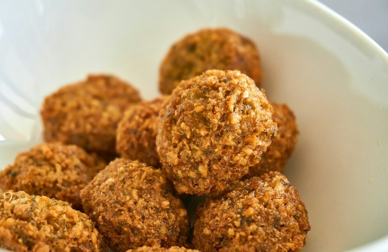

**⏱️ Prep Time:** 15 mins | **🔥 Cook Time:** 13 mins | **⌛ Total:** 28 mins
**🌡️ Air Fryer Temp:** 185°C / 365°F | **👥 Servings:** 4 | **📊 Calories:** 150 kcal
**Macros:** Protein: 4.5g | Carbs: 22g | Fat: 3.8g
**🏷️ Tags:** Nutrient Packed, Vegetarian, Crispy Bites

### 🛒 Ingredients
- 2 cups Fresh spinach (palak), blanched, squeezed dry, and finely chopped
- 1 cup Sweet corn kernels (steamed, half crushed coarsely)
- 2 medium Potatoes, boiled and mashed smooth
- 1/4 cup Paneer or grated cheese (optional)
- 1 Green chili & 1 tsp ginger, minced
- 1/2 tsp Garam masala & 1/2 tsp chaat masala
- 2 tbsp Cornstarch / cornflour
- 1/2 cup Crushed cornflakes or breadcrumbs (for coating)
- 1 tbsp Oil for brushing
- Salt to taste

### 👩‍🍳 Step-by-Step Air Fryer Instructions
1. Ensure blanched spinach is squeezed in a muslin cloth to remove all liquid.
2. In a mixing bowl, combine chopped spinach, sweet corn, mashed potatoes, paneer, chili, ginger, spices, salt, and 1 tbsp cornflour. Knead into a firm dough.
3. Shape mixture into 8 round cutlets.
4. Make a thin slurry with 1 tbsp cornflour and 3 tbsp water. Dip each cutlet in slurry, then dredge in crushed cornflakes, pressing gently so the flakes stick.
5. Preheat the air fryer to 185°C (365°F) for 3 minutes.
6. Brush or spray the coated cutlets with oil.
7. Place cutlets in the air fryer basket in a single layer. Air fry at 185°C for 7 minutes.
8. Flip gently with a spatula, mist tops with oil, and air fry for 5-6 more minutes until cornflake crust is crackling and golden brown.
9. Serve hot.

> [!TIP]
> **Chef's Air Fryer Secret:** Crushed cornflakes create an infinitely crispier crust in convection air fryers than plain breadcrumbs because of their lower moisture absorption.

**🥢 Serving & Pairing:** Mint Mayo and Sweet Chili Dip.

---

## 5. Roasted Makhana & Peanuts

*Crunchy popped lotus water lily seeds roasted with raw red-skin peanuts, curry leaves, and a fragrant pinch of turmeric and black salt.*

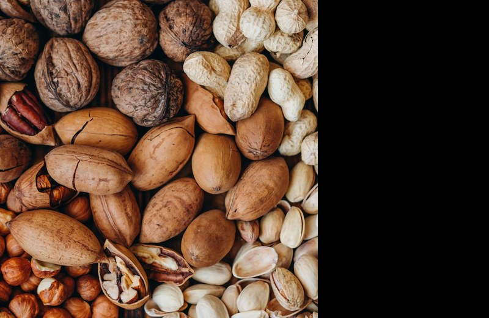

**⏱️ Prep Time:** 5 mins | **🔥 Cook Time:** 9 mins | **⌛ Total:** 14 mins
**🌡️ Air Fryer Temp:** 160°C / 320°F | **👥 Servings:** 4 | **📊 Calories:** 120 kcal
**Macros:** Protein: 4.5g | Carbs: 16g | Fat: 3.5g
**🏷️ Tags:** Guilt Free, High Antioxidant, Tea Time Snack

### 🛒 Ingredients
- 3 cups Fox nuts (phool makhana / lotus seeds)
- 1/2 cup Raw red-skin peanuts
- 10-12 Fresh curry leaves
- 1 Green chili, slit lengthwise
- 1/2 tsp Turmeric powder
- 1/2 tsp Chaat masala
- 1/4 tsp Black pepper powder
- 1 tsp Desi ghee or coconut oil
- Rock salt (sendha namak) or black salt to taste

### 👩‍🍳 Step-by-Step Air Fryer Instructions
1. In a large bowl, toss makhana and peanuts with 1 tsp melted ghee so spices will cling to the porous seeds.
2. Sprinkle turmeric, chaat masala, pepper, salt, torn curry leaves, and green chili. Toss well.
3. Preheat air fryer to 160°C (320°F) for 2 minutes.
4. Transfer spiced makhana and peanuts into the air fryer basket.
5. Air fry at 160°C for 5 minutes.
6. Pull out the basket and shake vigorously. Cook for an additional 3-4 minutes until a makhana pearl crushes cleanly between your fingers with a distinct snap.
7. Cool completely; store in an airtight glass container.

> [!TIP]
> **Chef's Air Fryer Secret:** Keep temperature strictly at 160°C. High temperatures burn the delicate outer shells of makhana before the inner moisture evaporates.

**🥢 Serving & Pairing:** Enjoy as a standalone crunchy accompaniment with afternoon Masala Chai.

---

## 6. Vegetable Spring Rolls

*Paper-thin spring roll wrappers packed with stir-fried crunchy cabbage, carrots, bell peppers, and scallions, air-fried until shatteringly crispy.*

**⏱️ Prep Time:** 20 mins | **🔥 Cook Time:** 13 mins | **⌛ Total:** 33 mins
**🌡️ Air Fryer Temp:** 190°C / 375°F | **👥 Servings:** 4 | **📊 Calories:** 160 kcal / 2 rolls
**Macros:** Protein: 4g | Carbs: 26g | Fat: 4g
**🏷️ Tags:** Indo-Chinese, Party Starter, Golden Crunch

### 🛒 Ingredients
- 8 Spring roll pastry sheets (thawed)
- 1.5 cups Shredded cabbage
- 1/2 cup Grated carrot
- 1/2 cup Thinly sliced capsicum
- 1/4 cup Spring onion greens, chopped
- 1 tbsp Ginger-garlic minced
- 1 tbsp Soy sauce & 1 tsp vinegar
- 1/2 tsp Black pepper powder
- 1 tbsp Cornstarch mixed with 2 tbsp water (sealing glue)
- 1 tbsp Sesame oil for brushing
- Salt to taste

### 👩‍🍳 Step-by-Step Air Fryer Instructions
1. Heat 1 tsp oil in a wok; stir-fry ginger, garlic, and veggies on high flame for 2 minutes until cooked but still crunchy. Add soy sauce, vinegar, pepper, and salt. Cool completely (draining any moisture).
2. Lay a spring roll sheet diagonally. Place 2 tablespoons of vegetable filling near bottom corner.
3. Fold bottom corner over filling, fold left and right corners inward into an envelope, brush edges with cornstarch glue, and roll tightly into a cylinder.
4. Preheat air fryer to 190°C (375°F) for 3 minutes.
5. Brush each roll lightly with sesame oil on all sides.
6. Place rolls seam-side down in the basket without touching. Air fry at 190°C for 7 minutes.
7. Flip rolls over, mist with oil, and air fry for another 5-6 minutes until golden and flaky.
8. Cut diagonally and serve immediately.

> [!TIP]
> **Chef's Air Fryer Secret:** High flame sauté and completely cooling the filling avoids soggy wrappers. Seam-side down placement locks the roll shut in the cyclonic air stream.

**🥢 Serving & Pairing:** Sweet Chili Garlic Sauce and Hot Schezwan Dip.

---

## 7. Air Fryer Falafel

*Herbaceous green chickpea patties packed with fresh parsley, cilantro, toasted cumin, and garlic, air-fried into golden crunchy spheres with moist, vibrant centers.*

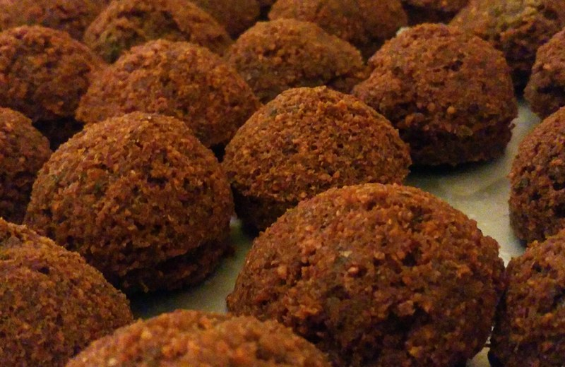

**⏱️ Prep Time:** 15 mins + soaking | **🔥 Cook Time:** 15 mins | **⌛ Total:** 30 mins
**🌡️ Air Fryer Temp:** 190°C / 375°F | **👥 Servings:** 4 | **📊 Calories:** 180 kcal
**Macros:** Protein: 8g | Carbs: 24g | Fat: 5.5g
**🏷️ Tags:** Middle Eastern Classic, Vegan, High Protein

### 🛒 Ingredients
- 1 cup Dried chickpeas (kabuli chana), soaked overnight (do NOT use canned!)
- 1 cup Fresh parsley and cilantro leaves, packed
- 1 small Onion, roughly chopped
- 4 Garlic cloves
- 1 Green chili
- 1 tbsp Toasted cumin seeds & 1 tbsp coriander seeds, ground
- 1/2 tsp Baking soda (for airy interior)
- 2 tbsp Chickpea flour / all-purpose flour (if needed for binding)
- 1 tbsp Olive oil for brushing
- 1 tsp Salt

### 👩‍🍳 Step-by-Step Air Fryer Instructions
1. Drain soaked chickpeas and dry thoroughly on a clean towel. Pulse chickpeas, parsley, cilantro, onion, garlic, chili, and spices in a food processor until it forms a coarse meal (not a puree).
2. Stir in salt and baking soda. Refrigerate mixture for 30 minutes to firm up.
3. Using a falafel scoop or wet hands, shape mixture into 12 small flattened discs or golf-ball-sized spheres.
4. Preheat air fryer to 190°C (375°F) for 4 minutes.
5. Brush or spray falafels generously with olive oil.
6. Arrange falafels in a single layer in the air fryer basket with space between each.
7. Air fry at 190°C for 8 minutes.
8. Carefully flip falafels, brush again with olive oil, and air fry for 6-7 more minutes until deep golden brown on the outside and cooked through inside.
9. Serve warm.

> [!TIP]
> **Chef's Air Fryer Secret:** Never use canned cooked chickpeas! Soaked raw chickpeas contain the native starch needed to bind the patties and create an ultra-crispy shell.

**🥢 Serving & Pairing:** Silky Creamy Hummus, Tahini Sauce, and Pickled Vegetables.

---

## 8. Air Fryer Aloo Tikki

*Authentic Delhi street-style spiced potato cutlets with a shatteringly crisp exterior, stuffed with seasoned chana dal and green peas, air-fried with minimal oil.*

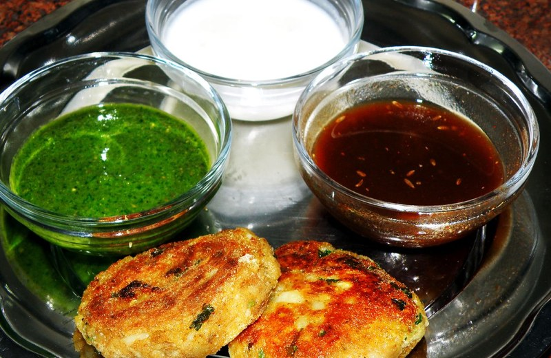

**⏱️ Prep Time:** 15 mins | **🔥 Cook Time:** 16 mins | **⌛ Total:** 31 mins
**🌡️ Air Fryer Temp:** 190°C / 375°F | **👥 Servings:** 4 | **📊 Calories:** 170 kcal
**Macros:** Protein: 3.5g | Carbs: 30g | Fat: 4g
**🏷️ Tags:** Delhi Street Food, Chaat King, Crispy Potato

### 🛒 Ingredients
- 3 large Russet or Yukon gold potatoes, boiled, peeled, and refrigerated for 2 hours
- 2 tbsp Cornflour (cornstarch) or rice flour
- 1/3 cup Boiled chana dal (split Bengal gram), drained dry (for stuffing)
- 1/4 cup Boiled green peas, crushed
- 1 Green chili & 1 tsp ginger, minced
- 1/2 tsp Roasted cumin powder & 1/2 tsp chaat masala
- 1/2 tsp Amchur (dry mango powder)
- 2 tbsp Fresh coriander leaves
- 1 tbsp Ghee or mustard oil for brushing
- Salt to taste

### 👩‍🍳 Step-by-Step Air Fryer Instructions
1. Grate chilled potatoes smooth; knead with cornstarch, salt, and 1/2 tsp cumin powder into a smooth dough.
2. Prepare stuffing: mix boiled chana dal, crushed green peas, ginger, chili, amchur, chaat masala, and salt.
3. Divide potato dough into 6 balls. Flatten a ball in palm, place 1 tablespoon of spiced dal filling in center, bring edges together, seal, and shape into a 3/4-inch thick round patty.
4. Preheat the air fryer to 190°C (375°F) for 4 minutes.
5. Brush both sides of the tikkis generously with ghee or oil.
6. Place tikkis in the air fryer basket in a single layer.
7. Air fry at 190°C for 9 minutes.
8. Flip tikkis carefully with silicone tongs, brush lightly with ghee, and air fry for another 6-7 minutes until the outer crust is crackling and deep golden brown.
9. Assemble immediately with chaat toppings or serve hot.

> [!TIP]
> **Chef's Air Fryer Secret:** Refrigerating boiled potatoes overnight or for 2 hours removes free moisture, resulting in crisp tikkis that never split open in the air fryer.

**🥢 Serving & Pairing:** Whisked Sweet Dahi, Green Chutney, Saunth, and Crunchy Sev.

---

## 9. Air Fryer Paneer Pakora

*Thick paneer sandwiches filled with green chutney, dipped in a spiced, thick chickpea flour batter with a hint of carom seeds, air-fried onto perforated parchment.*

**⏱️ Prep Time:** 15 mins | **🔥 Cook Time:** 12 mins | **⌛ Total:** 27 mins
**🌡️ Air Fryer Temp:** 190°C / 375°F | **👥 Servings:** 4 | **📊 Calories:** 210 kcal
**Macros:** Protein: 11g | Carbs: 16g | Fat: 11g
**🏷️ Tags:** Monsoon Craving, High Protein, Vegetarian

### 🛒 Ingredients
- 200g Fresh paneer, sliced into 8 squares (1/2-inch thick)
- 2 tbsp Thick mint-coriander chutney (for sandwiching)
- 1 cup Besan (gram flour)
- 1.5 tbsp Rice flour (for extra crunch)
- 1/2 tsp Ajwain (carom seeds)
- 1/2 tsp Turmeric & 1/2 tsp red chili powder
- 1/4 tsp Baking soda
- 1/2 cup Water (for very thick batter)
- 1 tbsp Oil (for batter and brushing)
- Salt to taste

### 👩‍🍳 Step-by-Step Air Fryer Instructions
1. Slit each paneer square horizontally down the center to make a pocket, or take two thin slices. Spread a layer of mint chutney inside and press gently together.
2. In a bowl, whisk besan, rice flour, ajwain, turmeric, chili powder, salt, and 1 tsp hot oil. Add water gradually to make a thick, coating batter (it should coat the back of a spoon thickly). Fold in baking soda.
3. Preheat air fryer to 190°C (375°F) for 4 minutes.
4. Line the air fryer basket with perforated parchment paper and mist lightly with oil.
5. Dip stuffed paneer squares into the thick batter, letting excess drip off for 3 seconds, and place immediately onto the parchment paper in the basket.
6. Air fry at 190°C for 6 minutes.
7. Carefully peel the pakoras off the paper, flip over onto the wire basket, brush with a touch of oil, and air fry for another 5-6 minutes until golden and crisp.
8. Sprinkle with chaat masala and serve.

> [!TIP]
> **Chef's Air Fryer Secret:** Perforated parchment prevents wet batter from dripping through the basket wire grates during the first 6 minutes until the crust sets firmly.

**🥢 Serving & Pairing:** Pudina Chutney and Steaming Masala Chai.

---

## 10. Crispy Chana Chaat Crisps

*Boiled chickpeas tossed with olive oil and aromatic spices, roasted until shatteringly crisp like corn nuts, then tossed with chopped onions, tomatoes, and lemon.*

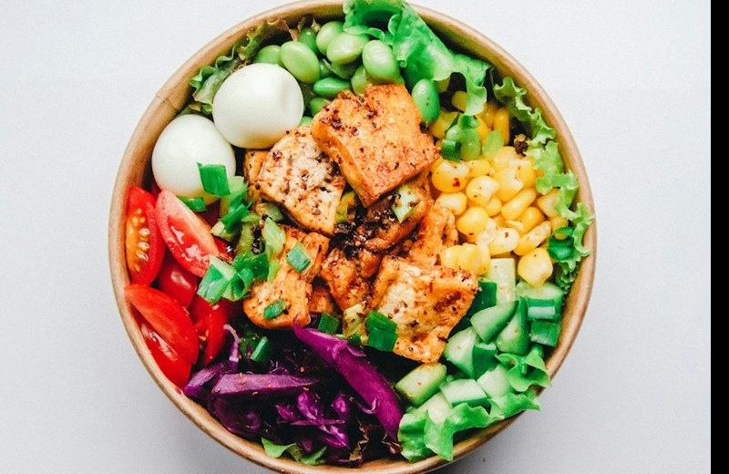

**⏱️ Prep Time:** 10 mins | **🔥 Cook Time:** 16 mins | **⌛ Total:** 26 mins
**🌡️ Air Fryer Temp:** 180°C / 360°F | **👥 Servings:** 4 | **📊 Calories:** 140 kcal
**Macros:** Protein: 7g | Carbs: 22g | Fat: 3g
**🏷️ Tags:** High Protein Snack, Vegan, Gluten-Free

### 🛒 Ingredients
- 2 cups Boiled or canned chickpeas (kabuli chana), rinsed and completely dried
- 1 tbsp Olive oil
- 1 tsp Chaat masala
- 1/2 tsp Roasted cumin powder
- 1/2 tsp Kashmiri red chili powder
- 1/4 tsp Black salt (kala namak)
- For Chaat Toss: 1/4 cup diced onion, 1/4 cup diced tomato, 1 green chili, 2 tbsp coriander, 1 tbsp lemon juice

### 👩‍🍳 Step-by-Step Air Fryer Instructions
1. Roll chickpeas between two kitchen towels to absorb all exterior moisture. Discard any loose skins.
2. Toss dry chickpeas with 1 tbsp olive oil and half the spice blend (cumin, chili powder, and salt).
3. Preheat the air fryer to 180°C (360°F) for 3 minutes.
4. Spread chickpeas across the air fryer basket in a single layer.
5. Air fry at 180°C for 10 minutes.
6. Shake the basket vigorously to rotate the chickpeas and air fry for another 5-6 minutes until light, golden, and hollowly crunchy.
7. Transfer immediately to a bowl; toss with chaat masala, diced onions, tomatoes, green chili, coriander, and fresh lemon juice while warm.
8. Serve immediately.

> [!TIP]
> **Chef's Air Fryer Secret:** If storing as a travel snack, omit fresh vegetables and let chickpeas cool completely in the air fryer basket; they will remain crispy for up to 2 weeks.

**🥢 Serving & Pairing:** Chilled Mint Buttermilk or Lemon Soda.

---

## 11. Air Fryer Gobi 65 (Crispy Cauliflower)

*Tender cauliflower florets coated in a fiery yogurt, curry leaf, and South Indian spice marinade, air-fried until craggy and crunchy with zero deep frying.*

**⏱️ Prep Time:** 15 mins | **🔥 Cook Time:** 15 mins | **⌛ Total:** 30 mins
**🌡️ Air Fryer Temp:** 190°C / 375°F | **👥 Servings:** 4 | **📊 Calories:** 145 kcal
**Macros:** Protein: 4g | Carbs: 22g | Fat: 4.5g
**🏷️ Tags:** South Indian 65, Restaurant Favorite, Spicy & Tangy

### 🛒 Ingredients
- 1 medium Cauliflower head (gobi), cut into bite-sized florets
- 2 tbsp Thick yogurt (curd)
- 2 tbsp Cornstarch / cornflour
- 2 tbsp Rice flour (for signature 65 crunch)
- 1 tbsp Ginger-garlic paste
- 1 tbsp Kashmiri red chili powder (for red color)
- 1 tsp Garam masala & 1/2 tsp black pepper
- 10-12 Fresh curry leaves, torn
- 1 Green chili, slit
- 1 tbsp Oil for coating + cooking spray
- Salt to taste

### 👩‍🍳 Step-by-Step Air Fryer Instructions
1. Blanch cauliflower florets in boiling salted water for 2 minutes; drain thoroughly and pat dry with paper towels.
2. In a bowl, mix yogurt, ginger-garlic paste, chili powder, garam masala, pepper, salt, torn curry leaves, and 1 tbsp oil.
3. Add florets and toss until coated. Sprinkle cornstarch and rice flour over florets; toss until a dryish, craggy paste coats each piece.
4. Preheat air fryer to 190°C (375°F) for 4 minutes.
5. Arrange florets in the basket without overcrowding.
6. Air fry at 190°C for 8 minutes.
7. Shake basket, spray a light mist of oil over florets, add slit green chili and remaining curry leaves into the basket, and air fry for 6-7 more minutes until crispy and blistered.
8. Serve immediately garnished with lemon wedges.

> [!TIP]
> **Chef's Air Fryer Secret:** Drying the blanched florets completely before adding the flour ensures the coating clings tightly to the florets and doesn't separate during air circulation.

**🥢 Serving & Pairing:** Sliced Red Onions, Lemon Wedges, and Garlic Dip.

---

## 12. Air Fryer Paneer 65

*Bite-sized cubes of cottage cheese tossed in a zesty South Indian spiced rice flour and curd crust, air-fried until crackly outside while preserving the creamy center.*

**⏱️ Prep Time:** 15 mins | **🔥 Cook Time:** 12 mins | **⌛ Total:** 27 mins
**🌡️ Air Fryer Temp:** 190°C / 375°F | **👥 Servings:** 3 | **📊 Calories:** 230 kcal
**Macros:** Protein: 13g | Carbs: 12g | Fat: 14g
**🏷️ Tags:** High Protein, Spicy Appetizer, Vegetarian

### 🛒 Ingredients
- 250g Paneer, cut into 3/4-inch cubes
- 2 tbsp Whisked yogurt (dahi)
- 1.5 tbsp Cornflour
- 1.5 tbsp Rice flour
- 1 tbsp Ginger-garlic paste
- 1 tbsp Kashmiri chili powder
- 1 tsp Coriander powder & 1/2 tsp cumin powder
- 12 Curry leaves & 2 green chilies, slit
- 1 tbsp Oil for marinade
- Lemon juice and salt to taste

### 👩‍🍳 Step-by-Step Air Fryer Instructions
1. Pat paneer cubes dry with paper towels.
2. In a bowl, mix yogurt, ginger-garlic paste, chili powder, spices, lemon juice, salt, and oil.
3. Gently coat paneer cubes in the paste. Dust cornflour and rice flour over top and toss until coated.
4. Preheat the air fryer to 190°C (375°F) for 4 minutes.
5. Place paneer cubes in a single layer in the basket.
6. Air fry at 190°C for 6 minutes.
7. Turn cubes over, add curry leaves and slit green chilies into the basket, mist lightly with oil, and air fry for another 5-6 minutes until the edges are golden red and crisp.
8. Serve hot right out of the fryer.

> [!TIP]
> **Chef's Air Fryer Secret:** Do not overcook paneer beyond 12 minutes! The high heat (190°C) crisps the rice flour crust quickly before the paneer can lose its internal moisture.

**🥢 Serving & Pairing:** Curry Leaf Tempering and Mint Yogurt Dip.

---

## 13. Air Fryer Vegetable Momos

*Delicate handmade flour dumplings stuffed with finely minced vegetables, ginger, and garlic, air-fried into golden kothay-style potstickers with crunchy bottoms.*

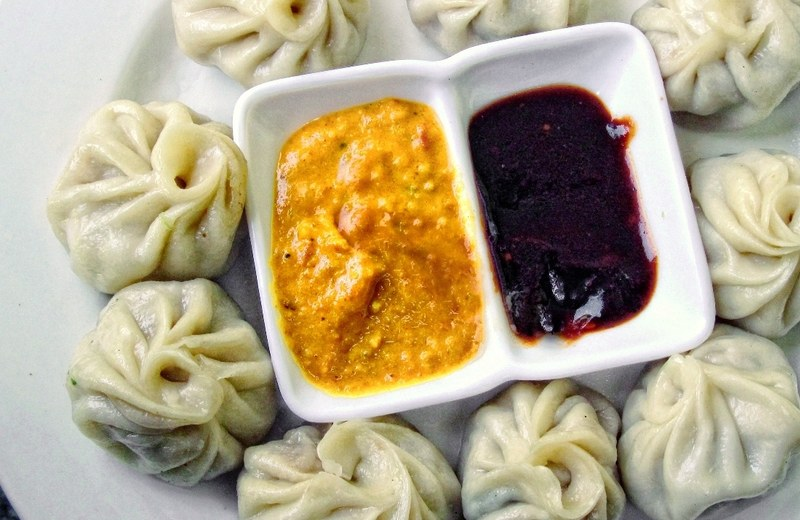

**⏱️ Prep Time:** 25 mins | **🔥 Cook Time:** 11 mins | **⌛ Total:** 36 mins
**🌡️ Air Fryer Temp:** 180°C / 360°F | **👥 Servings:** 4 | **📊 Calories:** 150 kcal / 4 pieces
**Macros:** Protein: 4g | Carbs: 28g | Fat: 3g
**🏷️ Tags:** Tibetan / Himalayan, Crispy Dumplings, Street Food

### 🛒 Ingredients
- 1 cup All-purpose flour (maida) + water to knead a soft dough
- 1.5 cups Finely grated cabbage, squeezed dry
- 1/2 cup Finely grated carrots
- 1/4 cup Finely diced onions & spring onion greens
- 1 tbsp Ginger & garlic, minced
- 1 tsp Soy sauce & 1/2 tsp black pepper
- 1 tsp Sesame oil
- Water in a spray bottle (essential for moisture)
- 1 tbsp Oil for brushing
- Salt to taste

### 👩‍🍳 Step-by-Step Air Fryer Instructions
1. Knead flour and water into a smooth dough; rest 15 minutes. Prepare stuffing: mix cabbage, carrots, onions, ginger, garlic, soy sauce, pepper, sesame oil, and salt.
2. Roll small dough balls into thin 3-inch rounds with thinner edges. Place 1 tablespoon stuffing in center, pleat edges around filling, and twist top to seal.
3. Preheat air fryer to 180°C (360°F) for 3 minutes.
4. Lightly brush momos with oil and arrange in the air fryer basket.
5. Mist momos with a fine spray of water (this creates steam to cook the dough through).
6. Air fry at 180°C for 6 minutes.
7. Flip momos, spray once more with water mist and brush light oil on bottoms. Air fry for 4-5 minutes until the dumpling skin is blistered and crunchy.
8. Serve piping hot.

> [!TIP]
> **Chef's Air Fryer Secret:** Spraying with a water mister during air frying mimics the potsticker technique, ensuring the wrapper cooks through tenderly while crisping up blistered and golden.

**🥢 Serving & Pairing:** Fiery Red Schezwan Chili Garlic Chutney.

---

## 14. Air Fryer Cheese Corn Balls

*Golden spheres packed with sweet corn, mashed potatoes, and mozzarella cheese, encased in a double breadcrumb crust that creates an irresistible molten cheese pull.*

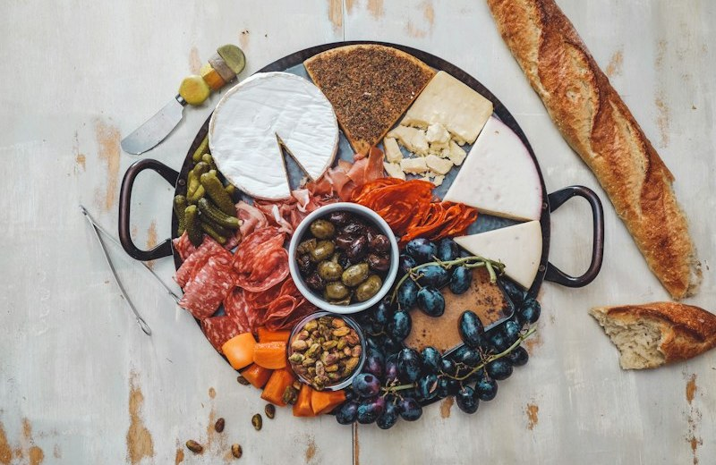

**⏱️ Prep Time:** 20 mins + chilling | **🔥 Cook Time:** 11 mins | **⌛ Total:** 31 mins
**🌡️ Air Fryer Temp:** 180°C / 360°F | **👥 Servings:** 4 | **📊 Calories:** 210 kcal
**Macros:** Protein: 8g | Carbs: 22g | Fat: 9.5g
**🏷️ Tags:** Kids Special, Cheese Pull, Party Starter

### 🛒 Ingredients
- 1 cup Sweet corn kernels, steamed and coarsely crushed
- 2 medium Potatoes, boiled and mashed smooth
- 3/4 cup Shredded mozzarella or processed cheese
- 1/4 cup Finely diced capsicum
- 1/2 tsp Oregano & 1/2 tsp chili flakes
- 1/2 tsp Black pepper & pinch of nutmeg
- 3 tbsp All-purpose flour + water (to make a slurry)
- 1 cup Panko breadcrumbs (for ultimate crunch)
- 1 tbsp Oil for brushing
- Salt to taste

### 👩‍🍳 Step-by-Step Air Fryer Instructions
1. In a bowl, mix mashed potatoes, crushed corn, capsicum, oregano, chili flakes, pepper, and salt into a smooth dough.
2. Flatten a portion of dough, place a generous tablespoon of cheese in the center, and roll tightly into a sealed sphere (no cracks!).
3. Dip ball into flour-water slurry, then roll in panko breadcrumbs. Dip in slurry a second time and roll in breadcrumbs again (double coat locks the cheese).
4. Freeze coated balls for 20 minutes before air frying.
5. Preheat air fryer to 180°C (360°F) for 3 minutes.
6. Brush or spray the cold cheese balls with cooking oil.
7. Place balls in the air fryer basket with space between them. Air fry at 180°C for 6 minutes.
8. Gently roll the balls over, mist with oil, and air fry for 4-5 minutes until deep golden brown and crunchy.
9. Serve immediately for the ultimate cheese stretch.

> [!TIP]
> **Chef's Air Fryer Secret:** Double breadcrumb coating and chilling in the freezer for 20 minutes prevents cheese from bursting out into the basket before the crust has browned.

**🥢 Serving & Pairing:** Chipotle Mayo or Marinara Sauce.

---

## 15. Air Fryer Onion Pakora (Kanda Bhaji)

*Authentic Mumbai street-style craggy onion fritters, made without added water by drawing out the natural onion juices, air-fried to a crackling golden crisp.*

**⏱️ Prep Time:** 15 mins | **🔥 Cook Time:** 15 mins | **⌛ Total:** 30 mins
**🌡️ Air Fryer Temp:** 180°C / 360°F | **👥 Servings:** 4 | **📊 Calories:** 160 kcal
**Macros:** Protein: 5.5g | Carbs: 22g | Fat: 4.5g
**🏷️ Tags:** Monsoon Classic, Street Food, Vegan

### 🛒 Ingredients
- 3 large Red onions, thinly sliced lengthwise
- 3/4 cup Besan (gram flour)
- 2 tbsp Rice flour (for craggy crisp edges)
- 2 Green chilies, finely chopped
- 1 tsp Ajwain (carom seeds), rubbed between palms
- 1/2 tsp Turmeric powder & 1/2 tsp Kashmiri chili powder
- 2 tbsp Fresh coriander leaves, chopped
- 1 tbsp Warm oil (mixed into onions)
- Salt to taste

### 👩‍🍳 Step-by-Step Air Fryer Instructions
1. Place sliced onions in a bowl; add salt and rub vigorously with fingers. Let rest 5 minutes until onions release moisture.
2. Add green chilies, ajwain, turmeric, chili powder, coriander, and 1 tbsp warm oil. Mix well.
3. Sprinkle besan and rice flour over onions gradually. Toss until a thick, sticky coating wraps each onion strand (do NOT add water!).
4. Preheat air fryer to 180°C (360°F) for 4 minutes.
5. Line the basket with a perforated parchment paper sheet and spray with oil.
6. Drop loose, craggy clusters of the onion mixture onto the parchment (avoid pressing into dense balls; loose strands crisp best).
7. Air fry at 180°C for 8 minutes.
8. Carefully turn pakoras over, spray a light mist of oil, and air fry for 6-7 more minutes until deep golden, craggy, and crisp.
9. Serve immediately with fried green chilies.

> [!TIP]
> **Chef's Air Fryer Secret:** Never add water! Relying purely on the natural moisture released by salted onions makes the pakoras light and crisp rather than heavy and doughy.

**🥢 Serving & Pairing:** Salted Fried Green Chilies and Cutting Masala Chai.

---

## 16. Air Fryer Sabudana Tikki

*Tapioca pearls, mashed potatoes, and crushed roasted peanuts seasoned with green chilies and cumin, air-fried into light, puffed cutlets with crackling shells.*

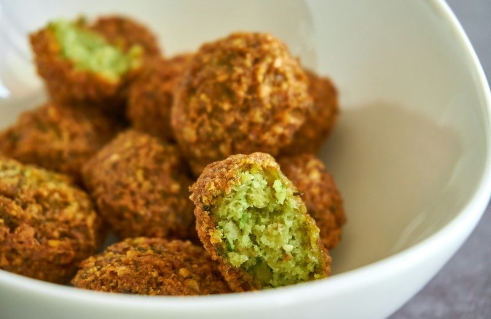

**⏱️ Prep Time:** 15 mins + soaking | **🔥 Cook Time:** 15 mins | **⌛ Total:** 30 mins
**🌡️ Air Fryer Temp:** 190°C / 375°F | **👥 Servings:** 4 | **📊 Calories:** 205 kcal
**Macros:** Protein: 4.5g | Carbs: 36g | Fat: 5g
**🏷️ Tags:** Fasting / Vrat, Gluten-Free, Festive Favorite

### 🛒 Ingredients
- 1 cup Sabudana (tapioca pearls), soaked and drained dry
- 2 medium Potatoes, boiled and mashed smooth
- 1/2 cup Roasted peanuts, coarsely crushed
- 2 Green chilies, finely minced
- 1 tsp Cumin seeds (jeera)
- 1 tbsp Lemon juice
- 2 tbsp Coriander leaves, chopped
- 1 tbsp Peanut oil or ghee for brushing
- Rock salt (sendha namak) to taste

### 👩‍🍳 Step-by-Step Air Fryer Instructions
1. In a bowl, mix soaked sabudana, mashed potatoes, peanut powder, green chilies, cumin seeds, lemon juice, salt, and coriander until smooth.
2. Shape into 8 flat round tikkis. Smooth the edges with oiled fingers.
3. Preheat air fryer to 190°C (375°F) for 4 minutes.
4. Brush both sides of the tikkis with peanut oil or ghee.
5. Place tikkis in the air fryer basket leaving 1/2 inch space between each.
6. Air fry at 190°C for 8 minutes.
7. Flip gently with a spatula, brush lightly with oil, and air fry for 6-7 minutes until the pearls blister and turn golden crisp.
8. Serve hot.

> [!TIP]
> **Chef's Air Fryer Secret:** Smooth out any cracks on the edges of the tikkis before air frying to prevent individual tapioca pearls from bursting under high heat.

**🥢 Serving & Pairing:** Sweet Fasting Curd Dip and Mint Coriander Chutney.

---

## 17. Air Fryer Beetroot Cutlets

*Stunning ruby-red cutlets made with grated beetroot, carrots, and potatoes, dredged in semolina (rava) and air-fried for a crackly crust over an earthy, sweet center.*

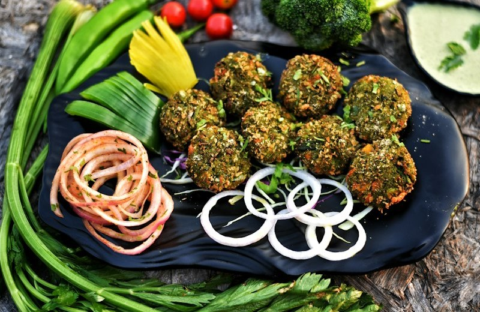

**⏱️ Prep Time:** 15 mins | **🔥 Cook Time:** 13 mins | **⌛ Total:** 28 mins
**🌡️ Air Fryer Temp:** 180°C / 360°F | **👥 Servings:** 4 | **📊 Calories:** 145 kcal
**Macros:** Protein: 3.8g | Carbs: 26g | Fat: 3.2g
**🏷️ Tags:** Vibrant Ruby, Healthy Snack, High Iron

### 🛒 Ingredients
- 1.5 cups Beetroot, grated
- 1/2 cup Carrot, grated
- 2 medium Potatoes, boiled and mashed
- 1 Green chili & 1 tsp ginger, minced
- 1/2 tsp Cumin powder & 1/2 tsp garam masala
- 1/2 tsp Amchur powder
- 2 tbsp Roasted peanuts, crushed
- 1/3 cup Semolina (rava) for dredging
- 1 tbsp Oil for brushing
- Salt to taste

### 👩‍🍳 Step-by-Step Air Fryer Instructions
1. Sauté grated beetroot and carrot in a pan with 1/2 tsp oil for 3 minutes to evaporate surface liquid. Let cool.
2. Mix sautéed veggies with mashed potatoes, ginger, chili, spices, peanuts, and salt. Shape into 8 heart-shaped or round patties.
3. Roll each patty in semolina (rava) to coat evenly on all sides.
4. Preheat air fryer to 180°C (360°F) for 3 minutes.
5. Brush or spray the rava-coated cutlets lightly with oil.
6. Place cutlets in the air fryer basket in a single layer. Air fry at 180°C for 7 minutes.
7. Flip carefully, spray lightly with oil, and air fry for another 5-6 minutes until the rava coating is golden and crisp.
8. Serve hot.

> [!TIP]
> **Chef's Air Fryer Secret:** Lightly sautéing the grated beetroot first is essential to reduce moisture so the cutlets crisp up quickly without becoming mushy inside.

**🥢 Serving & Pairing:** Thick Garlic Yogurt Dip and Green Mint Chutney.

---

## 18. Air Fryer Whole Wheat Mathri

*Flaky Punjabi tea-time crackers made from whole wheat flour, ajwain, and dried fenugreek leaves (kasuri methi), air-fried to golden, crisp perfection.*

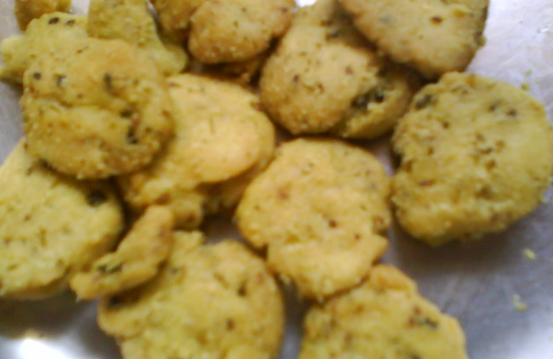

**⏱️ Prep Time:** 15 mins | **🔥 Cook Time:** 15 mins | **⌛ Total:** 30 mins
**🌡️ Air Fryer Temp:** 170°C / 340°F | **👥 Servings:** 6 | **📊 Calories:** 110 kcal / 2 mathris
**Macros:** Protein: 3g | Carbs: 16g | Fat: 4g
**🏷️ Tags:** Festive Classic, Whole Wheat, Long Shelf Life

### 🛒 Ingredients
- 1.5 cups Whole wheat flour (atta)
- 2 tbsp Fine semolina (rava) for crunch
- 3 tbsp Melted ghee or oil (moyen)
- 1 tsp Ajwain (carom seeds), crushed
- 1 tbsp Kasuri methi (dry fenugreek leaves), crushed
- 1/2 tsp Coarsely crushed black peppercorns
- 1/3 cup Luke-warm water
- 1 tsp Oil for brushing
- Salt to taste

### 👩‍🍳 Step-by-Step Air Fryer Instructions
1. Rub flour, rava, ajwain, kasuri methi, crushed pepper, salt, and ghee together with fingertips until mixture forms clumps when squeezed.
2. Add lukewarm water gradually and knead into a very stiff, tight dough. Rest for 15 minutes.
3. Pinch small portions of dough, roll into balls, and press flat between palms (1/4-inch thick). Prick each mathri 4-5 times with a fork on both sides.
4. Preheat air fryer to 170°C (340°F) for 4 minutes.
5. Brush mathris lightly with oil.
6. Arrange mathris in a single layer in the air fryer basket (do not overlap).
7. Air fry at 170°C for 8 minutes.
8. Turn mathris over and air fry for another 6-7 minutes until pale golden and cooked through.
9. Cool completely on a wire rack; mathris will become shatteringly crisp as they cool.

> [!TIP]
> **Chef's Air Fryer Secret:** Air fry at moderate heat (170°C) rather than high heat. This bakes the thick dough evenly to the center for that classic flaky, layered khasta texture.

**🥢 Serving & Pairing:** Authentic Mango Pickle (Aam ka Achar) and Hot Chai.

---

## 19. Air Fryer Vegetable Nuggets

*Golden crumbed vegetable fingers packed with finely diced carrots, peas, corn, and potatoes, air-fried with a feather-light oil mist into crunchy nuggets.*

**⏱️ Prep Time:** 15 mins | **🔥 Cook Time:** 13 mins | **⌛ Total:** 28 mins
**🌡️ Air Fryer Temp:** 190°C / 375°F | **👥 Servings:** 4 | **📊 Calories:** 155 kcal
**Macros:** Protein: 4.2g | Carbs: 24g | Fat: 4.5g
**🏷️ Tags:** Kids Lunchbox, Crunchy Bites, Vegetarian

### 🛒 Ingredients
- 2 cups Steamed finely chopped mixed vegetables (carrots, green peas, sweet corn, beans)
- 2 medium Potatoes, boiled and mashed
- 1/2 tsp Garlic powder & 1/2 tsp onion powder
- 1/2 tsp Mixed Italian herbs & 1/4 tsp black pepper
- 2 tbsp Cornstarch + 3 tbsp water (slurry)
- 1 cup Panko breadcrumbs
- 1 tbsp Olive oil for brushing
- Salt to taste

### 👩‍🍳 Step-by-Step Air Fryer Instructions
1. Mix mashed potatoes, steamed veggies, garlic powder, onion powder, herbs, pepper, and salt into a firm mixture.
2. Shape into rectangular nugget batons or small oval shapes.
3. Dip each nugget into the cornstarch slurry, then roll in panko breadcrumbs until completely covered.
4. Preheat air fryer to 190°C (375°F) for 3 minutes.
5. Brush or spray nuggets lightly with olive oil.
6. Place nuggets in the basket with space between each. Air fry at 190°C for 7 minutes.
7. Flip gently with tongs, mist with oil, and air fry for another 5-6 minutes until golden brown and crackling.
8. Serve hot.

> [!TIP]
> **Chef's Air Fryer Secret:** Panko breadcrumbs are essential for that restaurant-grade crunchy crust in the air fryer because of their coarse, airy texture.

**🥢 Serving & Pairing:** Creamy Garlic Dip or Sweet Tomato Ketchup.

---

## 20. Air Fryer Roasted Masala Papad

*Lentil papad roasted in minutes without open flame scorch, topped with a zesty salad of crunchy red onions, tomatoes, fresh cilantro, chaat masala, and lemon.*

**⏱️ Prep Time:** 5 mins | **🔥 Cook Time:** 3 mins | **⌛ Total:** 8 mins
**🌡️ Air Fryer Temp:** 180°C / 360°F | **👥 Servings:** 2 | **📊 Calories:** 65 kcal
**Macros:** Protein: 3g | Carbs: 11g | Fat: 0.8g
**🏷️ Tags:** Low Calorie, Instant Starter, Gluten-Free

### 🛒 Ingredients
- 2 Lentil papads (urad dal / pepper papad)
- 1/3 cup Finely diced red onions
- 1/3 cup Finely diced tomatoes (deseeded)
- 1 Green chili, finely chopped
- 2 tbsp Fresh coriander, chopped
- 1/2 tsp Chaat masala & 1/4 tsp red chili powder
- 1 tbsp Lemon juice
- Salt to taste

### 👩‍🍳 Step-by-Step Air Fryer Instructions
1. Preheat air fryer to 180°C (360°F) for 2 minutes.
2. Place a papad in the air fryer basket. Place a small lightweight heatproof wire rack or spoon on top of the papad (this prevents convection air from blowing the light papad into the heating element).
3. Air fry at 180°C for 2 to 2.5 minutes until puffed and evenly speckled white-gold.
4. Remove immediately and let cool on a plate (it crisps up within 30 seconds).
5. In a bowl, toss chopped onions, tomatoes, chili, coriander, chaat masala, salt, and lemon juice.
6. Spoon vegetable mixture evenly over the roasted papad just before serving.
7. Enjoy immediately while crunchy.

> [!TIP]
> **Chef's Air Fryer Secret:** Weigh down the papad with a lightweight metal rack or fork! The intense cyclonic fan in an air fryer will lift a bare papad straight into the upper coil if unweighted.

**🥢 Serving & Pairing:** Serve as a crunchy appetizer alongside any Indian meal or beverage.

---

## 21. Air Fryer Aloo Bread Roll

*Crusty bread rolls enclosing a spiced potato, green pea, and fresh ginger stuffing, air-fried to a crackling golden mahogany shell with 85% less oil.*

**⏱️ Prep Time:** 15 mins | **🔥 Cook Time:** 13 mins | **⌛ Total:** 28 mins
**🌡️ Air Fryer Temp:** 190°C / 375°F | **👥 Servings:** 4 | **📊 Calories:** 175 kcal / roll
**Macros:** Protein: 4.5g | Carbs: 30g | Fat: 4.2g
**🏷️ Tags:** Tea Time Snack, Crispy Crust, Comfort Food

### 🛒 Ingredients
- 6 slices White or sandwich bread, crusts trimmed
- 2 large Potatoes, boiled, peeled and mashed
- 1/3 cup Boiled green peas
- 1 Green chili & 1 tsp ginger, minced
- 1/2 tsp Cumin powder & 1/2 tsp garam masala
- 1/2 tsp Chaat masala & 1/2 tsp amchur
- 2 tbsp Coriander leaves, chopped
- Water in a shallow bowl (for dipping bread)
- 1 tbsp Oil for brushing
- Salt to taste

### 👩‍🍳 Step-by-Step Air Fryer Instructions
1. Mix mashed potatoes, peas, chili, ginger, spices, salt, and coriander into a firm stuffing. Shape into 6 oval logs.
2. Dip a slice of bread into water for 1 second; immediately press flat between palms to squeeze out all water completely.
3. Place a potato log in the center of the damp flattened bread. Fold edges around the filling and press firmly to seal into a smooth cylindrical roll.
4. Preheat air fryer to 190°C (375°F) for 3 minutes.
5. Brush each roll lightly with oil on all sides.
6. Place rolls in the air fryer basket without touching. Air fry at 190°C for 7 minutes.
7. Rotate rolls, brush lightly with oil, and air fry for another 5-6 minutes until deep golden brown and crunchy all over.
8. Serve hot with chutneys.

> [!TIP]
> **Chef's Air Fryer Secret:** Squeeze out all moisture from the bread so it absorbs the circulating hot air instantly instead of steaming from within.

**🥢 Serving & Pairing:** Tangy Mint Chutney and Sweet Imli Chutney.

---

## 22. Air Fryer Corn Cheese Toast

*Crusty bread topped with sweet corn kernels, melted mozzarella cheese, finely chopped capsicum, and chili flakes, toasted until bubbly and golden.*

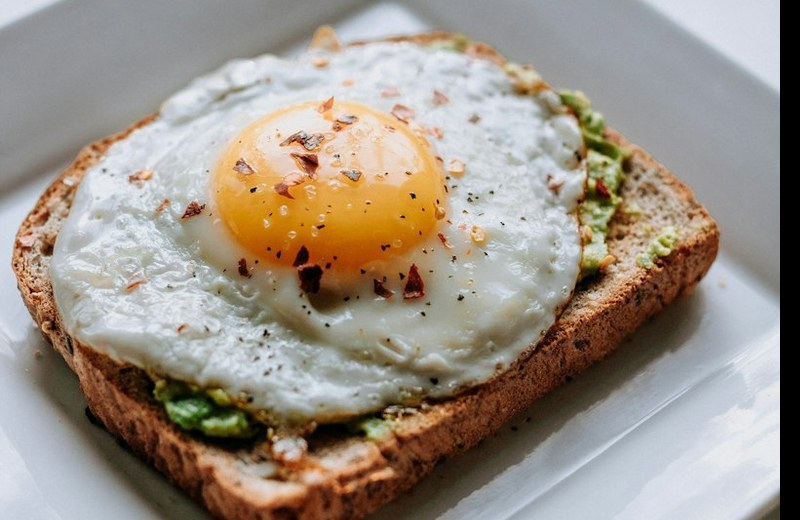

**⏱️ Prep Time:** 10 mins | **🔥 Cook Time:** 8 mins | **⌛ Total:** 18 mins
**🌡️ Air Fryer Temp:** 180°C / 360°F | **👥 Servings:** 3 | **📊 Calories:** 210 kcal
**Macros:** Protein: 8g | Carbs: 24g | Fat: 8.5g
**🏷️ Tags:** Café Style, Melted Cheese, Kids Favorite

### 🛒 Ingredients
- 4 slices Sourdough or whole wheat bread
- 3/4 cup Sweet corn kernels, steamed
- 1/2 cup Shredded mozzarella or cheddar cheese
- 1/4 cup Capsicum, finely minced
- 1 Green chili, finely chopped
- 1/2 tsp Mixed Italian herbs & 1/2 tsp chili flakes
- 1 tbsp Butter for brushing
- Salt to taste

### 👩‍🍳 Step-by-Step Air Fryer Instructions
1. In a bowl, mix steamed corn, cheese, capsicum, chili, herbs, chili flakes, and a pinch of salt.
2. Preheat air fryer to 180°C (360°F) for 2 minutes.
3. Butter the bottom side of the bread slices lightly.
4. Mound the corn-cheese mixture generously on top of each slice, pressing down gently so it adheres.
5. Place toasts side-by-side in the air fryer basket.
6. Air fry at 180°C for 7-8 minutes until cheese is completely melted, bubbling, and speckled golden brown.
7. Slice diagonally and serve immediately.

> [!TIP]
> **Chef's Air Fryer Secret:** Press the cheese down firmly onto the bread before sliding the basket in so the high-speed air fan doesn't blow light shreds into the heating coils.

**🥢 Serving & Pairing:** Classic Tomato Ketchup or Garlic Butter Sauce.

---

## 23. Air Fryer Vegetable Manchurian Balls

*Minced cabbage, carrots, and bell peppers bound with cornstarch, air-fried into golden crisp spheres, ready to enjoy dry or tossed in a luscious garlic-soy sauce.*

**⏱️ Prep Time:** 20 mins | **🔥 Cook Time:** 14 mins | **⌛ Total:** 34 mins
**🌡️ Air Fryer Temp:** 180°C / 360°F | **👥 Servings:** 4 | **📊 Calories:** 150 kcal
**Macros:** Protein: 3.8g | Carbs: 24g | Fat: 4.2g
**🏷️ Tags:** Indo-Chinese, Party Starter, Crispy Balls

### 🛒 Ingredients
- 1.5 cups Cabbage, finely shredded & squeezed dry
- 1/2 cup Carrots, finely grated
- 1/4 cup Capsicum & spring onions, finely chopped
- 1 tbsp Ginger-garlic minced
- 2 tbsp Cornstarch / cornflour
- 2 tbsp All-purpose flour or rice flour
- 1 tsp Soy sauce & 1/2 tsp black pepper
- 1 tbsp Oil for brushing
- Salt to taste

### 👩‍🍳 Step-by-Step Air Fryer Instructions
1. Toss shredded cabbage and carrots with 1/2 tsp salt; rest 5 minutes, then squeeze firmly in a kitchen towel to remove all liquid.
2. In a bowl, combine squeezed veggies, capsicum, ginger, garlic, soy sauce, pepper, cornstarch, and flour. Mix into a tight, moldable dough.
3. Shape into 12 small round balls (approx. walnut size).
4. Preheat air fryer to 180°C (360°F) for 3 minutes.
5. Brush or spray the manchurian balls with oil.
6. Place balls in the air fryer basket leaving space between them.
7. Air fry at 180°C for 8 minutes.
8. Shake basket, lightly mist with oil, and air fry for another 5-6 minutes until deep golden brown and crunchy outside.
9. Toss in garlic-soy sauce or serve dry as finger food.

> [!TIP]
> **Chef's Air Fryer Secret:** Squeezing out vegetable moisture is vital. Wet veggies require too much flour to bind, which makes the balls rubbery instead of crisp.

**🥢 Serving & Pairing:** Spicy Schezwan Sauce or Garlic Chili Dip.

---

## 24. Air Fryer Crispy Corn (Restaurant Style)

*Sweet corn kernels coated in a crisp cornstarch and rice flour shell, air-fried until popping and crunchy, tossed with red onions, green chilies, and tangy chaat masala.*

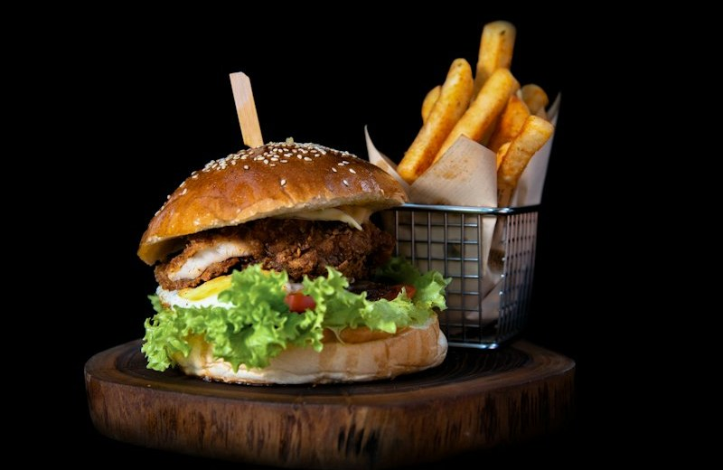

**⏱️ Prep Time:** 10 mins | **🔥 Cook Time:** 14 mins | **⌛ Total:** 24 mins
**🌡️ Air Fryer Temp:** 190°C / 375°F | **👥 Servings:** 4 | **📊 Calories:** 165 kcal
**Macros:** Protein: 4g | Carbs: 32g | Fat: 3.5g
**🏷️ Tags:** Barbeque Nation Style, Super Crunchy, Party Starter

### 🛒 Ingredients
- 2 cups Sweet corn kernels (steamed for 2 minutes and drained dry)
- 2.5 tbsp Cornstarch / cornflour
- 1.5 tbsp Rice flour
- 1 tsp Kashmiri red chili powder
- 1 tsp Chaat masala & 1/2 tsp black pepper
- 1 tbsp Oil
- 1/4 cup Finely diced onions & 1 green chili (for tossing)
- 2 tbsp Coriander leaves & 1 tbsp lemon juice
- Salt to taste

### 👩‍🍳 Step-by-Step Air Fryer Instructions
1. Pat steamed corn dry with paper towels. Toss with 1 tsp oil.
2. Sprinkle cornstarch, rice flour, half the chili powder, and salt over the corn. Toss until each kernel has a dusty white coating (spritz 1 tsp water if needed for flour to stick).
3. Preheat air fryer to 190°C (375°F) for 3 minutes.
4. Line basket with perforated parchment or place directly on tray. Spread corn in an even layer.
5. Air fry at 190°C for 8 minutes.
6. Pull out the basket and shake well. Mist lightly with oil spray and air fry for another 5-6 minutes until kernels are crackling and golden.
7. Transfer hot corn into a mixing bowl; immediately toss with chopped onions, chili, coriander, chaat masala, pepper, and fresh lemon juice.
8. Serve immediately.

> [!TIP]
> **Chef's Air Fryer Secret:** Combining cornstarch with rice flour ensures the kernels develop an ultra-crisp shell that stays crunchy even after tossing with lemon juice.

**🥢 Serving & Pairing:** Chilled Beverages and Spicy Garlic Relish.

---

## 25. Air Fryer Masala Peanuts

*Raw peanuts coated in a crunchy spiced besan and rice flour crust, air-roasted slowly until nutty, brittle, and coated in aromatic Indian spices.*

**⏱️ Prep Time:** 10 mins | **🔥 Cook Time:** 11 mins | **⌛ Total:** 21 mins
**🌡️ Air Fryer Temp:** 160°C / 320°F | **👥 Servings:** 4 | **📊 Calories:** 190 kcal
**Macros:** Protein: 8g | Carbs: 12g | Fat: 13g
**🏷️ Tags:** Haldiram Style, High Protein, Tea Time Snack

### 🛒 Ingredients
- 1.5 cups Raw red-skin peanuts
- 3 tbsp Besan (gram flour)
- 1.5 tbsp Rice flour
- 1 tsp Kashmiri red chili powder
- 1/2 tsp Turmeric & 1/2 tsp chaat masala
- 1/4 tsp Hing (asafoetida) & 1/4 tsp amchur
- 1 tbsp Oil
- 2-3 tbsp Water (sprinkled just enough to bind)
- Salt to taste

### 👩‍🍳 Step-by-Step Air Fryer Instructions
1. In a bowl, mix besan, rice flour, chili powder, turmeric, chaat masala, hing, amchur, salt, and 1 tbsp oil.
2. Add peanuts to the flour mixture. Sprinkle 1 tablespoon of water at a time, tossing with a spoon until each peanut is coated with a textured spice batter. Separate any large clusters.
3. Preheat air fryer to 160°C (320°F) for 2 minutes.
4. Spread peanuts across the basket (cook in 2 batches if needed for single layer).
5. Air fry at 160°C for 6 minutes.
6. Shake basket vigorously to break up clusters, mist lightly with cooking spray, and air fry for 4-5 more minutes until the crust turns golden and fragrant.
7. Cool completely before storing in an airtight jar.

> [!TIP]
> **Chef's Air Fryer Secret:** Roast at a lower heat (160°C) so the peanut cooks through to a crunchy roasted core at the exact moment the outer besan crust crisps up.

**🥢 Serving & Pairing:** Enjoy as a standalone crunchy snack with hot chai or cold beverages.

---

## 26. Air Fryer Baby Corn Fritters

*Tender baby corn spears marinated in herbs and spices, coated in a crisp breadcrumb crust, and air-fried into golden crunchy dipping batons.*

**⏱️ Prep Time:** 15 mins | **🔥 Cook Time:** 13 mins | **⌛ Total:** 28 mins
**🌡️ Air Fryer Temp:** 190°C / 375°F | **👥 Servings:** 3 | **📊 Calories:** 140 kcal
**Macros:** Protein: 3.5g | Carbs: 22g | Fat: 4g
**🏷️ Tags:** Finger Food, Party Appetizer, Crunchy Veg

### 🛒 Ingredients
- 12 Fresh baby corn spears (blanched in salted water for 2 mins, dried)
- 2 tbsp All-purpose flour & 2 tbsp cornstarch (slurry)
- 1/2 tsp Garlic powder & 1/2 tsp red chili flakes
- 1/2 tsp Oregano & 1/4 tsp black pepper
- 1 cup Panko breadcrumbs
- 1 tbsp Olive oil for brushing
- Salt to taste

### 👩‍🍳 Step-by-Step Air Fryer Instructions
1. Pat blanched baby corn completely dry with a paper towel.
2. Whisk flour, cornstarch, garlic powder, chili flakes, oregano, pepper, salt, and 4 tablespoons of water into a smooth batter.
3. Dip each baby corn spear into the batter, then roll in panko breadcrumbs until evenly coated.
4. Preheat air fryer to 190°C (375°F) for 3 minutes.
5. Brush or spray the breadcrumbed baby corn with oil.
6. Place spears side-by-side in the basket with space between each.
7. Air fry at 190°C for 7 minutes.
8. Flip spears over, mist with oil, and air fry for 5-6 minutes until deep golden brown and crunchy.
9. Serve hot.

> [!TIP]
> **Chef's Air Fryer Secret:** Blanching the baby corn briefly softens the center so it turns tender-crisp in the air fryer without needing prolonged cooking that might burn the breadcrumbs.

**🥢 Serving & Pairing:** Garlic Mayo, Sweet Chili Sauce, or Sriracha Dip.

---

## 27. Air Fryer Vegetable Kachori

*Flaky, puffed golden pastries filled with a spicy, aromatic mixture of ground lentils, fennel, and crushed coriander, air-fried at gentle heat for multi-layered crunch.*

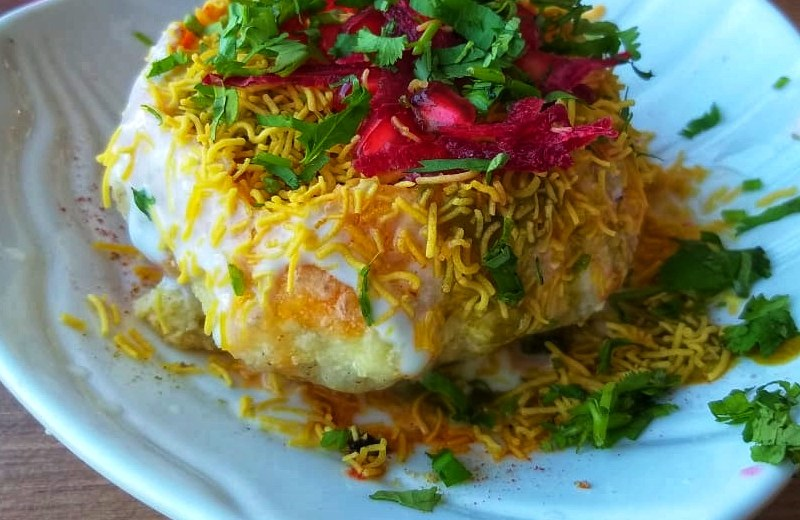

**⏱️ Prep Time:** 25 mins | **🔥 Cook Time:** 16 mins | **⌛ Total:** 41 mins
**🌡️ Air Fryer Temp:** 170°C / 340°F | **👥 Servings:** 4 | **📊 Calories:** 180 kcal / kachori
**Macros:** Protein: 5g | Carbs: 26g | Fat: 6.2g
**🏷️ Tags:** Khasta Classic, Rajasthani Specialty, Flaky Pastry

### 🛒 Ingredients
- 1.5 cups All-purpose flour or half whole wheat flour
- 3 tbsp Melted ghee (for moyen)
- 1/2 tsp Ajwain & 1/3 cup cold water
- 1/2 cup Yellow moong dal, soaked 2 hours and coarsely crushed
- 1 tbsp Fennel seeds (saunf) & 1 tbsp coriander seeds, crushed
- 1/2 tsp Hing (asafoetida)
- 1 tsp Kashmiri chili powder & 1/2 tsp amchur
- 1 tbsp Ghee for brushing
- Salt to taste

### 👩‍🍳 Step-by-Step Air Fryer Instructions
1. Knead flour, ghee, ajwain, and salt into a smooth semi-firm dough using cold water. Rest 20 minutes.
2. Prepare filling: Sauté crushed fennel, coriander seeds, hing, and crushed dal in 1 tsp oil until dry and aromatic. Add spices and salt. Cool completely and roll into 6 small balls.
3. Divide dough into 6 balls. Flatten edges thinner than the center, place a filling ball inside, pleat to seal tightly, and flatten with palm into a 3-inch disc (do NOT use a rolling pin).
4. Preheat air fryer to 170°C (340°F) for 4 minutes.
5. Brush kachoris on both sides generously with melted ghee.
6. Place in air fryer basket with space between each. Air fry at 170°C for 9 minutes.
7. Flip gently, brush with a touch of ghee, and air fry for another 6-7 minutes until puffed and golden brown.
8. Cool for 3 minutes before serving.

> [!TIP]
> **Chef's Air Fryer Secret:** Keep temperature strictly at 170°C. Gentle heat cooks the thick dough through to the core, yielding that authentic flaky khasta texture without burning.

**🥢 Serving & Pairing:** Spicy Aloo Rasedar Gravy, Tamarind Saunth, and Green Chutney.

---

## 28. Air Fryer Paneer Fingers

*Strips of fresh cottage cheese seasoned with Italian herbs and garlic, coated in crushed cornflakes, and air-fried into golden crunchy fingers with soft milky interiors.*

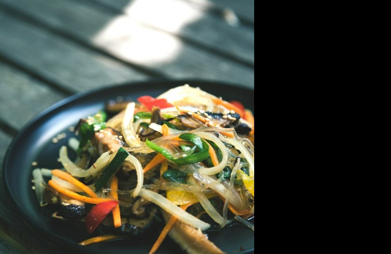

**⏱️ Prep Time:** 15 mins | **🔥 Cook Time:** 11 mins | **⌛ Total:** 26 mins
**🌡️ Air Fryer Temp:** 190°C / 375°F | **👥 Servings:** 3 | **📊 Calories:** 220 kcal
**Macros:** Protein: 13g | Carbs: 14g | Fat: 12.5g
**🏷️ Tags:** High Protein, Kid Friendly, Golden Crunch

### 🛒 Ingredients
- 250g Paneer, cut into 1/2-inch thick batons (fingers)
- 2 tbsp Cornstarch + 2 tbsp all-purpose flour (slurry)
- 1/2 tsp Garlic powder & 1/2 tsp oregano
- 1/2 tsp Kashmiri chili powder
- 1 cup Crushed cornflakes or panko breadcrumbs
- 1 tbsp Olive oil for brushing
- Salt to taste

### 👩‍🍳 Step-by-Step Air Fryer Instructions
1. Pat paneer batons dry with paper towels. Season lightly with salt and chili powder.
2. Whisk cornstarch, flour, garlic powder, oregano, salt, and 4 tablespoons water into a smooth coating batter.
3. Dip each paneer baton into the slurry, then roll in crushed cornflakes, pressing gently to coat all sides.
4. Preheat air fryer to 190°C (375°F) for 3 minutes.
5. Brush or spray the coated paneer fingers with oil.
6. Arrange in the basket with space between each baton. Air fry at 190°C for 6 minutes.
7. Turn fingers over, mist with oil, and air fry for another 4-5 minutes until the cornflake shell is golden and crisp.
8. Serve hot.

> [!TIP]
> **Chef's Air Fryer Secret:** Crushed cornflakes create an unbeatable crust on paneer in the air fryer that won't get soggy even when dipped in heavy sauces.

**🥢 Serving & Pairing:** Honey Mustard Dip, Mint Mayo, or Spicy Ketchup.

---

## 29. Air Fryer Peri Peri Potato Wedges

*Thick-cut skin-on potato wedges soaked to remove surface starch, tossed with olive oil and cornstarch, and air-fried at high heat before dusting with fiery peri peri seasoning.*

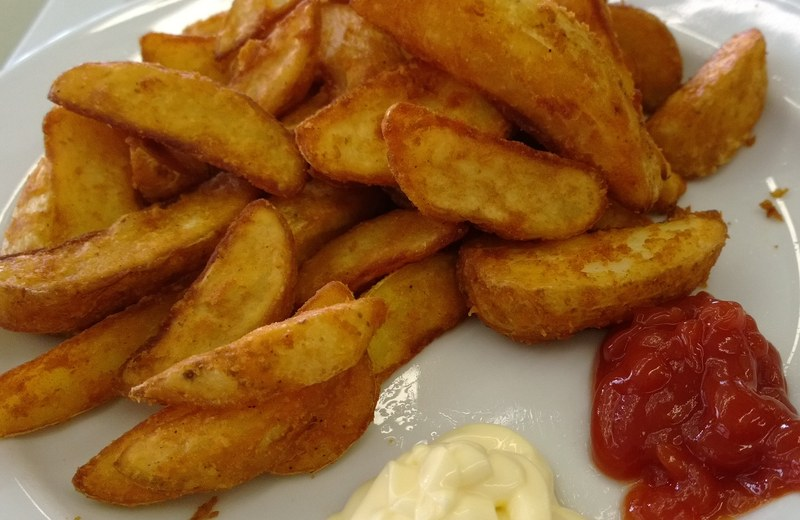

**⏱️ Prep Time:** 15 mins + soaking | **🔥 Cook Time:** 18 mins | **⌛ Total:** 33 mins
**🌡️ Air Fryer Temp:** 200°C / 400°F | **👥 Servings:** 4 | **📊 Calories:** 160 kcal
**Macros:** Protein: 3g | Carbs: 30g | Fat: 3.8g
**🏷️ Tags:** Café Classic, Spicy Wedges, Vegan

### 🛒 Ingredients
- 3 large Russet potatoes, scrubbed clean and cut into thick wedges (skin on)
- 1 tbsp Olive oil
- 1 tbsp Cornstarch / cornflour (the secret to crispiness)
- 1.5 tbsp Peri Peri spice mix (paprika, garlic powder, chili, oregano, onion powder)
- 1/2 tsp Salt (adjusted for spice mix)

### 👩‍🍳 Step-by-Step Air Fryer Instructions
1. Soak cut wedges in a large bowl of cold salted water for 20 minutes to wash off surface starch. Drain and dry completely on a clean kitchen towel.
2. In a bowl, toss dried wedges with 1 tbsp olive oil and 1 tbsp cornstarch until evenly coated with a translucent film.
3. Preheat air fryer to 200°C (400°F) for 4 minutes.
4. Arrange wedges in the air fryer basket in a single layer (cook in two batches if needed).
5. Air fry at 200°C for 10 minutes.
6. Shake the basket vigorously to redistribute the wedges. Spray a light mist of oil and air fry for another 7-8 minutes until deeply golden with blistered, crispy skins.
7. Transfer immediately to a warm bowl, sprinkle peri peri spice mix generously, and toss vigorously while hot.
8. Serve right away.

> [!TIP]
> **Chef's Air Fryer Secret:** Drying potatoes thoroughly and tossing with a tablespoon of cornstarch before oiling creates a micro-crust that ensures long-lasting crunch.

**🥢 Serving & Pairing:** Cheesy Jalapeño Dip or Garlic Aioli.

---

## 30. Air Fryer Paneer Manchurian

*Crispy cornstarch-crusted paneer cubes air-fried until golden, then tossed in a sizzling dry Indo-Chinese wok sauce of minced ginger, garlic, soy sauce, and scallions.*

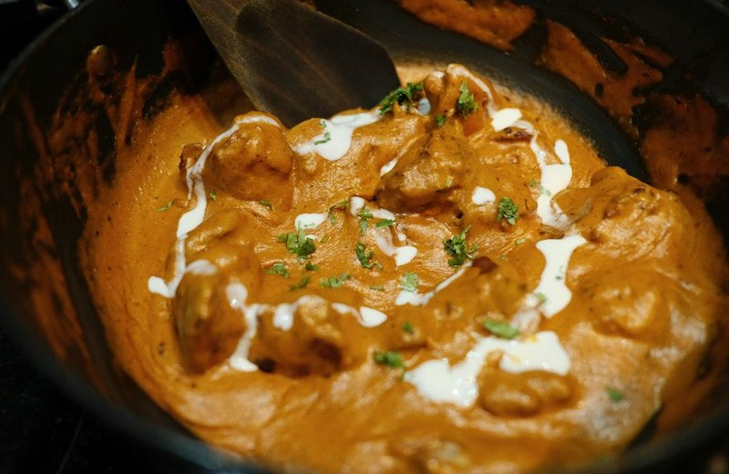

**⏱️ Prep Time:** 15 mins | **🔥 Cook Time:** 13 mins | **⌛ Total:** 28 mins
**🌡️ Air Fryer Temp:** 190°C / 375°F | **👥 Servings:** 3 | **📊 Calories:** 225 kcal
**Macros:** Protein: 13g | Carbs: 14g | Fat: 13g
**🏷️ Tags:** Indo-Chinese, Party Starter, High Protein

### 🛒 Ingredients
- 250g Paneer, cut into 3/4-inch cubes
- 2 tbsp Cornstarch / cornflour
- 1 tbsp All-purpose flour
- 1 tsp Soy sauce & 1/2 tsp black pepper
- 1 tbsp Oil for air frying
- For Dry Manchurian Sauce: 1 tbsp minced garlic, 1 tbsp minced ginger, 2 green chilies, 1/4 cup diced capsicum & onion, 1.5 tbsp soy sauce, 1 tbsp chili sauce, 1 tsp vinegar, 1/4 cup spring onion greens

### 👩‍🍳 Step-by-Step Air Fryer Instructions
1. Toss paneer cubes with 1 tsp soy sauce, pepper, and 1 tsp oil. Dust with cornstarch and flour until evenly coated.
2. Preheat air fryer to 190°C (375°F) for 3 minutes.
3. Arrange paneer cubes in the basket in a single layer.
4. Air fry at 190°C for 7 minutes.
5. Shake basket, mist lightly with oil, and air fry for 4-5 minutes until the exterior is crunchy and golden brown.
6. Meanwhile, heat 1 tsp oil in a wok; quickly sauté ginger, garlic, green chilies, capsicum, and onions on high flame for 2 minutes. Stir in soy sauce, chili sauce, and vinegar.
7. Toss the hot air-fried paneer cubes into the sizzling sauce for 45 seconds until glazed.
8. Garnish with chopped spring onion greens and serve immediately.

> [!TIP]
> **Chef's Air Fryer Secret:** Air-frying the paneer beforehand gives it a crisp shell that holds its shape and texture without absorbing excess oil from wok frying.

**🥢 Serving & Pairing:** Enjoy straight from the wok with toothpicks and Schezwan dip.

---

## 31. Air Fryer Vegetable Kofta (Dry, Restaurant-Style)

*Melt-in-mouth vegetable kofta balls made with grated bottle gourd, cabbage, and paneer, air-fried with a crisp outer crust, served as a dry appetizer or dropped into curries.*

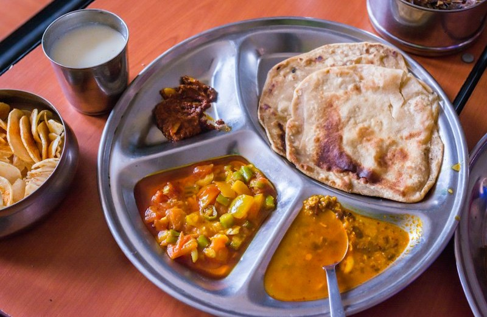

**⏱️ Prep Time:** 20 mins | **🔥 Cook Time:** 14 mins | **⌛ Total:** 34 mins
**🌡️ Air Fryer Temp:** 180°C / 360°F | **👥 Servings:** 4 | **📊 Calories:** 145 kcal
**Macros:** Protein: 4.2g | Carbs: 22g | Fat: 4.5g
**🏷️ Tags:** North Indian, Crispy Kofta, Festive

### 🛒 Ingredients
- 1 cup Bottle gourd (lauki), grated and squeezed dry
- 1/2 cup Cabbage, finely shredded and squeezed
- 1/3 cup Paneer, grated
- 3 tbsp Besan (gram flour), dry roasted
- 1 Green chili & 1 tsp ginger, minced
- 1/2 tsp Garam masala & 1/2 tsp cumin powder
- 1/2 tsp Chaat masala
- 1 tbsp Oil for brushing
- Salt to taste

### 👩‍🍳 Step-by-Step Air Fryer Instructions
1. Squeeze out all liquid from the grated lauki and cabbage into a cup (save water for curries).
2. In a bowl, mix squeezed veggies, grated paneer, ginger, chili, spices, salt, and roasted besan until a soft dough forms.
3. Shape into 10 smooth round kofta balls.
4. Preheat air fryer to 180°C (360°F) for 3 minutes.
5. Brush kofta balls lightly with oil.
6. Place koftas in the basket with space between each.
7. Air fry at 180°C for 8 minutes.
8. Carefully roll koftas over, mist with oil, and air fry for 5-6 minutes until deep golden brown on all sides.
9. Serve hot as an appetizer or add to hot gravy.

> [!TIP]
> **Chef's Air Fryer Secret:** Roasting the besan dry before using as a binder gives the koftas a rich, nutty flavor and eliminates any raw flour taste.

**🥢 Serving & Pairing:** Silky Makhani Dip or Green Coriander Chutney.

---

## 32. Air Fryer Paneer Bhurji Rolls

*Crisp whole wheat rolls stuffed with spiced scrambled cottage cheese, onions, tomatoes, and fresh coriander, air-fried to a flaky, golden crunch.*

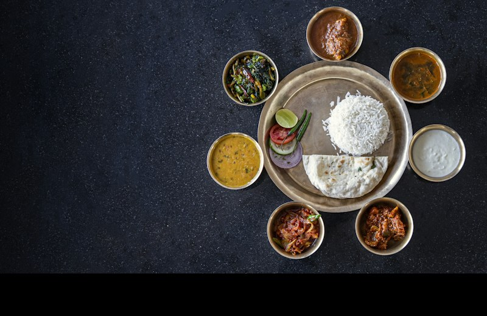

**⏱️ Prep Time:** 15 mins | **🔥 Cook Time:** 11 mins | **⌛ Total:** 26 mins
**🌡️ Air Fryer Temp:** 180°C / 360°F | **👥 Servings:** 3 | **📊 Calories:** 210 kcal
**Macros:** Protein: 11g | Carbs: 24g | Fat: 7.5g
**🏷️ Tags:** High Protein, Street Wrap, Vegetarian

### 🛒 Ingredients
- 3 Whole wheat rotis or thin parathas
- 1.5 cups Spiced paneer bhurji (crumbled paneer cooked dry with onions, tomatoes, turmeric, cumin, and green chili)
- 1/4 cup Sliced red onions
- 2 tbsp Mint chutney
- 1 tsp Oil for brushing

### 👩‍🍳 Step-by-Step Air Fryer Instructions
1. Ensure paneer bhurji filling is completely dry with no liquid gravy. Cool to room temperature.
2. Spread 1 tsp mint chutney across each roti.
3. Mound 1/2 cup paneer bhurji along the center; top with sliced onions.
4. Roll tightly into a cylinder, tucking edges or securing with a wooden toothpick.
5. Preheat air fryer to 180°C (360°F) for 3 minutes.
6. Brush outer roti surface with oil; place seam-side down in the air fryer basket.
7. Air fry at 180°C for 6 minutes.
8. Rotate roll, mist with oil, and air fry for 4-5 minutes until the roti turns flaky and crackly.
9. Slice diagonally and serve warm.

> [!TIP]
> **Chef's Air Fryer Secret:** A dry bhurji filling is essential so the wrap stays crisp and doesn't get soggy from within.

**🥢 Serving & Pairing:** Zesty Mint Chutney and Lemon Slices.

---

## 33. Air Fryer Mushroom 65

*Plump button mushrooms coated in a fragrant spiced rice flour, cornstarch, and curry leaf batter, air-fried until the crust is shatteringly crisp while the mushroom stays juicy.*

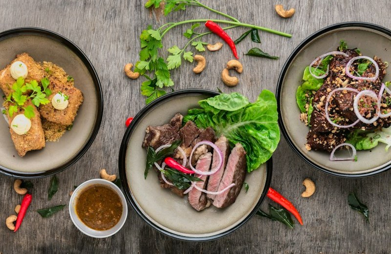

**⏱️ Prep Time:** 15 mins | **🔥 Cook Time:** 13 mins | **⌛ Total:** 28 mins
**🌡️ Air Fryer Temp:** 190°C / 375°F | **👥 Servings:** 3 | **📊 Calories:** 130 kcal
**Macros:** Protein: 4.5g | Carbs: 18g | Fat: 4g
**🏷️ Tags:** South Indian 65, Spicy Starter, Vegan

### 🛒 Ingredients
- 250g Button mushrooms, wiped clean and halved
- 2 tbsp Rice flour
- 2 tbsp Cornstarch / cornflour
- 1 tbsp Ginger-garlic paste
- 1 tbsp Kashmiri chili powder
- 1/2 tsp Garam masala & 1/2 tsp black pepper
- 12 Curry leaves & 2 green chilies, slit
- 1 tbsp Oil
- Salt to taste

### 👩‍🍳 Step-by-Step Air Fryer Instructions
1. Never soak mushrooms in water! Wipe them clean with a damp towel and pat dry. Cut in halves.
2. Toss mushrooms with 1 tbsp oil, ginger-garlic paste, chili powder, garam masala, pepper, and salt.
3. Sprinkle rice flour and cornstarch over mushrooms; toss until a textured coating forms over each piece.
4. Preheat air fryer to 190°C (375°F) for 4 minutes.
5. Spread coated mushrooms in a single layer in the basket.
6. Air fry at 190°C for 7 minutes.
7. Shake basket, add curry leaves and slit green chilies, spray lightly with oil, and air fry for 5-6 more minutes until golden red and crunchy.
8. Serve hot.

> [!TIP]
> **Chef's Air Fryer Secret:** Wiping mushrooms dry instead of washing preserves their firm texture and prevents them from sweating water inside the air fryer basket.

**🥢 Serving & Pairing:** Curry Leaf Tempering and Lemon Wedges.

---

## 34. Air Fryer Corn Pakora

*Sweet corn kernels partially crushed and bound with gram flour, onions, green chilies, and carom seeds, air-fried into golden craggy fritters.*

**⏱️ Prep Time:** 15 mins | **🔥 Cook Time:** 14 mins | **⌛ Total:** 29 mins
**🌡️ Air Fryer Temp:** 185°C / 365°F | **👥 Servings:** 4 | **📊 Calories:** 165 kcal
**Macros:** Protein: 5g | Carbs: 26g | Fat: 4.2g
**🏷️ Tags:** Monsoon Snack, Crispy Fritters, Vegetarian

### 🛒 Ingredients
- 1.5 cups Sweet corn kernels (pulse half into a coarse paste, leave half whole)
- 3/4 cup Besan (gram flour)
- 2 tbsp Rice flour
- 1 small Onion, finely sliced
- 2 Green chilies, finely chopped
- 1/2 tsp Ajwain (carom seeds)
- 1/2 tsp Turmeric & 1/2 tsp red chili powder
- 2 tbsp Coriander leaves, chopped
- 1 tbsp Warm oil
- Salt to taste

### 👩‍🍳 Step-by-Step Air Fryer Instructions
1. Combine coarse corn paste, whole corn kernels, sliced onions, chilies, ajwain, spices, salt, and warm oil in a bowl.
2. Gradually add besan and rice flour. Mix without adding water (the natural moisture from corn and onions forms a sticky batter).
3. Preheat air fryer to 185°C (365°F) for 3 minutes.
4. Line basket with perforated parchment paper and brush with oil.
5. Drop rough spoonfuls of corn batter onto parchment.
6. Air fry at 185°C for 8 minutes.
7. Carefully turn pakoras over, spray a light mist of oil, and air fry for another 5-6 minutes until golden and crunchy.
8. Serve hot.

> [!TIP]
> **Chef's Air Fryer Secret:** Pulsing half the corn creates a natural binder, eliminating the need for added water so the pakoras cook crisp and light.

**🥢 Serving & Pairing:** Sweet Tamarind Chutney and Mint Chutney.

---

## 35. Air Fryer Bread Pakora

*Spiced potato and paneer sandwiches coated in a thick, ajwain-scented chickpea batter, air-fried on perforated parchment to golden, puffy perfection with 80% less grease.*

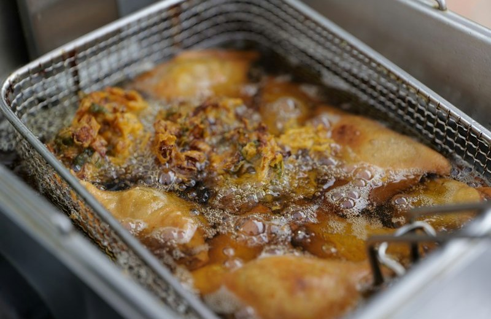

**⏱️ Prep Time:** 15 mins | **🔥 Cook Time:** 13 mins | **⌛ Total:** 28 mins
**🌡️ Air Fryer Temp:** 185°C / 365°F | **👥 Servings:** 4 | **📊 Calories:** 190 kcal / piece
**Macros:** Protein: 6g | Carbs: 30g | Fat: 4.8g
**🏷️ Tags:** Halwai Classic, Comfort Food, Low Oil Pakora

### 🛒 Ingredients
- 4 slices Bread, crusts trimmed, cut diagonally into 8 triangles
- 1 cup Spiced boiled potato & green pea filling
- 4 thin slices Paneer (optional, for royal stuffing)
- 1 cup Besan (gram flour)
- 2 tbsp Rice flour
- 1/2 tsp Ajwain & 1/2 tsp turmeric powder
- 1/2 tsp Red chili powder & pinch of baking soda
- 1/2 cup Water (for very thick batter)
- 1 tbsp Oil
- Salt to taste

### 👩‍🍳 Step-by-Step Air Fryer Instructions
1. Spread green chutney on bread triangles. Layer spiced potato filling and a paneer slice between two triangles, pressing gently.
2. Whisk besan, rice flour, ajwain, turmeric, chili powder, salt, and water into a thick, lump-free batter. Stir in baking soda and 1 tsp hot oil.
3. Preheat air fryer to 185°C (365°F) for 4 minutes.
4. Line basket with perforated parchment paper and brush with oil.
5. Dip stuffed bread triangles into thick batter, coat quickly, let excess drip for 2 seconds, and place onto parchment.
6. Air fry at 185°C for 7 minutes until batter sets and turns pale golden.
7. Carefully peel off parchment, flip pakoras onto the basket wire rack, brush lightly with oil, and air fry for 5-6 minutes until deep golden and crisp.
8. Serve piping hot.

> [!TIP]
> **Chef's Air Fryer Secret:** Using perforated parchment prevents wet batter from seeping through the wire mesh during the initial 7 minutes until the outer crust hardens.

**🥢 Serving & Pairing:** Chaat Masala Dust, Green Chutney, and Sweet Saunth.

---

## 36. Air Fryer Vegetable Seekh Kebab

*Finely minced vegetables, paneer, and roasted gram flour molded onto skewers, air-fried at high heat and basted with spiced butter for authentic tandoor char.*

**⏱️ Prep Time:** 20 mins | **🔥 Cook Time:** 14 mins | **⌛ Total:** 34 mins
**🌡️ Air Fryer Temp:** 190°C / 375°F | **👥 Servings:** 4 | **📊 Calories:** 155 kcal
**Macros:** Protein: 6.5g | Carbs: 20g | Fat: 5g
**🏷️ Tags:** Tandoori Classic, High Fiber, Gluten-Free Option

### 🛒 Ingredients
- 1 cup Finely chopped steamed vegetables (carrots, green beans, cabbage, peas)
- 1/2 cup Crumbled paneer or tofu
- 1 medium Boiled potato, mashed
- 3 tbsp Roasted besan or sattu (for binding)
- 1 tbsp Ginger-garlic paste
- 1 Green chili, minced
- 1 tsp Garam masala & 1 tsp chaat masala
- 1 tsp Kasuri methi, crushed
- 1 tbsp Melted butter or mustard oil for basting
- Salt to taste

### 👩‍🍳 Step-by-Step Air Fryer Instructions
1. Ensure steamed veggies are squeezed dry in a cheesecloth. Mix with paneer, mashed potato, ginger-garlic paste, chili, spices, salt, and roasted besan into a firm, moldable dough.
2. Divide into 6 portions. Mold each portion tightly around soaked wooden skewers into long cylindrical kebabs.
3. Preheat air fryer to 190°C (375°F) for 4 minutes.
4. Place skewers in the air fryer basket in a single layer.
5. Air fry at 190°C for 7 minutes.
6. Rotate skewers, baste with melted butter or mustard oil, and air fry for another 6-7 minutes until the exterior has charred golden patches.
7. Gently slide kebabs off skewers, sprinkle chaat masala, and serve.

> [!TIP]
> **Chef's Air Fryer Secret:** Squeezing every drop of moisture from the vegetables ensures the kebabs hold their shape firmly on the skewers during high-speed air circulation.

**🥢 Serving & Pairing:** Restaurant Mint Chutney and Spiced Onion Rings.

---

## 37. Air Fryer Sesame Paneer Sticks

*Batons of paneer dipped in a savory garlic-soy marinade, crusted generously in white and black sesame seeds, and air-fried until nutty, fragrant, and crackling.*

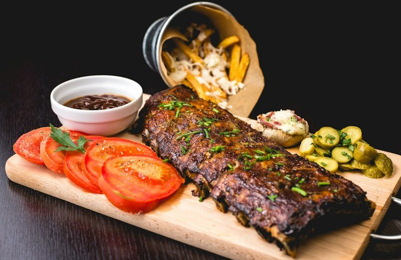

**⏱️ Prep Time:** 15 mins | **🔥 Cook Time:** 11 mins | **⌛ Total:** 26 mins
**🌡️ Air Fryer Temp:** 190°C / 375°F | **👥 Servings:** 3 | **📊 Calories:** 230 kcal
**Macros:** Protein: 13g | Carbs: 10g | Fat: 15g
**🏷️ Tags:** Nutty Crunch, High Protein, Vegetarian

### 🛒 Ingredients
- 250g Paneer, cut into 1/2-inch thick sticks
- 1 tbsp Soy sauce & 1 tbsp chili sauce
- 1 tsp Garlic paste & 1/2 tsp black pepper
- 1 tbsp Cornstarch mixed with 2 tbsp water
- 1/3 cup White sesame seeds (til)
- 1 tbsp Black sesame seeds (for visual contrast)
- 1 tbsp Sesame oil for brushing
- Salt to taste

### 👩‍🍳 Step-by-Step Air Fryer Instructions
1. Toss paneer sticks in soy sauce, chili sauce, garlic paste, and pepper. Rest 5 minutes.
2. Dip each seasoned stick into the cornstarch slurry, then roll in the sesame seed mixture, pressing gently so the seeds coat all four sides.
3. Preheat air fryer to 190°C (375°F) for 3 minutes.
4. Brush or spray sesame sticks lightly with oil.
5. Arrange sticks in the air fryer basket with space between each.
6. Air fry at 190°C for 6 minutes.
7. Carefully roll sticks over, mist with oil, and air fry for 4-5 minutes until sesame seeds turn golden and aromatic.
8. Serve hot.

> [!TIP]
> **Chef's Air Fryer Secret:** Sesame seeds toast quickly and release natural aromatic oils under air convection, creating an incredible nutty crunch without deep frying.

**🥢 Serving & Pairing:** Sweet Chili Garlic Dip or Spicy Scallion Sauce.

---

## 38. Air Fryer Sweet Potato Fries

*Thin matchstick sweet potato fries tossed in olive oil, cornstarch, and smoked paprika, air-fried until crisp and caramelized at the edges.*

**⏱️ Prep Time:** 15 mins | **🔥 Cook Time:** 16 mins | **⌛ Total:** 31 mins
**🌡️ Air Fryer Temp:** 190°C / 375°F | **👥 Servings:** 4 | **📊 Calories:** 140 kcal
**Macros:** Protein: 2g | Carbs: 28g | Fat: 2.8g
**🏷️ Tags:** Nutrient Rich, Vegan, Gluten-Free

### 🛒 Ingredients
- 2 large Sweet potatoes, peeled and cut into 1/4-inch matchsticks
- 1 tbsp Cornstarch / cornflour
- 1 tbsp Olive oil
- 1/2 tsp Smoked paprika & 1/2 tsp garlic powder
- 1/2 tsp Chaat masala or sea salt

### 👩‍🍳 Step-by-Step Air Fryer Instructions
1. Soak cut sweet potato matchsticks in cold water for 15 minutes. Drain and dry completely between kitchen towels.
2. Toss dried sweet potatoes with 1 tbsp olive oil, then toss with cornstarch until an invisible thin film covers every stick.
3. Preheat air fryer to 190°C (375°F) for 4 minutes.
4. Spread sweet potato fries in the air fryer basket (do not overcrowd; cook in 2 batches).
5. Air fry at 190°C for 8 minutes.
6. Shake basket thoroughly to redistribute fries. Spray lightly with oil and air fry for another 7-8 minutes until edges turn dark golden brown and crisp.
7. Toss with smoked paprika, garlic powder, and sea salt in a warm bowl and serve immediately.

> [!TIP]
> **Chef's Air Fryer Secret:** Sweet potatoes have more sugar and less starch than white potatoes. A light cornstarch dusting is essential to achieve that restaurant-style crisp exterior.

**🥢 Serving & Pairing:** Smoked Paprika Garlic Mayo or Tangy Yogurt Dip.

---

## 39. Air Fryer Mixed Root Vegetable Chips

*Paper-thin slices of beetroot, sweet potato, and taro root (arbi), dehydrated and air-baked at moderate heat into colorful, shatteringly crisp gourmet vegetable chips.*

**⏱️ Prep Time:** 15 mins | **🔥 Cook Time:** 15 mins | **⌛ Total:** 30 mins
**🌡️ Air Fryer Temp:** 160°C / 320°F | **👥 Servings:** 4 | **📊 Calories:** 110 kcal
**Macros:** Protein: 2g | Carbs: 22g | Fat: 2g
**🏷️ Tags:** Gourmet Veggie Chips, High Fiber, Vegan

### 🛒 Ingredients
- 1 medium Beetroot, peeled
- 1 medium Sweet potato, peeled
- 1 medium Taro root (arbi), peeled
- 1 tbsp Olive oil or avocado oil
- 1/2 tsp Sea salt & 1/2 tsp chaat masala
- 1/4 tsp Freshly cracked black pepper

### 👩‍🍳 Step-by-Step Air Fryer Instructions
1. Using a mandoline slicer, slice vegetables paper-thin (about 1mm thickness).
2. Soak slices in ice-cold salted water for 15 minutes. Drain thoroughly and pat completely dry between layers of paper towels.
3. Toss slices with 1 tbsp oil until lightly coated.
4. Preheat air fryer to 160°C (320°F) for 3 minutes.
5. Arrange vegetable slices in the air fryer basket in slightly overlapping layers.
6. Air fry at 160°C for 8 minutes.
7. Shake basket to rearrange slices and air fry for 6-7 more minutes until chips are dry and edges curled.
8. Transfer to a wire rack to cool completely (they turn super crisp as they cool). Sprinkle with sea salt and chaat masala.

> [!TIP]
> **Chef's Air Fryer Secret:** Bake at 160°C. High temperatures will burn the natural sugars in beetroots and sweet potatoes before the chips can dry out completely.

**🥢 Serving & Pairing:** Herb Labneh or French Onion Dip.

---

## 40. Air Fryer Paneer Popcorn

*Bite-sized cubes of fresh cottage cheese coated in spiced buttermilk and crushed cornflakes, air-fried until crunchy, poppable, and golden.*

**⏱️ Prep Time:** 15 mins | **🔥 Cook Time:** 11 mins | **⌛ Total:** 26 mins
**🌡️ Air Fryer Temp:** 190°C / 375°F | **👥 Servings:** 4 | **📊 Calories:** 210 kcal
**Macros:** Protein: 12g | Carbs: 15g | Fat: 11.5g
**🏷️ Tags:** Party Poppers, Kids Favorite, High Protein

### 🛒 Ingredients
- 250g Paneer, cut into 1/2-inch mini cubes
- 1/3 cup Buttermilk or whisked yogurt
- 1 tsp Kashmiri red chili powder & 1/2 tsp garlic powder
- 1/2 tsp Oregano & 1/2 tsp chaat masala
- 1.5 cups Crushed cornflakes or panko crumbs
- 1 tbsp Oil for brushing
- Salt to taste

### 👩‍🍳 Step-by-Step Air Fryer Instructions
1. In a bowl, mix buttermilk, chili powder, garlic powder, oregano, and salt.
2. Add mini paneer cubes and let marinate for 5 minutes.
3. Toss marinated cubes in crushed cornflakes until completely coated with craggy flakes.
4. Preheat air fryer to 190°C (375°F) for 3 minutes.
5. Arrange coated paneer popcorn in the air fryer basket in a single layer.
6. Air fry at 190°C for 6 minutes.
7. Shake basket, spray lightly with cooking oil, and air fry for 4-5 minutes until golden brown and crackling.
8. Toss with extra chaat masala and serve in paper cones.

> [!TIP]
> **Chef's Air Fryer Secret:** Mini 1/2-inch cubes ensure the ideal ratio of crunchy outer crust to soft paneer core in every single bite.

**🥢 Serving & Pairing:** Peri Peri Mayo and Mint Chutney.

---

# 🍽️ SECTION: MAIN COURSE

## 1. Stuffed Bell Peppers (Bharwan Shimla Mirch)

*Vibrant bell pepper crowns stuffed with a spiced paneer, potato, sweet corn, and cashew filling, roasted until the pepper skin is blistered and tender.*

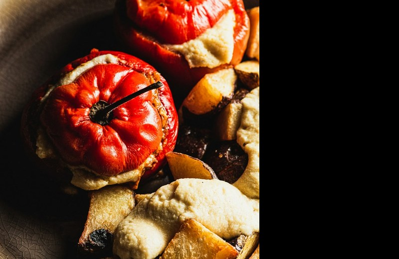

**⏱️ Prep Time:** 15 mins | **🔥 Cook Time:** 17 mins | **⌛ Total:** 32 mins
**🌡️ Air Fryer Temp:** 180°C / 360°F | **👥 Servings:** 3 | **📊 Calories:** 190 kcal / pepper
**Macros:** Protein: 7g | Carbs: 22g | Fat: 8g
**🏷️ Tags:** Dinner Star, Low Carb, Vegetarian

### 🛒 Ingredients
- 3 Medium Bell Peppers (capsicum - red, yellow, green), tops cut off and deseeded
- 1.5 cups Boiled mashed potatoes or crumbled paneer mix
- 1/3 cup Steamed sweet corn kernels
- 1/4 cup Finely diced onions & 1 green chili, minced
- 1 tbsp Chopped cashews & raisins
- 1/2 tsp Cumin powder & 1/2 tsp garam masala
- 1/2 tsp Amchur (dry mango powder)
- 1/3 cup Shredded mozzarella or processed cheese (for topping)
- 1 tbsp Olive oil or ghee
- Salt to taste

### 👩‍🍳 Step-by-Step Air Fryer Instructions
1. Rub the outer skin of deseeded peppers lightly with a drop of olive oil.
2. In a bowl, mix mashed potatoes/paneer, sweet corn, onions, green chili, cashews, spices, and salt into a flavorful stuffing.
3. Stuff the peppers generously with the mixture, pressing down lightly.
4. Preheat the air fryer to 180°C (360°F) for 4 minutes.
5. Stand stuffed peppers upright in the air fryer basket.
6. Air fry at 180°C for 12 minutes until pepper walls are blistered and tender.
7. Top peppers with shredded cheese and air fry for an additional 4-5 minutes until the cheese is bubbling and golden brown.
8. Serve hot garnished with fresh cilantro.

> [!TIP]
> **Chef's Air Fryer Secret:** If the peppers tilt over in the basket, slice a thin sliver off the bottom to create a flat base so they stand stably under the circulating air.

**🥢 Serving & Pairing:** Warm Garlic Naan, Mint Raita, and Jeera Rice.

---

## 2. Paneer & Vegetable Skewers

*Thick skewers of succulent marinated cottage cheese, crunchy bell peppers, mushrooms, and red onions, air-fried at high convection for caramelized edges.*

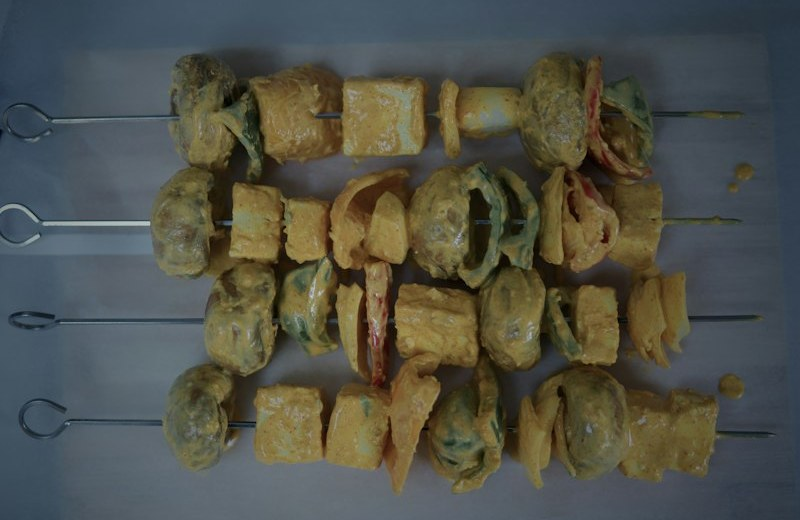

**⏱️ Prep Time:** 20 mins + marinating | **🔥 Cook Time:** 13 mins | **⌛ Total:** 33 mins
**🌡️ Air Fryer Temp:** 200°C / 400°F | **👥 Servings:** 3 | **📊 Calories:** 240 kcal
**Macros:** Protein: 14g | Carbs: 10g | Fat: 16g
**🏷️ Tags:** Tandoori Feast, High Protein, Gluten-Free

### 🛒 Ingredients
- 250g Paneer, cut into 1-inch thick cubes
- 1 Bell pepper, cut into 1-inch squares
- 1 Red onion, separated into layers
- 6 Button mushrooms, halved
- 1/2 cup Hung curd (Greek yogurt)
- 1 tbsp Mustard oil
- 1 tbsp Kashmiri red chili powder
- 1 tbsp Ginger-garlic paste
- 1 tsp Kasuri methi, crushed
- 1/2 tsp Garam masala & 1/2 tsp chaat masala
- Salt to taste

### 👩‍🍳 Step-by-Step Air Fryer Instructions
1. Whisk hung curd, mustard oil, ginger-garlic paste, chili powder, kasuri methi, garam masala, and salt into a rich tandoori marinade.
2. Toss paneer, mushrooms, peppers, and onions in the marinade; refrigerate 30 minutes.
3. Thread ingredients alternately onto soaked bamboo skewers.
4. Preheat air fryer to 200°C (400°F) for 4 minutes.
5. Place skewers in the air fryer basket in a single layer.
6. Air fry at 200°C for 7 minutes.
7. Turn skewers over, brush with melted butter or oil, and air fry for 5-6 more minutes until edges are charred and fragrant.
8. Sprinkle with chaat masala and lemon juice before serving.

> [!TIP]
> **Chef's Air Fryer Secret:** Soak wooden skewers in water for 30 minutes before threading to prevent them from scorching during high-temperature air frying.

**🥢 Serving & Pairing:** Mint Chutney, Lemon Wedges, and Laccha Pyaz.

---

## 3. Whole Roasted Sweet Potato (Shakarkandi Chaat)

*Whole sweet potatoes roasted in their skins until caramelized and custard-soft inside, slit open and spiced with roasted cumin, rock salt, and fresh lime juice.*

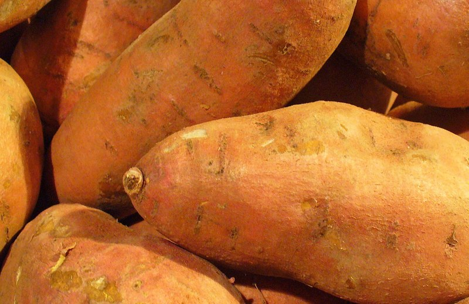

**⏱️ Prep Time:** 5 mins | **🔥 Cook Time:** 38 mins | **⌛ Total:** 43 mins
**🌡️ Air Fryer Temp:** 190°C / 375°F | **👥 Servings:** 2 | **📊 Calories:** 180 kcal
**Macros:** Protein: 3g | Carbs: 42g | Fat: 1g
**🏷️ Tags:** Slow Roasted, Street Chaat, Vegan

### 🛒 Ingredients
- 2 Medium Sweet potatoes (shakarkandi), washed and scrubbed
- 1 tsp Mustard oil or ghee
- 1 tsp Chaat masala
- 1/2 tsp Roasted cumin powder
- 1/4 tsp Black salt (kala namak)
- 1 Green chili & 2 tbsp fresh coriander, chopped
- 1 tbsp Fresh lemon juice

### 👩‍🍳 Step-by-Step Air Fryer Instructions
1. Prick the sweet potatoes all over with a fork (to allow steam release). Rub skins with a few drops of mustard oil and a pinch of salt.
2. Preheat air fryer to 190°C (375°F) for 4 minutes.
3. Place whole sweet potatoes directly in the air fryer basket.
4. Air fry at 190°C for 20 minutes.
5. Turn sweet potatoes over and continue air frying for 15-18 minutes until a knife inserts into the thickest part with zero resistance.
6. Slice lengthwise down the center; gently press ends to open.
7. Fluff the caramelized interior with a fork; season with chaat masala, roasted cumin, black salt, chilies, cilantro, and lemon juice.
8. Serve hot.

> [!TIP]
> **Chef's Air Fryer Secret:** Roasting sweet potatoes whole in their skins concentrates natural sugars, turning the flesh sweet, buttery, and caramelized.

**🥢 Serving & Pairing:** Tangy Tamarind Chutney and Sweet Dahi.

---

## 4. Rajma Galouti (Kidney Bean Patties)

*Royal Lucknow-style melt-in-mouth patties crafted from slow-cooked kidney beans, browned onions, roasted spices, and roasted gram flour, air-fried with ghee.*

**⏱️ Prep Time:** 20 mins | **🔥 Cook Time:** 14 mins | **⌛ Total:** 34 mins
**🌡️ Air Fryer Temp:** 180°C / 360°F | **👥 Servings:** 4 | **📊 Calories:** 165 kcal
**Macros:** Protein: 8.5g | Carbs: 24g | Fat: 4g
**🏷️ Tags:** Awadhi Royal, Melt-In-Mouth, High Protein

### 🛒 Ingredients
- 1.5 cups Boiled kidney beans (rajma), completely drained dry
- 1/2 cup Deeply browned onions (birista)
- 1 tbsp Ginger-garlic paste
- 3 tbsp Roasted besan (chickpea flour) or sattu
- 1 tsp Shahi garam masala (cardamom, mace, cloves, cinnamon)
- 1/2 tsp Red chili powder & 1/2 tsp amchur
- 1 tbsp Desi ghee for brushing
- Salt to taste

### 👩‍🍳 Step-by-Step Air Fryer Instructions
1. In a food processor, blend boiled rajma, browned onions, ginger-garlic paste, shahi spices, and salt into a smooth, silky paste.
2. Stir in roasted besan to bind. Chill dough in the refrigerator for 20 minutes.
3. Shape into 8 smooth round patties (approx. 1/2-inch thickness).
4. Preheat air fryer to 180°C (360°F) for 3 minutes.
5. Brush patties lightly with melted desi ghee.
6. Place patties in the air fryer basket in a single layer.
7. Air fry at 180°C for 8 minutes.
8. Carefully flip patties with a wide spatula, brush lightly with ghee, and air fry for another 5-6 minutes until edges are crisp while centers stay creamy.
9. Serve immediately.

> [!TIP]
> **Chef's Air Fryer Secret:** Browned onions (birista) and royal mace-cardamom spices give these vegetarian galoutis the authentic smoky aromatic richness of royal Awadhi cuisine.

**🥢 Serving & Pairing:** Soft Ulte Tawe ka Paratha, Mint Chutney, and Onion Rings.

---

## 5. Air Fryer Stuffed Mushrooms

*Large button mushroom caps stuffed with seasoned cream cheese, finely chopped mushroom stems, garlic, and fresh herbs, air-baked until bubbling and golden.*

**⏱️ Prep Time:** 15 mins | **🔥 Cook Time:** 11 mins | **⌛ Total:** 26 mins
**🌡️ Air Fryer Temp:** 180°C / 360°F | **👥 Servings:** 3 | **📊 Calories:** 150 kcal
**Macros:** Protein: 6g | Carbs: 8g | Fat: 10g
**🏷️ Tags:** Appetizer / Entree, Cheese Melt, Low Carb

### 🛒 Ingredients
- 12 Large White button or Cremini mushrooms, stems removed and minced
- 1/3 cup Cream cheese or crumbled paneer
- 1/4 cup Shredded mozzarella or cheddar
- 2 Garlic cloves, minced
- 2 tbsp Minced bell pepper & onion
- 1/2 tsp Italian seasoning & chili flakes
- 2 tbsp Panko breadcrumbs (for topping)
- 1 tbsp Olive oil
- Salt to taste

### 👩‍🍳 Step-by-Step Air Fryer Instructions
1. Wipe mushroom caps clean with a damp towel. Sauté minced stems, garlic, onion, and bell pepper in 1 tsp olive oil for 2 minutes. Cool slightly.
2. Mix sautéed mixture with cream cheese, half the mozzarella, herbs, and salt.
3. Spoon filling generously into hollowed mushroom caps. Top with remaining mozzarella and panko crumbs.
4. Preheat air fryer to 180°C (360°F) for 3 minutes.
5. Place stuffed mushrooms in the basket in an upright single layer.
6. Air fry at 180°C for 10-11 minutes until the cheese is bubbling, breadcrumbs are golden, and mushroom caps are tender and juicy.
7. Serve hot garnished with parsley.

> [!TIP]
> **Chef's Air Fryer Secret:** Wipe mushrooms with a towel instead of washing them to prevent excess water from pooling inside the caps during cooking.

**🥢 Serving & Pairing:** Balsamic Glaze Drizzle and Garlic Herb Bread.

---

## 6. Air Fryer Hara Bhara Kebab

*Classic emerald-green North Indian patties crafted from blanched spinach, sweet green peas, and boiled potatoes, crowned with a roasted cashew nut and air-fried with minimal oil.*

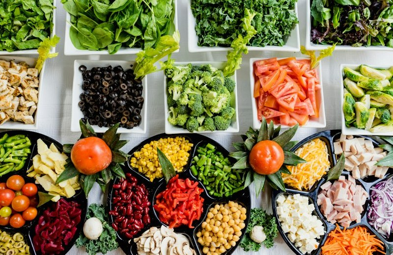

**⏱️ Prep Time:** 20 mins | **🔥 Cook Time:** 13 mins | **⌛ Total:** 33 mins
**🌡️ Air Fryer Temp:** 185°C / 365°F | **👥 Servings:** 4 | **📊 Calories:** 155 kcal
**Macros:** Protein: 6g | Carbs: 22g | Fat: 4.5g
**🏷️ Tags:** Green Goodness, Restaurant Star, Vegetarian

### 🛒 Ingredients
- 2 cups Fresh spinach (palak), blanched, squeezed dry, and pureed coarsely
- 1 cup Green peas, steamed and coarsely mashed
- 2 medium Potatoes, boiled and mashed smooth
- 1/4 cup Crumbled paneer
- 1 Green chili & 1 tsp ginger, minced
- 1/2 tsp Chaat masala & 1/2 tsp garam masala
- 1/2 tsp Amchur powder
- 3 tbsp Roasted besan (gram flour)
- 8 Whole cashew nuts (halved, for garnish)
- 1 tbsp Ghee or oil for brushing
- Salt to taste

### 👩‍🍳 Step-by-Step Air Fryer Instructions
1. Ensure blanched spinach is squeezed completely dry in a muslin cloth to remove all water before pulsing.
2. In a bowl, mix spinach, mashed peas, potatoes, paneer, chili, ginger, spices, salt, and roasted besan into a firm dough.
3. Shape into 8 round patties. Press a cashew nut half onto the center of each patty.
4. Preheat air fryer to 185°C (365°F) for 3 minutes.
5. Brush patties lightly with melted ghee on both sides.
6. Place patties in the basket in a single layer.
7. Air fry at 185°C for 7 minutes.
8. Carefully flip patties, brush lightly with ghee, and air fry for 5-6 more minutes until exterior is crisp and cashews are roasted golden.
9. Serve hot.

> [!TIP]
> **Chef's Air Fryer Secret:** Squeezing all liquid out of the blanched spinach ensures the emerald green color stays bright and the kebabs do not turn mushy in the air fryer.

**🥢 Serving & Pairing:** Zesty Mint-Coriander Chutney and Sweet Tamarind Dip.

---

## 7. Air Fryer Baingan Bharta (Roasted Eggplant Mash)

*Whole large eggplant roasted at high convection until the skin is charred paper-thin and flesh is meltingly tender, mashed and tempered with onions, tomatoes, and ginger.*

**⏱️ Prep Time:** 10 mins | **🔥 Cook Time:** 24 mins | **⌛ Total:** 34 mins
**🌡️ Air Fryer Temp:** 200°C / 400°F | **👥 Servings:** 3 | **📊 Calories:** 140 kcal
**Macros:** Protein: 3g | Carbs: 16g | Fat: 7g
**🏷️ Tags:** Punjabi Comfort, Smoky Roasted, Vegan

### 🛒 Ingredients
- 1 large Round eggplant (bharta baingan, ~500g)
- 4 Garlic cloves, peeled
- 2 Green chilies
- 1 tbsp Mustard oil
- For Bharta Tempering: 1 large onion (chopped), 2 ripe tomatoes (chopped), 1 inch ginger (julienned), 1/2 tsp cumin seeds, 1/2 tsp turmeric, 1 tsp coriander powder, 1/2 tsp garam masala, fresh cilantro, salt

### 👩‍🍳 Step-by-Step Air Fryer Instructions
1. Make 3-4 deep slits in the eggplant. Stuff garlic cloves and green chilies inside the slits. Rub outer skin with 1 tsp mustard oil.
2. Preheat air fryer to 200°C (400°F) for 4 minutes.
3. Place eggplant directly into the air fryer basket.
4. Air fry at 200°C for 12 minutes.
5. Rotate eggplant and air fry for another 10-12 minutes until skin is charred, wrinkled, and the eggplant collapses completely when pressed.
6. Cool slightly, peel charred skin easily, and mash the roasted pulp and garlic with a fork.
7. In a skillet, heat remaining mustard oil, crackle cumin seeds, sauté onions and ginger until golden, add tomatoes and dry spices, then fold in the mashed eggplant. Cook 3 minutes.
8. Garnish generously with cilantro and serve.

> [!TIP]
> **Chef's Air Fryer Secret:** Stuffing garlic and chilies inside the eggplant slits roasts them together in the eggplant steam, infusing deep rustic smokiness into the pulp.

**🥢 Serving & Pairing:** Piping Hot Phulkas, Makki ki Roti, and Masala Chaas.

---

## 8. Air Fryer Whole Tandoori Gobi (Cauliflower)

*A whole head of cauliflower blanched and coated in a vibrant tandoori spiced yogurt and roasted gram flour crust, air-roasted until charred on the tips and tender inside.*

**⏱️ Prep Time:** 15 mins + parboiling | **🔥 Cook Time:** 24 mins | **⌛ Total:** 39 mins
**🌡️ Air Fryer Temp:** 180°C / 360°F | **👥 Servings:** 4 | **📊 Calories:** 160 kcal
**Macros:** Protein: 6g | Carbs: 18g | Fat: 7g
**🏷️ Tags:** Showstopper Centerpiece, Tandoori Roast, Gluten-Free

### 🛒 Ingredients
- 1 Medium whole cauliflower head (gobi), leaves trimmed, base cut flat
- 1/2 cup Hung curd (thick Greek yogurt)
- 2 tbsp Roasted besan (gram flour)
- 1 tbsp Mustard oil
- 1 tbsp Ginger-garlic paste
- 1.5 tbsp Kashmiri red chili powder
- 1 tsp Kasuri methi & 1 tsp garam masala
- 1 tsp Chaat masala & 1 tbsp lemon juice
- 1 tbsp Melted butter for basting
- Salt to taste

### 👩‍🍳 Step-by-Step Air Fryer Instructions
1. Submerge trimmed whole cauliflower head in a pot of boiling salted water with 1/2 tsp turmeric for 5 minutes. Drain and let steam dry completely for 10 minutes.
2. Whisk hung curd, roasted besan, mustard oil, ginger-garlic paste, chili powder, kasuri methi, garam masala, lemon juice, and salt into a thick marinade.
3. Slather marinade thoroughly all over the cauliflower, working it into every crevice and floret.
4. Preheat air fryer to 180°C (360°F) for 4 minutes.
5. Place whole cauliflower upright in the air fryer basket.
6. Air fry at 180°C for 16 minutes.
7. Baste top and sides with melted butter, and air fry for an additional 7-8 minutes until tips are blistered, charred, and a knife pierces the core smoothly.
8. Transfer to a platter, dust with chaat masala, and carve into steaks at the table.

> [!TIP]
> **Chef's Air Fryer Secret:** Parboiling for 5 minutes ensures the thick central stalk cooks through to buttery tenderness while the exterior gets that coveted tandoor char.

**🥢 Serving & Pairing:** Mint Coriander Chutney, Lemon Crowns, and Garlic Naan.

---

## 9. Air Fryer Soya Chaap Tikka

*Tender soya chaap pieces layered and marinated in a rich spiced hung curd, ginger-garlic, and tandoori masala blend, air-fried until crisped at the edges and juicy inside.*

**⏱️ Prep Time:** 20 mins + marinating | **🔥 Cook Time:** 14 mins | **⌛ Total:** 34 mins
**🌡️ Air Fryer Temp:** 190°C / 375°F | **👥 Servings:** 3 | **📊 Calories:** 210 kcal
**Macros:** Protein: 16g | Carbs: 14g | Fat: 9.5g
**🏷️ Tags:** High Protein, Meatless Feast, Delhi Dhaba Style

### 🛒 Ingredients
- 4 Soya chaap sticks (canned or fresh), sticks removed, cut into 1.5-inch pieces
- 1/2 cup Hung curd
- 1 tbsp Mustard oil
- 1 tbsp Ginger-garlic paste
- 1 tbsp Kashmiri chili powder
- 1 tsp Kasuri methi & 1/2 tsp garam masala
- 1/2 tsp Chaat masala & 1 tbsp lemon juice
- 1 tbsp Melted butter (for basting)
- 1/2 Onion & 1/2 capsicum, cut into chunks
- Salt to taste

### 👩‍🍳 Step-by-Step Air Fryer Instructions
1. Boil soya chaap pieces in salted water for 5 minutes; drain and squeeze out excess water gently so layers can absorb marinade.
2. Whisk hung curd, mustard oil, ginger-garlic paste, chili powder, spices, lemon juice, and salt into a marinade.
3. Toss chaap pieces, onion, and capsicum chunks in marinade. Rest for 20 minutes.
4. Preheat air fryer to 190°C (375°F) for 4 minutes.
5. Place chaap pieces in the basket in a single layer.
6. Air fry at 190°C for 8 minutes.
7. Turn chaap pieces over, baste with melted butter, and air fry for 5-6 more minutes until charred spots appear on the flaky layers.
8. Toss in a bowl with melted butter, chaat masala, and sliced onions.

> [!TIP]
> **Chef's Air Fryer Secret:** Gently squeezing out water after boiling allows the flavorful tandoori marinade to soak deep into the inner layers of the chaap.

**🥢 Serving & Pairing:** Lachha Pyaz, Green Chutney, and Butter Roomali Roti.

---

## 10. Air Fryer Vegetable Biryani Cups

*Fragrant basmati rice layered with spiced vegetables, caramelized onions (birista), saffron-infused milk, and fresh mint, baked dum-style in individual heatproof cups.*

**⏱️ Prep Time:** 20 mins | **🔥 Cook Time:** 16 mins | **⌛ Total:** 36 mins
**🌡️ Air Fryer Temp:** 170°C / 340°F | **👥 Servings:** 3 | **📊 Calories:** 260 kcal
**Macros:** Protein: 7g | Carbs: 44g | Fat: 6g
**🏷️ Tags:** Dum Biryani, Individual Servings, Royal Flavors

### 🛒 Ingredients
- 1.5 cups Aged Basmati rice, parboiled to 70% doneness with whole spices
- 1 cup Spiced vegetable gravy (carrots, beans, peas, paneer cooked with biryani masala)
- 1/4 cup Fried caramelized onions (birista)
- 2 tbsp Warm milk infused with a pinch of saffron strands
- 2 tbsp Fresh mint & fresh coriander leaves, chopped
- 1 tbsp Desi ghee
- Aluminum foil (to seal cups for dum)

### 👩‍🍳 Step-by-Step Air Fryer Instructions
1. Take 3 heatproof ceramic ramekins or oven-safe cups. Grease bottoms with a few drops of ghee.
2. Layer 2 tablespoons of spiced vegetable gravy at the bottom of each cup.
3. Top with a layer of parboiled basmati rice.
4. Sprinkle caramelized onions, chopped mint, coriander, a spoonful of saffron milk, and 1/2 tsp ghee.
5. Add another layer of spiced vegetables, followed by a final layer of rice, onions, and saffron.
6. Cover each cup tightly with a double layer of aluminum foil to seal in the steam.
7. Preheat air fryer to 170°C (340°F) for 3 minutes.
8. Place foil-covered cups in the air fryer basket.
9. Air fry at 170°C for 16 minutes on gentle convection.
10. Carefully remove foil; the grains will be fluffy, aromatic, and infused with saffron dum flavors.
11. Serve hot directly in the cups.

> [!TIP]
> **Chef's Air Fryer Secret:** Tightly sealing the ramekins with foil traps internal steam perfectly, replicating the traditional heavy sealed handi dum process in half the time.

**🥢 Serving & Pairing:** Chilled Boondi Raita and Mirchi ka Salan.

---

## 11. Air Fryer Raw Jackfruit (Kathal) Tikka

*Tender raw jackfruit chunks boiled with turmeric, marinated in a smoky tandoori spiced yogurt paste, and air-roasted for a meaty, fibrous texture with charred edges.*

**⏱️ Prep Time:** 20 mins + boiling | **🔥 Cook Time:** 16 mins | **⌛ Total:** 36 mins
**🌡️ Air Fryer Temp:** 190°C / 375°F | **👥 Servings:** 3 | **📊 Calories:** 170 kcal
**Macros:** Protein: 4.5g | Carbs: 26g | Fat: 5.5g
**🏷️ Tags:** Plant-Based Meat, Tandoori Spice, Vegan

### 🛒 Ingredients
- 300g Raw green jackfruit (kathal), peeled, deseeded, and cut into 1.5-inch chunks
- 1/2 cup Hung curd or thick coconut yogurt
- 1 tbsp Mustard oil
- 1 tbsp Ginger-garlic paste
- 1 tbsp Kashmiri red chili powder
- 1 tsp Coriander powder & 1/2 tsp garam masala
- 1 tsp Kasuri methi & 1 tsp chaat masala
- Salt to taste

### 👩‍🍳 Step-by-Step Air Fryer Instructions
1. Pressure cook or boil jackfruit chunks in salted water with 1/2 tsp turmeric for 2 whistles (about 6 minutes) until just tender but not mushy. Drain thoroughly.
2. In a bowl, mix hung curd, mustard oil, ginger-garlic paste, chili powder, coriander powder, garam masala, kasuri methi, and salt into a marinade.
3. Toss jackfruit chunks in marinade until coated; rest 15 minutes.
4. Preheat air fryer to 190°C (375°F) for 4 minutes.
5. Place jackfruit pieces in the air fryer basket in a single layer.
6. Air fry at 190°C for 9 minutes.
7. Turn pieces over, mist with oil or melted butter, and air fry for another 6-7 minutes until the outer fibers turn crisp and charred.
8. Sprinkle with chaat masala and serve hot.

> [!TIP]
> **Chef's Air Fryer Secret:** Boiling kathal beforehand softens the tough plant fibers so that the air fryer's high heat can focus purely on crisping and caramelizing the marinade.

**🥢 Serving & Pairing:** Mint Chutney, Sliced Lemon, and Lachha Paratha.

---

## 12. Air Fryer Stuffed Tomatoes

*Ripe firm tomatoes hollowed and filled with seasoned paneer, green peas, mashed potatoes, and roasted spices, air-roasted until skins wrinkle and the cheese crust browns.*

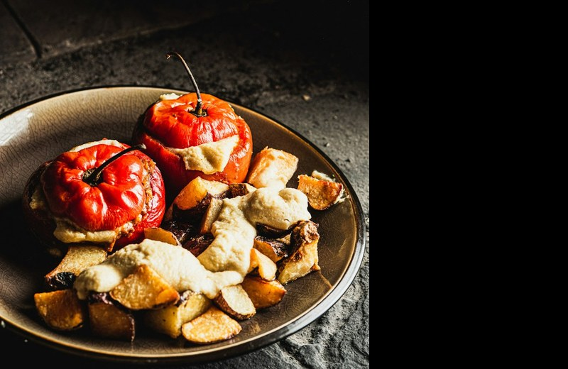

**⏱️ Prep Time:** 15 mins | **🔥 Cook Time:** 13 mins | **⌛ Total:** 28 mins
**🌡️ Air Fryer Temp:** 175°C / 350°F | **👥 Servings:** 3 | **📊 Calories:** 160 kcal / tomato
**Macros:** Protein: 6g | Carbs: 16g | Fat: 7.5g
**🏷️ Tags:** Bharwan Tamatar, Juicy & Roasted, Vegetarian

### 🛒 Ingredients
- 4 Large Firm red tomatoes
- 1 cup Crumbled paneer or mashed potatoes
- 1/4 cup Green peas, boiled
- 1 Green chili & 1 tsp ginger, minced
- 1/2 tsp Cumin powder & 1/2 tsp garam masala
- 1/4 tsp Turmeric & 1/2 tsp chaat masala
- 1/4 cup Shredded cheese or breadcrumbs (for topping)
- 1 tbsp Olive oil or ghee
- Salt to taste

### 👩‍🍳 Step-by-Step Air Fryer Instructions
1. Cut a thin slice off the top of each tomato; scoop out the pulp and seeds with a spoon, leaving a 1/4-inch shell. (Reserve pulp for curries).
2. In a bowl, mix paneer/potato, peas, ginger, chili, spices, salt, and 1 tsp oil.
3. Stuff the tomatoes with the filling. Top with shredded cheese or seasoned breadcrumbs.
4. Preheat air fryer to 175°C (350°F) for 3 minutes.
5. Place stuffed tomatoes upright in the air fryer basket.
6. Air fry at 175°C for 12-13 minutes until the tomato skins are wrinkled and tender, and the cheese topping is bubbly and golden brown.
7. Garnish with fresh cilantro and serve warm.

> [!TIP]
> **Chef's Air Fryer Secret:** Select firm, thick-walled tomatoes so they hold their structure without collapsing while air roasting.

**🥢 Serving & Pairing:** Jeera Rice and Creamy Dal Makhani.

---

## 13. Air Fryer Vegetable Pulao Cups

*Fluffy basmati rice tossed with garden vegetables, whole cloves, star anise, and ghee, baked in foil-covered individual cups for tender separated grains.*

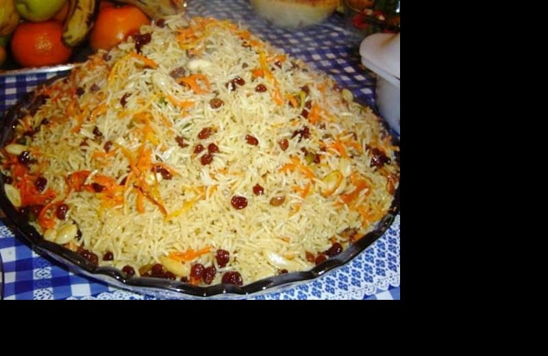

**⏱️ Prep Time:** 15 mins | **🔥 Cook Time:** 15 mins | **⌛ Total:** 30 mins
**🌡️ Air Fryer Temp:** 170°C / 340°F | **👥 Servings:** 3 | **📊 Calories:** 220 kcal
**Macros:** Protein: 5g | Carbs: 40g | Fat: 4.5g
**🏷️ Tags:** Aromatic Rice, One-Pot Style, Gluten-Free

### 🛒 Ingredients
- 1.5 cups Aged Basmati rice, soaked 20 mins and parboiled 75%
- 3/4 cup Diced vegetables (carrots, green peas, beans, corn)
- 1 Onion, thinly sliced & sautéed in ghee
- Whole spices: 1 bay leaf, 2 green cardamoms, 1-inch cinnamon, 3 cloves
- 1/2 tsp Cumin seeds & 1/2 tsp garam masala
- 1 tbsp Desi ghee
- Salt to taste

### 👩‍🍳 Step-by-Step Air Fryer Instructions
1. In a bowl, gently fold parboiled rice with sautéed onions, diced veggies, whole spices, garam masala, salt, and melted ghee.
2. Divide the mixture into 3 heatproof ceramic ramekins or foil cups.
3. Sprinkle 1 tablespoon of warm water over the top of each cup, then cover tightly with aluminum foil.
4. Preheat air fryer to 170°C (340°F) for 3 minutes.
5. Place cups in the air fryer basket.
6. Air fry at 170°C for 14-15 minutes.
7. Uncover and fluff with a fork; the grains will be separate, aromatic, and tender.
8. Garnish with roasted cashews and serve.

> [!TIP]
> **Chef's Air Fryer Secret:** Covering with foil is non-negotiable for rice recipes—it prevents the circulating air from drying out or scorching the rice grains.

**🥢 Serving & Pairing:** Cooling Cucumber Raita and Roasted Papad.

---

## 14. Air Fryer Paneer Kathi Roll

*Flaky parathas rolled around smoky spiced paneer tikka cubes, crunchy bell peppers, pickled onion rings, and tangy green chutney, crisped in the air fryer.*

**⏱️ Prep Time:** 15 mins | **🔥 Cook Time:** 9 mins | **⌛ Total:** 24 mins
**🌡️ Air Fryer Temp:** 190°C / 375°F | **👥 Servings:** 3 | **📊 Calories:** 270 kcal
**Macros:** Protein: 14g | Carbs: 32g | Fat: 9.5g
**🏷️ Tags:** Kolkata Street Food, High Protein, Grab & Go

### 🛒 Ingredients
- 3 Whole wheat parathas or rotis
- 1.5 cups Spiced air-fried paneer cubes and bell pepper strips
- 1/2 cup Thinly sliced red onions soaked in lemon juice & chaat masala
- 3 tbsp Mint-coriander chutney
- 1 tsp Butter or oil for brushing

### 👩‍🍳 Step-by-Step Air Fryer Instructions
1. Lay each paratha flat; spread a generous tablespoon of mint chutney across the center.
2. Arrange a line of hot spiced paneer cubes and pepper strips down the middle.
3. Top with pickled onion rings and a pinch of chaat masala.
4. Fold the bottom up, roll the sides tightly over the filling, and place seam-side down.
5. Preheat air fryer to 190°C (375°F) for 3 minutes.
6. Brush outer surface lightly with butter or oil.
7. Place rolls in the air fryer basket with space between each.
8. Air fry at 190°C for 8-9 minutes, turning once halfway through, until the paratha shell is flaky and crunchy.
9. Wrap half in parchment paper and serve hot.

> [!TIP]
> **Chef's Air Fryer Secret:** Air-frying the assembled roll for 8 minutes toasts the outer paratha into a shatteringly crisp flaky shell while warming the spiced paneer through.

**🥢 Serving & Pairing:** Extra Green Chutney and Sweet Saunth.

---

## 15. Air Fryer Baked Malai Kofta

*Luxurious paneer and potato dumplings stuffed with mawa, nuts, and raisins, air-fried to a golden shell without deep-fry oil absorption, ready for velvety shahi gravy.*

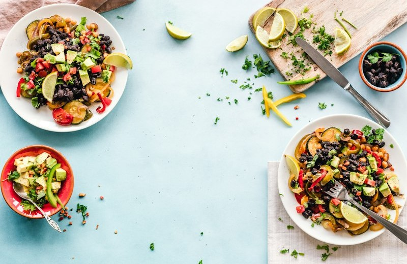

**⏱️ Prep Time:** 20 mins | **🔥 Cook Time:** 15 mins | **⌛ Total:** 35 mins
**🌡️ Air Fryer Temp:** 180°C / 360°F | **👥 Servings:** 4 | **📊 Calories:** 220 kcal (koftas)
**Macros:** Protein: 9g | Carbs: 20g | Fat: 11.5g
**🏷️ Tags:** Mughlai Royal, Guilt-Free Kofta, Festive

### 🛒 Ingredients
- 1.5 cups Paneer, finely grated
- 1 cup Boiled potatoes, peeled and mashed smooth
- 2 tbsp Cornstarch / cornflour (for binding)
- For Stuffing: 2 tbsp crumbled mawa (khoya) or cashew powder, 1 tbsp chopped raisins, 1 tbsp chopped pistachios, 1/4 tsp cardamom powder
- 1/2 tsp White pepper & salt
- 1 tbsp Ghee for brushing

### 👩‍🍳 Step-by-Step Air Fryer Instructions
1. Knead grated paneer, mashed potatoes, cornstarch, white pepper, and salt into a smooth, crack-free dough.
2. Divide into 8 balls. Flatten each ball, place 1 teaspoon of mawa-dry-fruit stuffing in the center, and roll into a smooth round or oval kofta.
3. Roll each kofta lightly in cornstarch to coat the exterior thinly.
4. Preheat air fryer to 180°C (360°F) for 4 minutes.
5. Brush koftas lightly with melted ghee.
6. Place koftas in the air fryer basket in a single layer.
7. Air fry at 180°C for 8 minutes.
8. Gently turn koftas over, brush with a touch of ghee, and air fry for another 6-7 minutes until uniformly golden and crisp.
9. Place hot koftas in serving bowls and pour simmering shahi cashew-tomato gravy over them just before serving.

> [!TIP]
> **Chef's Air Fryer Secret:** Dusting the formed koftas in cornstarch before air frying creates a protective shell that holds them together without cracking in the circulating air.

**🥢 Serving & Pairing:** Velvety Shahi Makhani Gravy, Butter Naan, and Jeera Rice.

---

## 16. Air Fryer Vegetable Cutlet Burger Patty

*Hearty, restaurant-grade burger patties made with mashed potatoes, peas, sweet corn, carrots, and beetroot, coated in coarse panko crumbs and air-fried to a massive crunch.*

**⏱️ Prep Time:** 20 mins | **🔥 Cook Time:** 15 mins | **⌛ Total:** 35 mins
**🌡️ Air Fryer Temp:** 190°C / 375°F | **👥 Servings:** 4 | **📊 Calories:** 180 kcal / patty
**Macros:** Protein: 5.5g | Carbs: 28g | Fat: 5g
**🏷️ Tags:** Gourmet Burger, Panko Crusted, Vegetarian

### 🛒 Ingredients
- 2.5 cups Boiled mashed potatoes & mixed steamed veggies
- 1/4 cup Grated beetroot (for vibrant color and moisture)
- 1 Green chili & 1 tsp ginger-garlic paste
- 1 tsp Garam masala & 1/2 tsp cumin powder
- 1/2 tsp Chaat masala & 1/2 tsp black pepper
- 2 tbsp Cornstarch + 4 tbsp water (slurry)
- 1.5 cups Panko breadcrumbs
- 1 tbsp Olive oil for brushing
- Salt to taste

### 👩‍🍳 Step-by-Step Air Fryer Instructions
1. Mix mashed potatoes, steamed veggies, grated beetroot, ginger-garlic, spices, and salt into a firm patty mixture.
2. Shape into 4 large, thick burger-sized patties (matching the size of your burger buns).
3. Dip each patty into the cornstarch slurry, then coat generously in panko breadcrumbs, pressing firmly so the crumbs stick.
4. Preheat air fryer to 190°C (375°F) for 4 minutes.
5. Brush or spray patties generously with olive oil on both sides.
6. Place patties in the basket in a single layer.
7. Air fry at 190°C for 8 minutes.
8. Flip gently with a wide spatula, mist tops with oil, and air fry for 6-7 more minutes until deep golden brown and crunchy.
9. Assemble inside toasted burger buns with lettuce, tomato, sliced cheese, and mint mayo.

> [!TIP]
> **Chef's Air Fryer Secret:** Grated beetroot not only gives the patty an appetizing gourmet color, but also keeps the interior juicy under the crunchy panko crust.

**🥢 Serving & Pairing:** Air-Fried Potato Wedges and Tangy Mint Mayonnaise.

---

## 17. Air Fryer Chilli Paneer Dry

*Crisp air-fried paneer cubes tossed with wok-charred bell peppers, red onions, garlic, and slit green chilies in a bold, savory soy-chili reduction.*

**⏱️ Prep Time:** 15 mins | **🔥 Cook Time:** 13 mins | **⌛ Total:** 28 mins
**🌡️ Air Fryer Temp:** 195°C / 385°F | **👥 Servings:** 3 | **📊 Calories:** 240 kcal
**Macros:** Protein: 14g | Carbs: 12g | Fat: 15g
**🏷️ Tags:** Indo-Chinese Star, Spicy & Tangy, High Protein

### 🛒 Ingredients
- 250g Paneer, cut into 1-inch cubes
- 2 tbsp Cornstarch / cornflour
- 1 tbsp All-purpose flour
- 1 tsp Soy sauce & 1/2 tsp black pepper
- 1 tbsp Oil
- For Chilli Wok Sauce: 1 tbsp minced garlic, 1 tbsp minced ginger, 3 green chilies (slit), 1 onion (cubed), 1 bell pepper (cubed), 1.5 tbsp dark soy sauce, 1 tbsp chili sauce, 1 tsp vinegar, 1 tsp sugar, spring onions

### 👩‍🍳 Step-by-Step Air Fryer Instructions
1. Toss paneer cubes in 1 tsp soy sauce, pepper, and 1 tsp oil. Dust with cornstarch and flour until evenly coated.
2. Preheat air fryer to 195°C (385°F) for 4 minutes.
3. Arrange paneer cubes in the basket in a single layer.
4. Air fry at 195°C for 7 minutes.
5. Shake basket, mist with oil, and air fry for 5 minutes until edges are crisp and golden.
6. In a hot wok, sauté garlic, ginger, and chilies in 1 tsp oil on high flame for 1 minute. Add cubed onions and capsicum; stir-fry for 2 minutes (keep veggies crunchy).
7. Add soy sauce, chili sauce, vinegar, and sugar. Pour in 2 tablespoons of water or cornstarch slurry to create a glossy glaze.
8. Tip in the hot air-fried paneer cubes; toss vigorously for 45 seconds to coat.
9. Garnish with chopped spring onion greens and serve immediately.

> [!TIP]
> **Chef's Air Fryer Secret:** High heat (195°C) in the air fryer crisps the paneer in minutes so it maintains its soft texture inside while soaking up the chili-soy glaze.

**🥢 Serving & Pairing:** Vegetable Fried Rice or Hakka Noodles.

---

## 18. Air Fryer Stuffed Zucchini Boats

*Tender zucchini halves scooped and filled with a seasoned mix of crumbled paneer, sweet corn, diced peppers, and Italian herbs, topped with melted mozzarella cheese.*

**⏱️ Prep Time:** 15 mins | **🔥 Cook Time:** 14 mins | **⌛ Total:** 29 mins
**🌡️ Air Fryer Temp:** 180°C / 360°F | **👥 Servings:** 3 | **📊 Calories:** 150 kcal
**Macros:** Protein: 7g | Carbs: 12g | Fat: 8g
**🏷️ Tags:** Low Carb, Keto Friendly, Mediterranean Touch

### 🛒 Ingredients
- 2 Medium Zucchinis, trimmed and halved lengthwise
- 1 cup Crumbled paneer or ricotta cheese
- 1/3 cup Sweet corn & finely diced capsicum
- 1/4 cup Sautéed zucchini pulp (chopped)
- 1 Garlic clove, minced
- 1/2 tsp Italian herb seasoning & 1/4 tsp chili flakes
- 1/2 cup Shredded mozzarella cheese
- 1 tbsp Olive oil
- Salt and black pepper to taste

### 👩‍🍳 Step-by-Step Air Fryer Instructions
1. Scoop out the center pulp of zucchini halves with a spoon, leaving a 1/4-inch shell. Finely chop the scooped pulp.
2. Sauté chopped zucchini pulp with garlic in 1 tsp olive oil for 2 minutes; mix with paneer, sweet corn, capsicum, herbs, salt, and pepper.
3. Brush zucchini boat shells lightly with olive oil; spoon the filling generously into each hollow.
4. Top each boat with shredded mozzarella cheese.
5. Preheat air fryer to 180°C (360°F) for 3 minutes.
6. Place zucchini boats in the air fryer basket in a single layer.
7. Air fry at 180°C for 13-14 minutes until the zucchini is tender-crisp and the cheese topping is bubbly and browned.
8. Serve hot garnished with chopped parsley.

> [!TIP]
> **Chef's Air Fryer Secret:** Do not scoop the zucchini too thin; leaving a 1/4-inch border ensures the boats hold their shape firmly under the circulating air.

**🥢 Serving & Pairing:** Herb Garlic Toast and Fresh Green Salad.

---

## 19. Air Fryer Vegetable Lasagna Cups

*Individual lasagna portions layered in silicone or ceramic ramekins with marinara sauce, ricotta/paneer, spinach, and mozzarella, air-baked until bubbly and browned.*

**⏱️ Prep Time:** 15 mins | **🔥 Cook Time:** 16 mins | **⌛ Total:** 31 mins
**🌡️ Air Fryer Temp:** 175°C / 350°F | **👥 Servings:** 3 | **📊 Calories:** 230 kcal / cup
**Macros:** Protein: 11g | Carbs: 24g | Fat: 9.5g
**🏷️ Tags:** Comfort Food, Single Serve, Cheesy Layers

### 🛒 Ingredients
- 6 Wonton wrappers or boiled lasagna pasta sheets cut to fit ramekins
- 1/2 cup Spiced marinara or tomato pasta sauce
- 1/2 cup Ricotta cheese or smooth crumbled paneer
- 1/2 cup Baby spinach, finely chopped and sautéed
- 3/4 cup Shredded mozzarella cheese
- 1 tbsp Grated parmesan cheese
- 1/2 tsp Italian seasoning & chili flakes

### 👩‍🍳 Step-by-Step Air Fryer Instructions
1. Grease 3 ramekins with olive oil. Press a wonton wrapper or pasta sheet into the bottom and sides of each cup.
2. Layer 1 tablespoon of marinara sauce, 1 tablespoon of ricotta/paneer, sautéed spinach, and shredded mozzarella.
3. Add another wrapper/sheet layer, followed by sauce, ricotta, spinach, and a generous layer of mozzarella and parmesan on top.
4. Sprinkle Italian herbs and chili flakes over the cheese.
5. Preheat air fryer to 175°C (350°F) for 3 minutes.
6. Place ramekins in the air fryer basket.
7. Air fry at 175°C for 15-16 minutes until the cheese is bubbling, bubbly golden brown, and the pasta edges are crisp.
8. Let cool for 3 minutes before serving.

> [!TIP]
> **Chef's Air Fryer Secret:** Wonton wrappers are an incredible shortcut for air fryer lasagna cups—they bake into crisp, delicate layers without needing pre-boiling.

**🥢 Serving & Pairing:** Crispy Garlic Bread and Green Salad.

---

## 20. Air Fryer Vegetable Enchilada Rolls

*Corn tortillas rolled with a zesty black bean, corn, and bell pepper filling, placed in a baking dish, blanketed with enchilada sauce and cheddar cheese, and air-baked.*

**⏱️ Prep Time:** 15 mins | **🔥 Cook Time:** 14 mins | **⌛ Total:** 29 mins
**🌡️ Air Fryer Temp:** 180°C / 360°F | **👥 Servings:** 3 | **📊 Calories:** 240 kcal
**Macros:** Protein: 9g | Carbs: 32g | Fat: 8.5g
**🏷️ Tags:** Mexican Fiesta, Cheesy Rolls, Vegetarian

### 🛒 Ingredients
- 4 Small Corn or flour tortillas
- 1 cup Black beans or kidney beans (cooked), lightly mashed
- 1/2 cup Sweet corn & diced bell peppers
- 1/2 cup Red enchilada sauce or spiced salsa
- 3/4 cup Shredded cheddar or Monterey Jack cheese
- 1/2 tsp Cumin powder & 1/2 tsp chili powder
- Fresh cilantro and sour cream (for garnish)

### 👩‍🍳 Step-by-Step Air Fryer Instructions
1. Mix beans, corn, bell peppers, cumin, chili powder, and 1/4 cup of cheese in a bowl.
2. Warm tortillas for 10 seconds to make them pliable. Divide filling down the center of each tortilla and roll tightly.
3. Spread 2 tablespoons of enchilada sauce on the bottom of an air-fryer-safe 6-inch baking dish.
4. Arrange the rolls seam-side down in the dish.
5. Pour remaining enchilada sauce over rolls and cover generously with shredded cheese.
6. Preheat air fryer to 180°C (360°F) for 3 minutes.
7. Place the baking dish in the air fryer basket.
8. Air fry at 180°C for 13-14 minutes until cheese is melted, bubbling, and the exposed tortilla tips are golden-crisp.
9. Garnish with chopped cilantro and a dollop of sour cream.

> [!TIP]
> **Chef's Air Fryer Secret:** Baking inside a compact dish keeps the enchilada sauce concentrated around the tortillas, ensuring soft juicy centers and crispy baked edges.

**🥢 Serving & Pairing:** Guacamole, Mexican Rice, and Pickled Jalapeños.

---

## 21. Air Fryer Paneer Steaks

*Thick slabs of fresh cottage cheese scored and marinated in an herb-garlic and peri-peri olive oil marinade, seared on the crisper rack for charred grill marks.*

**⏱️ Prep Time:** 15 mins + marinating | **🔥 Cook Time:** 11 mins | **⌛ Total:** 26 mins
**🌡️ Air Fryer Temp:** 195°C / 385°F | **👥 Servings:** 2 | **📊 Calories:** 280 kcal
**Macros:** Protein: 18g | Carbs: 8g | Fat: 20g
**🏷️ Tags:** High Protein, Gourmet Entree, Keto Friendly

### 🛒 Ingredients
- 2 Large Slabs of Paneer (approx. 150g each, 1-inch thick)
- 1 tbsp Olive oil
- 1 tbsp Peri-peri seasoning or tandoori masala
- 1 tsp Garlic paste
- 1/2 tsp Dried rosemary or oregano
- 1 tbsp Lemon juice
- Salt to taste
- Seasonal veggies (bell pepper slices, zucchini rounds) for grilling alongside

### 👩‍🍳 Step-by-Step Air Fryer Instructions
1. Lightly score a diamond criss-cross pattern on one side of each paneer slab (1/4-inch deep) to help marinade penetrate.
2. In a bowl, mix olive oil, peri-peri seasoning, garlic paste, herbs, lemon juice, and salt.
3. Rub marinade all over paneer steaks and veggies; rest for 15 minutes.
4. Preheat air fryer to 195°C (385°F) for 4 minutes.
5. Place paneer steaks on the elevated air fryer rack or directly in the basket with veggies around them.
6. Air fry at 195°C for 6 minutes.
7. Flip steaks carefully, brush with drops of olive oil, and air fry for 4-5 more minutes until edges are charred and the surface has golden blistering.
8. Serve immediately over a bed of roasted vegetables.

> [!TIP]
> **Chef's Air Fryer Secret:** Scoring a diamond pattern on the surface creates extra edges that caramelize rapidly in the hot air stream while absorbing flavor deep inside.

**🥢 Serving & Pairing:** Creamy Pepper Sauce or Mint Yogurt Dip.

---

## 22. Air Fryer Vegetable Korma Bake

*Steamed seasonal vegetables baked in a rich, fragrant coconut, cashew, and aromatic spice korma gravy in a casserole dish until bubbling with a toasted nut crust.*

**⏱️ Prep Time:** 15 mins | **🔥 Cook Time:** 16 mins | **⌛ Total:** 31 mins
**🌡️ Air Fryer Temp:** 175°C / 350°F | **👥 Servings:** 3 | **📊 Calories:** 220 kcal
**Macros:** Protein: 6g | Carbs: 24g | Fat: 11g
**🏷️ Tags:** Rich & Creamy, Casserole Style, Vegetarian

### 🛒 Ingredients
- 2 cups Par-cooked vegetables (carrots, green peas, cauliflower, beans, paneer)
- 1 cup Rich white korma gravy (cashews, melon seeds, coconut, onions, and whole spices pureed & cooked)
- 1/2 tsp Garam masala & 1/2 tsp kasuri methi
- 2 tbsp Sliced almonds and cashews (for topping)
- 1 tbsp Desi ghee
- Salt to taste

### 👩‍🍳 Step-by-Step Air Fryer Instructions
1. In an air-fryer-safe 6-inch baking dish, fold par-cooked vegetables into the rich korma gravy.
2. Season with garam masala, crushed kasuri methi, salt, and drizzle melted ghee over top.
3. Scatter sliced almonds and cashews generously across the surface.
4. Preheat air fryer to 175°C (350°F) for 3 minutes.
5. Place the baking dish in the air fryer basket.
6. Air fry at 175°C for 15-16 minutes until the gravy is bubbling around the edges, vegetables are tender, and the nut topping is toasted golden brown.
7. Garnish with cilantro and serve warm.

> [!TIP]
> **Chef's Air Fryer Secret:** Baking korma in the air fryer toasts the cashew and almond topping in the dry convection air, adding a luxurious contrast to the creamy gravy below.

**🥢 Serving & Pairing:** Flaky Paratha, Butter Naan, or Jeera Pulao.

---

## 23. Air Fryer Rajma Stuffed Potato

*Twice-baked Russet potatoes stuffed with spiced cooked kidney beans, sweet corn, sour cream, and sharp cheddar, broiled until the cheese crust is blistered.*

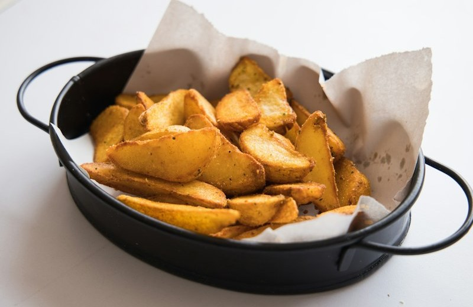

**⏱️ Prep Time:** 15 mins | **🔥 Cook Time:** 15 mins | **⌛ Total:** 30 mins
**🌡️ Air Fryer Temp:** 190°C / 375°F | **👥 Servings:** 2 | **📊 Calories:** 230 kcal / potato
**Macros:** Protein: 9g | Carbs: 36g | Fat: 5.5g
**🏷️ Tags:** Twice-Baked, Fusion Comfort, High Fiber

### 🛒 Ingredients
- 2 Large Russet potatoes, pre-baked until tender
- 1 cup Cooked spiced kidney beans (rajma masala, dry consistency)
- 1/3 cup Sweet corn kernels
- 1/2 cup Shredded cheddar cheese
- 2 tbsp Sour cream or Greek yogurt
- 1/2 tsp Cumin powder & 1/2 tsp chili powder
- 2 tbsp Green onions, chopped
- Salt to taste

### 👩‍🍳 Step-by-Step Air Fryer Instructions
1. Slice the top third off each baked potato. Scoop out potato flesh into a bowl, leaving a sturdy 1/4-inch shell.
2. Mash scooped potato flesh with sour cream, cumin, chili powder, and salt.
3. Fold in spiced kidney beans, sweet corn, and half the cheddar cheese.
4. Spoon filling back into potato shells, mounding high.
5. Top generously with remaining cheddar cheese.
6. Preheat air fryer to 190°C (375°F) for 3 minutes.
7. Place stuffed potatoes upright in the air fryer basket.
8. Air fry at 190°C for 14-15 minutes until cheese is deeply melted, bubbly, and blistered golden.
9. Garnish with chopped green onions and serve.

> [!TIP]
> **Chef's Air Fryer Secret:** Ensure the kidney bean filling is thick and dry so the potato skins stay crisp and the filling doesn't become watery.

**🥢 Serving & Pairing:** Fresh Guacamole and Crisp Garden Salad.

---

## 24. Air Fryer Vegetable Risotto Balls (Arancini-Style)

*Golden spheres of cold creamy vegetable risotto enclosing a cube of mozzarella cheese, rolled in panko breadcrumbs and air-fried to a crackling golden crunch.*

**⏱️ Prep Time:** 20 mins + chilling | **🔥 Cook Time:** 14 mins | **⌛ Total:** 34 mins
**🌡️ Air Fryer Temp:** 185°C / 365°F | **👥 Servings:** 4 | **📊 Calories:** 190 kcal
**Macros:** Protein: 6.5g | Carbs: 26g | Fat: 7g
**🏷️ Tags:** Italian Classic, Cheese Center, Gourmet Bites

### 🛒 Ingredients
- 2 cups Cold cooked vegetable risotto or spiced khichdi (chilled firm)
- 8 Small Mozzarella cheese cubes (approx. 1/2-inch)
- 2 tbsp All-purpose flour (for dusting)
- 2 tbsp Cornstarch + 4 tbsp water (slurry)
- 1 cup Panko breadcrumbs
- 1 tbsp Olive oil for brushing
- Salt and black pepper to taste

### 👩‍🍳 Step-by-Step Air Fryer Instructions
1. Take 1/4 cup of cold firm risotto; flatten in palm. Place a mozzarella cube in the center and shape rice tightly around cheese into a smooth ball (ensure no cracks).
2. Dust ball in flour, dip in cornstarch slurry, and roll in panko breadcrumbs until completely covered.
3. Refrigerate breaded balls for 15 minutes to firm up.
4. Preheat air fryer to 185°C (365°F) for 3 minutes.
5. Brush or spray balls lightly with olive oil.
6. Place arancini balls in the basket with space between each.
7. Air fry at 185°C for 7 minutes.
8. Roll balls over gently, mist with oil, and air fry for another 6-7 minutes until deep golden brown and crunchy all over.
9. Serve immediately for the molten mozzarella center.

> [!TIP]
> **Chef's Air Fryer Secret:** Cold, refrigerated risotto is essential—the starch firms up when cold, allowing you to mold tight spheres that won't fall apart during air circulation.

**🥢 Serving & Pairing:** Warm Spiced Arrabbiata Marinara Sauce.

---

# 🍽️ SECTION: SWEET TREATS

## 1. Baked Banana Chips (No Sugar)

*Thin, wafer-crisp chips made from green raw plantains (nendran bananas), soaked in turmeric salt water and air-fried with a whisper of coconut oil into crunchy golden rounds.*

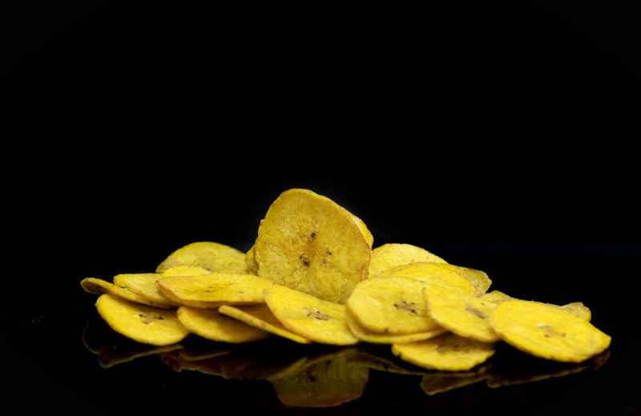

**⏱️ Prep Time:** 15 mins | **🔥 Cook Time:** 14 mins | **⌛ Total:** 29 mins
**🌡️ Air Fryer Temp:** 160°C / 320°F | **👥 Servings:** 4 | **📊 Calories:** 115 kcal
**Macros:** Protein: 1.5g | Carbs: 24g | Fat: 2.2g
**🏷️ Tags:** Naturally Sweet, Kerala Style, Guilt-Free Snack

### 🛒 Ingredients
- 2 Raw green plantains (nendran / raw cooking bananas), peeled
- 1.5 cups Water mixed with 1/2 tsp turmeric powder & 1/2 tsp rock salt
- 1 tbsp Cold-pressed coconut oil
- A pinch of freshly ground black pepper (optional)

### 👩‍🍳 Step-by-Step Air Fryer Instructions
1. Using a mandoline slicer, slice peeled raw plantains into uniform thin coins (about 1mm thickness).
2. Soak slices in the turmeric-salt water bath for 10 minutes to infuse yellow color and subtle saltiness.
3. Drain thoroughly; spread slices across clean kitchen towels and pat completely dry (zero surface moisture!).
4. Toss dried slices gently with 1 tbsp coconut oil.
5. Preheat air fryer to 160°C (320°F) for 3 minutes.
6. Arrange banana slices in the basket in slightly overlapping layers (cook in 2 batches).
7. Air fry at 160°C for 8 minutes.
8. Pull out the basket and shake well. Air fry for another 5-6 minutes until coins are light, crisp, and golden.
9. Transfer immediately to a wire cooling rack; they turn shatteringly crisp as they cool.

> [!TIP]
> **Chef's Air Fryer Secret:** Do not skip thorough towel-drying! Any residual water makes the chips steam in the air fryer rather than crisp up into wafer-thin chips.

**🥢 Serving & Pairing:** Enjoy as a healthy, naturally gluten-free teatime munchie.

---

## 2. Whole Wheat Gujiya (Festive, Low Oil)

*Festive crescent-shaped turnovers stuffed with roasted mawa (khoya), coconut, cardamom, and nuts, air-baked in a flaky whole-wheat crust with a fraction of festive oil.*

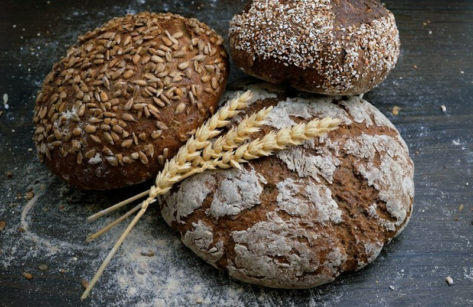

**⏱️ Prep Time:** 25 mins | **🔥 Cook Time:** 15 mins | **⌛ Total:** 40 mins
**🌡️ Air Fryer Temp:** 170°C / 340°F | **👥 Servings:** 6 | **📊 Calories:** 160 kcal / gujiya
**Macros:** Protein: 4.5g | Carbs: 22g | Fat: 6.5g
**🏷️ Tags:** Holi / Diwali Favorite, Whole Wheat, Low Oil Pastry

### 🛒 Ingredients
- 1.5 cups Whole wheat flour (atta)
- 3 tbsp Melted desi ghee (for moyen)
- 1/3 cup Cold milk or water (to knead stiff dough)
- For Royal Mawa Filling: 1 cup crumbled khoya/mawa (roasted lightly), 1/4 cup desiccated coconut, 1/4 cup powdered jaggery or boora, 2 tbsp chopped pistachios & almonds, 1/2 tsp green cardamom powder
- 1 tbsp Desi ghee for brushing

### 👩‍🍳 Step-by-Step Air Fryer Instructions
1. Rub wheat flour and ghee together with fingertips until crumbly. Gradually add cold milk/water and knead into a stiff, smooth dough. Rest 20 minutes under a damp cloth.
2. Prepare filling: In a small pan, roast mawa on low heat for 3 minutes until aromatic. Cool completely, then mix with coconut, jaggery/sugar, chopped nuts, and cardamom powder.
3. Roll small dough balls into 4-inch thin circles. Place 1.5 tablespoons of filling in the center.
4. Brush edges with water, fold into a crescent, and crimp edges tightly with a fork or traditional pleating to seal completely.
5. Preheat air fryer to 170°C (340°F) for 4 minutes.
6. Brush gujiyas generously on both sides with melted desi ghee.
7. Place in air fryer basket with space between each. Air fry at 170°C for 8 minutes.
8. Flip gently, brush with a touch of ghee, and air fry for another 6-7 minutes until pale golden with crisp, flaky edges.
9. Cool on a wire rack before serving.

> [!TIP]
> **Chef's Air Fryer Secret:** Sealing edges tightly is critical! Any small unsealed tear will allow sugar to melt and seep out onto the basket wire during hot air circulation.

**🥢 Serving & Pairing:** Dust with crushed pistachios and saffron strands; serve alongside festive Thandai.

---

## 3. Air Fryer Apple Cinnamon Chips

*Paper-thin slices of sweet red apples dusted with aromatic Ceylon cinnamon and a pinch of nutmeg, air-dehydrated at low heat into sweet, chewy-crisp fruity wafers.*

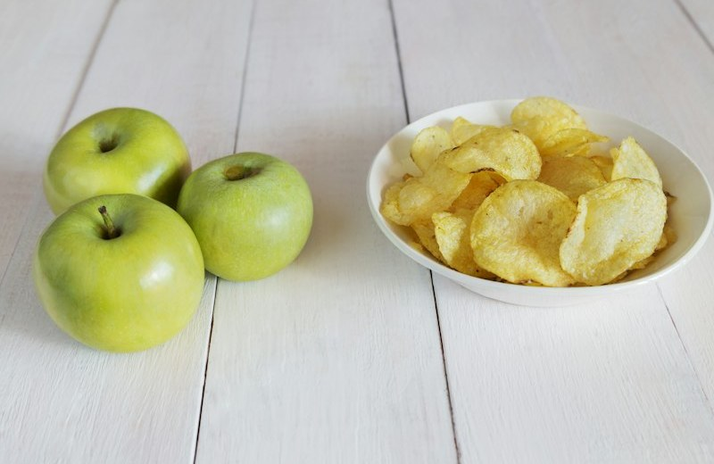

**⏱️ Prep Time:** 10 mins | **🔥 Cook Time:** 17 mins | **⌛ Total:** 27 mins
**🌡️ Air Fryer Temp:** 150°C / 300°F | **👥 Servings:** 3 | **📊 Calories:** 85 kcal
**Macros:** Protein: 0.5g | Carbs: 21g | Fat: 0.2g
**🏷️ Tags:** Naturally Sweet, Guilt-Free Snack, Vegan

### 🛒 Ingredients
- 2 Large Sweet crisp apples (Honeycrisp, Gala, or Fuji), cored
- 1 tsp Ground cinnamon powder
- 1/4 tsp Ground nutmeg
- 1 tsp Powdered coconut sugar or jaggery (optional)

### 👩‍🍳 Step-by-Step Air Fryer Instructions
1. Using a mandoline slicer, slice cored apples into paper-thin rounds (approx. 1mm thickness).
2. In a small bowl, mix cinnamon, nutmeg, and optional coconut sugar.
3. Lay apple slices on a board and sprinkle both sides lightly with the spice mixture.
4. Preheat air fryer to 150°C (300°F) for 3 minutes.
5. Arrange apple slices in the basket in slightly overlapping layers.
6. Air fry at 150°C for 9 minutes.
7. Flip slices over gently with tongs and air fry for another 7-8 minutes until edges curl up and slices feel dry to the touch.
8. Transfer immediately to a wire rack to cool; they crisp up substantially as moisture cools.

> [!TIP]
> **Chef's Air Fryer Secret:** Keep temperature strictly at 150°C (300°F). Apples contain natural fructose that will caramelize and burn black at standard frying temperatures.

**🥢 Serving & Pairing:** Enjoy as a wholesome topping on Greek yogurt, oatmeal bowls, or standalone munchies.

---

## 4. Air Fryer Whole Wheat Mawa Modak Bites

*Fluted whole wheat modak dumplings stuffed with roasted mawa, freshly grated coconut, cardamom, and toasted nuts, air-baked into crisp golden festive offerings.*

**⏱️ Prep Time:** 20 mins | **🔥 Cook Time:** 13 mins | **⌛ Total:** 33 mins
**🌡️ Air Fryer Temp:** 165°C / 330°F | **👥 Servings:** 5 | **📊 Calories:** 150 kcal / piece
**Macros:** Protein: 4.5g | Carbs: 20g | Fat: 6g
**🏷️ Tags:** Ganesh Chaturthi Special, Fried-Style Modak, Whole Wheat

### 🛒 Ingredients
- 1 cup Whole wheat flour
- 2 tbsp Melted desi ghee (moyen)
- 1/4 cup Cold milk (for dough)
- 1 cup Crumbled mawa (khoya), lightly roasted
- 1/3 cup Freshly grated or desiccated coconut
- 1/3 cup Powdered jaggery or cane sugar
- 2 tbsp Chopped cashews and raisins
- 1/2 tsp Cardamom powder
- 1 tbsp Desi ghee for brushing

### 👩‍🍳 Step-by-Step Air Fryer Instructions
1. Knead wheat flour, 2 tbsp ghee, and cold milk into a firm, non-sticky dough. Rest 15 minutes.
2. Mix roasted mawa, coconut, jaggery, nuts, and cardamom into a delicious stuffing.
3. Grease a modak mold lightly with ghee. Place a small ball of dough inside, press along the mold walls to form a hollow shell, fill with mawa mixture, and seal the base with dough.
4. Unmold to reveal perfectly fluted modak shapes.
5. Preheat air fryer to 165°C (330°F) for 3 minutes.
6. Brush modaks generously on all sides with melted desi ghee.
7. Place modaks upright in the basket with space between each.
8. Air fry at 165°C for 8 minutes.
9. Turn modaks slightly, brush again with ghee, and air fry for 4-5 minutes until the fluted wheat crust is golden and crisp.
10. Cool for 5 minutes before serving.

> [!TIP]
> **Chef's Air Fryer Secret:** Brushing generously with desi ghee before and midway through baking replicates the rich aroma and blistered crunch of deep-fried modaks.

**🥢 Serving & Pairing:** Warm Kesar Saffron Milk and Festive Prasad Platter.

---

## 5. Air Fryer Coconut Ladoo Bites

*Melt-in-mouth coconut truffles made from desiccated coconut and condensed milk, air-baked briefly to toast the exterior coconut flakes into an aromatic golden crust.*

**⏱️ Prep Time:** 10 mins | **🔥 Cook Time:** 9 mins | **⌛ Total:** 19 mins
**🌡️ Air Fryer Temp:** 160°C / 320°F | **👥 Servings:** 4 | **📊 Calories:** 135 kcal / piece
**Macros:** Protein: 2.5g | Carbs: 16g | Fat: 7g
**🏷️ Tags:** Quick Mithai, Festive Treats, Gluten-Free

### 🛒 Ingredients
- 1.5 cups Desiccated coconut flakes + 1/4 cup for rolling
- 1/2 cup Sweetened condensed milk
- 1/2 tsp Green cardamom powder
- 1 tbsp Chopped pistachios (for garnish)
- 1 tsp Ghee

### 👩‍🍳 Step-by-Step Air Fryer Instructions
1. In a bowl, mix desiccated coconut, condensed milk, and cardamom powder until a sticky, moldable dough forms. Rest for 5 minutes.
2. Grease palms with ghee and roll into 8 smooth round balls.
3. Roll each ball in extra dry desiccated coconut flakes so the outer surface is fluffy and coated.
4. Preheat air fryer to 160°C (320°F) for 2 minutes.
5. Line the basket with a small sheet of parchment paper.
6. Place coconut balls on parchment paper.
7. Air fry at 160°C for 5 minutes.
8. Shake basket gently to roll them over and air fry for another 3-4 minutes until outer coconut flakes turn pale golden-tan and fragrant.
9. Top each with a chopped pistachio and let cool completely to set.

> [!TIP]
> **Chef's Air Fryer Secret:** Gentle heat (160°C) for just 9 minutes toasts the outer coconut into a wonderful nutty macaroon-like shell while keeping the inside soft and fudgy.

**🥢 Serving & Pairing:** Serve as a dessert after festive lunches or gift in sweet boxes.

---

## 6. Air Fryer Sweet Shakarpara

*Crisp diamond-shaped sweet biscuits made from whole wheat flour, semolina, and jaggery syrup, air-fried into golden crunchy gems that melt in your mouth.*

**⏱️ Prep Time:** 15 mins | **🔥 Cook Time:** 14 mins | **⌛ Total:** 29 mins
**🌡️ Air Fryer Temp:** 170°C / 340°F | **👥 Servings:** 6 | **📊 Calories:** 140 kcal
**Macros:** Protein: 3g | Carbs: 24g | Fat: 3.8g
**🏷️ Tags:** Diwali Classic, Tea Time Crunch, Whole Wheat

### 🛒 Ingredients
- 1 cup Whole wheat flour (atta)
- 1/4 cup Fine semolina (rava / sooji) for crunch
- 1/3 cup Jaggery powder or sugar dissolved in 1/4 cup warm water
- 2.5 tbsp Melted ghee (for moyen)
- 1/2 tsp Cardamom powder
- 1 tbsp Ghee for brushing

### 👩‍🍳 Step-by-Step Air Fryer Instructions
1. Rub wheat flour, semolina, cardamom, and melted ghee together until sandy.
2. Knead into a stiff, smooth dough using the strained jaggery water. Rest 15 minutes.
3. Roll dough into a 1/4-inch thick round sheet.
4. Using a knife or pizza cutter, slice diagonal criss-cross lines to form diamond shapes.
5. Preheat air fryer to 170°C (340°F) for 3 minutes.
6. Separate the diamond pieces; brush lightly with melted ghee.
7. Place diamonds in the air fryer basket (single or slightly overlapping layer).
8. Air fry at 170°C for 7 minutes.
9. Shake the basket vigorously to rotate pieces, brush a tiny touch of ghee, and air fry for another 6-7 minutes until pale golden.
10. Cool completely on a plate; they harden and turn crunchy as they cool.

> [!TIP]
> **Chef's Air Fryer Secret:** Do not overcook until dark brown in the basket! Jaggery retains residual heat, so take them out when pale golden—they darken and crisp as they cool.

**🥢 Serving & Pairing:** Hot Spiced Masala Chai.

---

## 7. Air Fryer Roasted Dry Fruit & Seed Mix

*Whole raw almonds, cashews, walnuts, pumpkin seeds, and sunflower seeds toasted uniformly in gentle convection air with a touch of ghee and cardamom rock salt.*

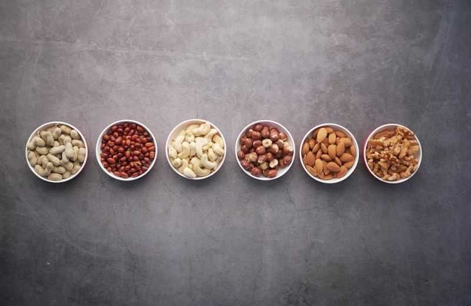

**⏱️ Prep Time:** 5 mins | **🔥 Cook Time:** 9 mins | **⌛ Total:** 14 mins
**🌡️ Air Fryer Temp:** 150°C / 300°F | **👥 Servings:** 6 | **📊 Calories:** 160 kcal
**Macros:** Protein: 5g | Carbs: 10g | Fat: 12g
**🏷️ Tags:** Superfood Trail Mix, High Energy, Keto Friendly

### 🛒 Ingredients
- 1/2 cup Whole raw almonds (badam)
- 1/2 cup Whole raw cashews (kaju)
- 1/3 cup Walnut halves (akhrot)
- 1/4 cup Pumpkin seeds & 1/4 cup sunflower seeds
- 1/4 cup Golden raisins (kishmish, added at the end)
- 1 tsp Desi ghee
- 1/2 tsp Cardamom powder & 1/4 tsp rock salt

### 👩‍🍳 Step-by-Step Air Fryer Instructions
1. In a bowl, toss almonds, cashews, walnuts, pumpkin seeds, and sunflower seeds with 1 tsp melted ghee, cardamom, and a pinch of rock salt.
2. Preheat air fryer to 150°C (300°F) for 2 minutes.
3. Transfer nut and seed mix into the air fryer basket.
4. Air fry at 150°C for 5 minutes.
5. Pull out the basket and shake thoroughly. Air fry for another 3-4 minutes until nuts are aromatic and cashews are pale golden.
6. Toss in the golden raisins during the final 1 minute (raisins burn if cooked too early).
7. Cool completely and store in a glass jar.

> [!TIP]
> **Chef's Air Fryer Secret:** Gentle heat (150°C) allows heat to penetrate to the center of the nuts so they roast from inside out without scorching the delicate outer skins.

**🥢 Serving & Pairing:** Morning energy snack or healthy school lunchbox trail mix.

---

## 8. Air Fryer Til Gud Chikki Bites

*Nutty toasted white sesame seeds bound with caramel jaggery syrup, air-roasted and rolled into snappy, brittle winter sweet bites.*

**⏱️ Prep Time:** 10 mins | **🔥 Cook Time:** 9 mins | **⌛ Total:** 19 mins
**🌡️ Air Fryer Temp:** 160°C / 320°F | **👥 Servings:** 5 | **📊 Calories:** 140 kcal
**Macros:** Protein: 3.5g | Carbs: 18g | Fat: 6.5g
**🏷️ Tags:** Makar Sankranti Classic, Winter Warmer, Iron Rich

### 🛒 Ingredients
- 1 cup White sesame seeds (til)
- 3/4 cup Jaggery (gud), finely chopped
- 1 tsp Desi ghee
- 1/4 tsp Cardamom powder

### 👩‍🍳 Step-by-Step Air Fryer Instructions
1. Preheat air fryer to 160°C (320°F) for 2 minutes.
2. Spread sesame seeds on a small parchment sheet in the basket; air-toast at 160°C for 3 minutes until slightly puffed and aromatic. Remove and cool.
3. In a small pan, melt jaggery with 1 tsp ghee on low heat until it turns bubbly and reaches soft crack stage (a drop in water turns into a firm brittle ball).
4. Stir in toasted sesame seeds and cardamom powder quickly.
5. Immediately pour mixture onto greased parchment paper, roll out flat with a rolling pin (1/4-inch thick), and score into squares with a knife while warm.
6. Pop the scored sheet into the air fryer at 160°C for 3-4 minutes to bake and set the caramel brittle.
7. Cool completely; snap along scored lines into crispy chikki squares.

> [!TIP]
> **Chef's Air Fryer Secret:** Pre-toasting the sesame seeds in the air fryer fan heat gives them a uniform nutty flavor and ensures they don't taste raw inside the chikki.

**🥢 Serving & Pairing:** Traditional winter treat enjoyed with evening tea.

---

## 9. Air Fryer Roasted Besan Ladoo

*Coarse gram flour roasted effortlessly in an air fryer cake pan with desi ghee, eliminating continuous kadai stirring, rolled with tagar and cardamom into royal ladoos.*

**⏱️ Prep Time:** 10 mins | **🔥 Cook Time:** 12 mins | **⌛ Total:** 22 mins
**🌡️ Air Fryer Temp:** 160°C / 320°F | **👥 Servings:** 5 | **📊 Calories:** 180 kcal / ladoo
**Macros:** Protein: 5g | Carbs: 22g | Fat: 8.5g
**🏷️ Tags:** Festive Mithai, Hands-Free Roasting, Traditional

### 🛒 Ingredients
- 1.5 cups Coarse gram flour (laddu besan / mota besan)
- 1/3 cup Desi ghee (melted)
- 3/4 cup Boora / Tagar (raw sugar / castor sugar)
- 1/2 tsp Cardamom powder
- 2 tbsp Chopped almonds and pistachios

### 👩‍🍳 Step-by-Step Air Fryer Instructions
1. In an air-fryer-safe 6-inch cake pan, mix coarse besan and melted ghee thoroughly until it forms a moist, crumbly paste.
2. Preheat air fryer to 160°C (320°F) for 3 minutes.
3. Place the cake pan with besan in the air fryer basket.
4. Air fry at 160°C for 6 minutes.
5. Remove pan and stir thoroughly with a spoon to ensure even heat distribution. Return to air fryer.
6. Air fry for another 5-6 minutes until the besan turns a rich golden-hazelnut color and releases an irresistible nutty aroma.
7. Let mixture cool until comfortably warm (lukewarm).
8. Stir in boora/tagar, cardamom powder, and nuts. Mix well and shape into 8 smooth round ladoos.
9. Garnish with slivered pistachios.

> [!TIP]
> **Chef's Air Fryer Secret:** Air fryer roasting prevents hot spots and scorched besan at the bottom of the pan. Never add sugar while hot, or it will melt and make the mixture runny.

**🥢 Serving & Pairing:** Diwali Mithai Platter and Royal Festive Tea.

---

## 10. Air Fryer Dry Fruit Barfi Bites

*Rich sugar-free fudge diamonds crafted from soft Medjool dates, dried figs, roasted almonds, cashews, and pistachios, air-roasted to caramelize natural date sugars.*

**⏱️ Prep Time:** 15 mins | **🔥 Cook Time:** 11 mins | **⌛ Total:** 26 mins
**🌡️ Air Fryer Temp:** 160°C / 320°F | **👥 Servings:** 6 | **📊 Calories:** 135 kcal / piece
**Macros:** Protein: 3.5g | Carbs: 18g | Fat: 6g
**🏷️ Tags:** No Added Sugar, Guilt-Free Mithai, Naturally Sweet

### 🛒 Ingredients
- 1.5 cups Soft dates (khajoor), pitted and finely chopped
- 1/2 cup Dried figs (anjeer), chopped
- 1/2 cup Mixed chopped nuts (almonds, cashews, pistachios)
- 1 tbsp Poppy seeds (khus khus)
- 1/2 tsp Cardamom powder
- 1 tsp Desi ghee

### 👩‍🍳 Step-by-Step Air Fryer Instructions
1. In an air-fryer-safe baking pan, toss chopped nuts with 1/2 tsp ghee. Air fry at 160°C (320°F) for 3 minutes until lightly toasted.
2. Pulse chopped dates and figs in a processor until a sticky, thick paste forms.
3. Transfer date paste into the pan with toasted nuts; add cardamom and mix thoroughly.
4. Air fry at 160°C for 6-7 minutes until the date paste softens and develops a deep caramel aroma.
5. Remove pan, press mixture firmly into a 1/2-inch thick rectangle in a greased tin.
6. Sprinkle toasted poppy seeds over top and press down gently with the back of a spoon.
7. Refrigerate for 30 minutes to set completely.
8. Slice into neat diamond shapes and serve.

> [!TIP]
> **Chef's Air Fryer Secret:** Warming the dates in the air fryer melts their natural fructose, allowing you to bind whole nuts tightly into firm barfi diamonds with zero added sugar or syrup.

**🥢 Serving & Pairing:** Perfect healthy festive gift or post-dinner sweet craving.

---

## 11. Air Fryer Gud Chana (Jaggery Roasted Chickpeas)

*Dry roasted black chickpeas coated in bubbling jaggery and dry ginger powder, air-baked until the jaggery crystallizes into a crunchy, brittle sweet shell.*

**⏱️ Prep Time:** 5 mins | **🔥 Cook Time:** 11 mins | **⌛ Total:** 16 mins
**🌡️ Air Fryer Temp:** 170°C / 340°F | **👥 Servings:** 5 | **📊 Calories:** 145 kcal
**Macros:** Protein: 6g | Carbs: 24g | Fat: 2.8g
**🏷️ Tags:** Traditional Immunity, Iron & Protein Rich, Crunchy Snack

### 🛒 Ingredients
- 1.5 cups Roasted black chickpeas (bhuna chana, skin-on or split)
- 3/4 cup Jaggery (gud), crushed
- 1 tsp Desi ghee
- 1/2 tsp Dry ginger powder (saunth) & 1/2 tsp cardamom powder
- 1/4 tsp Fennel powder (saunf)

### 👩‍🍳 Step-by-Step Air Fryer Instructions
1. In a small heatproof cake pan, combine crushed jaggery and 1 tsp ghee.
2. Preheat air fryer to 170°C (340°F) for 3 minutes.
3. Place the pan with jaggery in the air fryer for 3 minutes until melted and bubbly.
4. Carefully pull out basket; stir in dry ginger powder, cardamom, and fennel powder.
5. Add the roasted chickpeas into the melted jaggery and toss vigorously with a spatula until each chickpea is coated.
6. Return pan to air fryer and cook at 170°C for another 4-5 minutes until the jaggery thickens and bubbles intensely.
7. Pour onto greased parchment paper; quickly separate clusters with forks before it cools.
8. Let cool completely into brittle, crunchy nuggets.

> [!TIP]
> **Chef's Air Fryer Secret:** Ginger powder (saunth) balances the rich sweetness of jaggery and adds warming Ayurvedic benefits for immunity during colder months.

**🥢 Serving & Pairing:** Store in an airtight jar for daily afternoon energy bites.

---

## 12. Air Fryer Whole Wheat Jaggery Cookies

*Rustic, melt-in-mouth bakery-style atta biscuits made with whole wheat flour, powdered jaggery, cardamom, and desi ghee, air-baked into golden crisp cookies.*

**⏱️ Prep Time:** 15 mins | **🔥 Cook Time:** 13 mins | **⌛ Total:** 28 mins
**🌡️ Air Fryer Temp:** 165°C / 330°F | **👥 Servings:** 5 | **📊 Calories:** 120 kcal / cookie
**Macros:** Protein: 2.5g | Carbs: 18g | Fat: 4.5g
**🏷️ Tags:** Atta Biscuits, Refined Sugar Free, Bakery Style

### 🛒 Ingredients
- 1 cup Whole wheat flour (atta)
- 2 tbsp Fine semolina (rava)
- 1/3 cup Powdered jaggery (gud powder)
- 1/3 cup Desi ghee (solidified, at room temperature)
- 1/2 tsp Cardamom powder & pinch of nutmeg
- 1/2 tsp Baking powder & pinch of salt
- 2 tbsp Milk (if needed to bind)

### 👩‍🍳 Step-by-Step Air Fryer Instructions
1. In a bowl, beat room-temperature ghee and powdered jaggery with a whisk for 3 minutes until pale, light, and creamy.
2. Sift in whole wheat flour, rava, cardamom, nutmeg, baking powder, and a pinch of salt. Gently bring together into a soft cookie dough (add 1-2 tbsp milk if dry).
3. Roll into 8 balls, flatten into 1/2-inch thick cookie rounds, and press a fork on top to create classic bakery lines.
4. Preheat air fryer to 165°C (330°F) for 3 minutes.
5. Line the air fryer basket with perforated parchment paper.
6. Place cookies on the parchment with 1 inch space between each.
7. Air fry at 165°C for 12-13 minutes until edges are golden brown.
8. Carefully transfer cookies to a wire rack (they will feel slightly soft when hot, but turn shatteringly crisp as they cool).
9. Store in an airtight tin.

> [!TIP]
> **Chef's Air Fryer Secret:** Creaming the ghee and jaggery together until fluffy creates microscopic air pockets that give the cookies a tender, melt-in-mouth bakery texture.

**🥢 Serving & Pairing:** Dip in hot cutting Masala Chai.

---

## 13. Air Fryer Whole Wheat Banana Bread Bites

*Mini wholesome banana bread muffins made with overripe bananas, whole wheat flour, cinnamon, and walnuts, air-baked for a caramelized crust and tender crumb.*

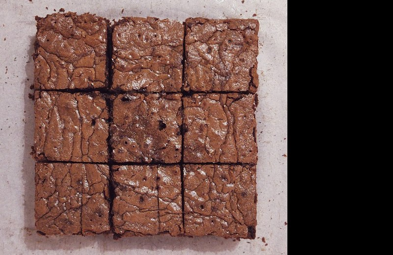

**⏱️ Prep Time:** 15 mins | **🔥 Cook Time:** 16 mins | **⌛ Total:** 31 mins
**🌡️ Air Fryer Temp:** 160°C / 320°F | **👥 Servings:** 4 | **📊 Calories:** 140 kcal / muffin
**Macros:** Protein: 3g | Carbs: 26g | Fat: 3.5g
**🏷️ Tags:** Naturally Sweet, Eggless Baking, Whole Wheat

### 🛒 Ingredients
- 2 Overripe bananas, mashed smooth with a fork
- 1 cup Whole wheat flour
- 1/4 cup Jaggery powder or brown sugar
- 3 tbsp Melted coconut oil or butter
- 1/4 cup Milk (dairy or almond)
- 1/2 tsp Cinnamon powder & 1/2 tsp vanilla extract
- 1 tsp Baking powder & 1/4 tsp baking soda
- 2 tbsp Chopped walnuts

### 👩‍🍳 Step-by-Step Air Fryer Instructions
1. In a bowl, whisk mashed bananas, jaggery powder, melted coconut oil, milk, and vanilla extract until smooth.
2. Fold in whole wheat flour, cinnamon, baking powder, baking soda, and a pinch of salt to form a thick batter. Fold in half the chopped walnuts.
3. Preheat air fryer to 160°C (320°F) for 3 minutes.
4. Grease 6 silicone muffin cups lightly; divide batter evenly among cups (filling 3/4 full). Scatter remaining walnuts on top.
5. Place silicone cups in the air fryer basket.
6. Air fry at 160°C for 15-16 minutes until tops are puffed, cracked, and a toothpick inserted in the center comes out clean.
7. Let cool for 5 minutes before unmolding.

> [!TIP]
> **Chef's Air Fryer Secret:** Silicone muffin molds prevent the bottoms from burning in the air fryer while allowing heat to circulate evenly around each mini bread bite.

**🥢 Serving & Pairing:** Warm Honey Drizzle or Nut Butter Spread.

---

## 14. Air Fryer Rava Ladoo

*Aromatic roasted semolina, fresh coconut, and ghee roasted effortlessly in the air fryer, infused with cardamom and warm saffron milk, and rolled into spheres.*

**⏱️ Prep Time:** 10 mins | **🔥 Cook Time:** 11 mins | **⌛ Total:** 21 mins
**🌡️ Air Fryer Temp:** 160°C / 320°F | **👥 Servings:** 5 | **📊 Calories:** 165 kcal / ladoo
**Macros:** Protein: 3.5g | Carbs: 24g | Fat: 6.5g
**🏷️ Tags:** Festive Classic, South Indian Mithai, Quick & Easy

### 🛒 Ingredients
- 1 cup Fine semolina (rava / sooji)
- 1/3 cup Freshly grated or desiccated coconut
- 3 tbsp Melted desi ghee
- 1/2 cup Powdered sugar or tagar
- 1/4 cup Warm milk (infused with a pinch of saffron)
- 1/2 tsp Cardamom powder
- 1 tbsp Golden raisins & 1 tbsp chopped cashews

### 👩‍🍳 Step-by-Step Air Fryer Instructions
1. In an air-fryer-safe cake pan, mix rava, coconut, and melted ghee.
2. Preheat air fryer to 160°C (320°F) for 3 minutes.
3. Place the pan in the basket. Air fry at 160°C for 5 minutes.
4. Pull out pan, stir thoroughly, add cashews and raisins, and air fry for another 5 minutes until rava turns aromatic and pale golden.
5. Transfer mixture to a bowl. When lukewarm, add powdered sugar and cardamom powder; mix well.
6. Sprinkle warm saffron milk a tablespoon at a time until mixture holds together when pressed.
7. Shape into 8 smooth round ladoos.
8. Let sit for 15 minutes to firm up before serving.

> [!TIP]
> **Chef's Air Fryer Secret:** Roasting rava in the air fryer gives it an even, toasted grain texture with zero scorched bottom, ensuring melt-in-mouth ladoos every time.

**🥢 Serving & Pairing:** Festive dessert platter with warm spiced milk.

---

## 15. Air Fryer Oats Coconut Cookies

*Golden toasted rolled oats and desiccated coconut biscuits sweetened with jaggery and coconut oil, air-baked into chewy-centered cookies with crisp caramelized edges.*

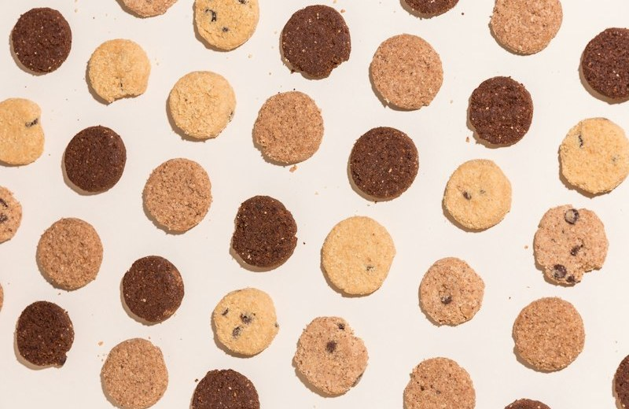

**⏱️ Prep Time:** 15 mins | **🔥 Cook Time:** 13 mins | **⌛ Total:** 28 mins
**🌡️ Air Fryer Temp:** 165°C / 330°F | **👥 Servings:** 5 | **📊 Calories:** 130 kcal / cookie
**Macros:** Protein: 3g | Carbs: 16g | Fat: 6g
**🏷️ Tags:** High Fiber, Chewy & Crisp, Guilt-Free

### 🛒 Ingredients
- 1 cup Rolled oats
- 1/2 cup Desiccated coconut flakes
- 1/3 cup Whole wheat flour
- 1/3 cup Jaggery powder or coconut sugar
- 3 tbsp Melted coconut oil or butter
- 2-3 tbsp Milk (dairy or plant-based)
- 1/2 tsp Cinnamon powder & 1/2 tsp baking powder
- Pinch of sea salt

### 👩‍🍳 Step-by-Step Air Fryer Instructions
1. In a bowl, mix rolled oats, desiccated coconut, wheat flour, jaggery powder, cinnamon, baking powder, and sea salt.
2. Stir in melted coconut oil and milk until a thick, moist cookie dough forms. Rest for 10 minutes (oats will absorb liquid).
3. Divide into 8 portions; roll into balls and flatten into 1/2-inch discs on a cutting board.
4. Preheat air fryer to 165°C (330°F) for 3 minutes.
5. Line the air fryer basket with perforated parchment paper.
6. Place cookies on parchment with space between each.
7. Air fry at 165°C for 12-13 minutes until edges turn deep golden brown.
8. Transfer cookies to a wire rack to cool completely (they firm up into crunchy biscuits as they cool).
9. Store in an airtight container.

> [!TIP]
> **Chef's Air Fryer Secret:** Perforated parchment allows air circulation underneath while keeping the oats from falling through the basket grate.

**🥢 Serving & Pairing:** Cold Almond Milk or Hot Filter Coffee.

---

## 16. Air Fryer Beetroot Chocolate Brownie Bites

*Fudgy, rich dark chocolate brownies enriched with pureed beetroot for natural moisture and sweetness, air-baked in a lined tin for crackly tops and dense molten centers.*

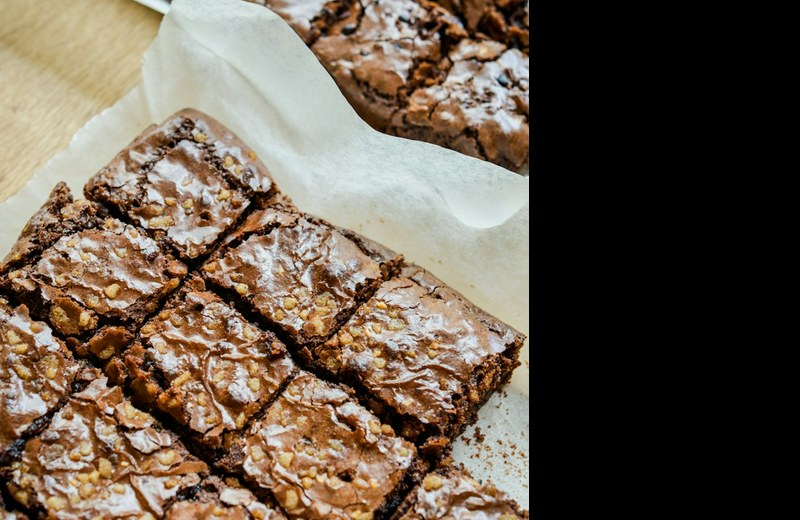

**⏱️ Prep Time:** 20 mins | **🔥 Cook Time:** 17 mins | **⌛ Total:** 37 mins
**🌡️ Air Fryer Temp:** 165°C / 330°F | **👥 Servings:** 4 | **📊 Calories:** 170 kcal / square
**Macros:** Protein: 4g | Carbs: 22g | Fat: 8g
**🏷️ Tags:** Fudgy Decadence, Secret Veggie, Rich Chocolate

### 🛒 Ingredients
- 1/2 cup Pureed cooked beetroot (smooth, no lumps)
- 1/2 cup Dark chocolate chips (melted with 2 tbsp coconut oil / butter)
- 1/3 cup Whole wheat flour or almond flour
- 1/4 cup Unsweetened Dutch cocoa powder
- 1/3 cup Brown sugar or jaggery powder
- 1/4 cup Milk
- 1/2 tsp Vanilla extract & 1/4 tsp baking powder
- Pinch of sea salt & 2 tbsp extra chocolate chips for topping

### 👩‍🍳 Step-by-Step Air Fryer Instructions
1. In a bowl, whisk smooth beetroot puree, melted dark chocolate, sugar, milk, and vanilla extract until glossy and cohesive.
2. Fold in whole wheat flour, cocoa powder, baking powder, and a pinch of salt until a thick brownie batter forms.
3. Preheat air fryer to 165°C (330°F) for 3 minutes.
4. Line a 6-inch square air-fryer-safe cake pan with parchment paper, leaving overhang handles. Pour batter into pan and smooth top. Scatter extra chocolate chips over surface.
5. Place pan in the air fryer basket.
6. Air fry at 165°C for 16-17 minutes until top is crackly and a toothpick inserted in center comes out with moist crumbs (not wet batter).
7. Let cool completely in the pan for 15 minutes, then lift out and slice into 8 fudgy bite-sized squares.
8. Serve warm or chilled.

> [!TIP]
> **Chef's Air Fryer Secret:** The earthy notes of beetroot blend seamlessly into dark cocoa, imparting luxurious fudginess without needing excess butter or eggs.

**🥢 Serving & Pairing:** Dust with raw cocoa powder and serve with Vanilla Bean Ice Cream or Mint Leaves.

---

## ❓ Frequently Asked Questions

### Q: Why does my food look pale or white instead of golden brown?
**A:** A feather-light mist of oil or ghee is essential for the Maillard reaction. If food is completely bone-dry with zero lipid mist, spices like turmeric and flour will look powdery. A quick 1-second spray or oil brush at minute 5 will instantly unlock rich golden blistering.

### Q: Can I cook wet batter (like traditional liquid pakora batter) in an air fryer?
**A:** Liquid runny batter will drip down through the basket perforations before it cooks! For air fryer pakoras and fritters, keep the batter thick and sticky (binding onions and veggies with just enough gram flour/besan to coat), or place on perforated parchment paper for the first 5 minutes until set.

### Q: How do I prevent smoke when cooking fatty marinades or paneer?
**A:** Smoke happens when fat drips onto the bottom drawer beneath the basket and burns. Pour 2 tablespoons of water or place a slice of bread at the bottom of the outer drawer to catch dripping oils and eliminate smoke instantly.

### Q: How do I reheat leftover samosas, rolls, and cutlets?
**A:** Never use the microwave! Pop cold leftovers directly into a preheated air fryer at 180°C (360°F) for 3 to 4 minutes. They emerge as shatteringly crisp as when freshly made.

### Q: Do I need to convert oven recipes to air fryer settings?
**A:** As a rule of thumb for any outside recipe: Reduce the temperature by 15°C to 20°C (25°F to 30°F) and reduce cook time by 20% to 25%, because the air fryer's compact convective cyclone cooks faster.

## 🙏 Thank You & Happy Air Frying!

May your air fryer bring crispy joy, rich memories, and wholesome nourishment to your table every single day!